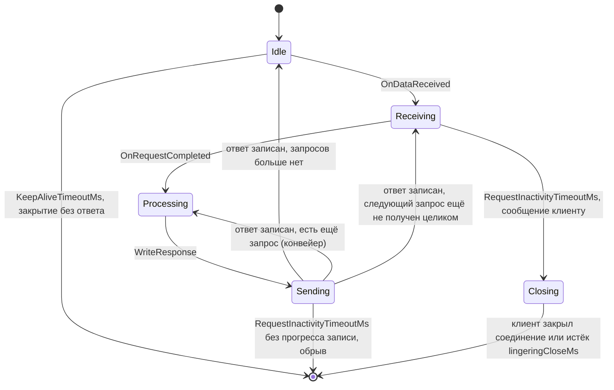

# Доработки `imtrest`

Документ объясняет каждое изменение HTTP-сервера `imtrest` и каждую новую сущность: какую проблему они решают и зачем нужны.
Повод — распределённое файловое хранилище Dogma (`IMTD/Dogma/Docs/Architecture.md`, раздел 5): файлы в гигабайты, загрузка
частями, докачка, прокси, TLS на всех каналах. Изменения общие: от них выигрывает любой сервер на `imtrest`.

## Правила

- Соответствие стандартам. Изменения и новые сущности обязаны соответствовать действующим стандартам (RFC) и уже
  принятым в ImtCore описаниям интерфейсов. Если часть кода в рамках изменения им не соответствует, адаптируется этот код
  (клиенты, сервлеты, реализации интерфейсов), а не наоборот: формат, не соответствующий стандарту, не закрепляется.
- Обратная совместимость: интерфейсы не ломаются, поведение по умолчанию сохраняется, новое включается атрибутами или новыми
  интерфейсами. Исправления ошибок и приведение к стандарту, меняющие поведение, перечислены в пункте «Совместимость».
- Один шаг — один коммит вместе с тестом. Тесты — `Include/imtrest/Test` (цель `imtrestTest`, собирается при `BUILD_TESTING`
  и `USE_QTDB`).
- Номера шагов — этап 1 плана Dogma (раздел 17). Шаги 1.12, 1.14 и 1.15 относятся к другим библиотекам (`imtcrypt`,
  клиенты ImtCore, `imtdb`) и здесь не описаны.

## Сводка

| Шаг | Изменение | Решаемая проблема | Статус |
|---|---|---|---|
| 1.1 | `CHttpRequest`: URL и заголовки по частям, объединение повторов | URL и заголовки, разорванные между чтениями из сокета, портятся; повторный заголовок затирает предыдущий | Реализовано |
| 1.2 | `Content-Range` по RFC 9110: `CHttpRangeTools`, `CHttpDataUploader`, `CHttpFileUploadServletComp`, `FileUploader.js`, `CCollectionImportControllerComp`; защита от бесконечной отправки | Загрузчик, сервлет и веб-клиент используют не стандартный `Content-Range` (конец без включения), поэтому с внешними клиентами не работают; файл больше одной части не загружается; нулевой размер части и нечитаемое устройство зацикливают загрузку | Реализовано |
| 1.3 | `CSocket`: таймауты бездействия и keep-alive (`CConnectionTimeoutTracker`, `CSocketTimeoutWatcher`) | Запрос дольше 5 с обрывается; простаивающее соединение занимает поток навсегда | Реализовано |
| 1.4 | `CHttpSender`: `HTTP/1.1`, без дублей заголовков, `Date`, границы сообщений, закрытие по `Connection: close` | Нет постоянных соединений и `chunked`; повторные `Content-Length` и `Content-Type`; тело в 204, 304 и ответе на `HEAD`; внедрение заголовков | Реализовано |
| 1.5 | `CSocket`: чтение без транзакций `QIODevice`, `400` на ошибку разбора, запросы по одному | Тело запроса в памяти дважды; ошибка разбора подвешивает соединение; соседний запрос портит готовый | Реализовано |
| 1.5.1 | Отказоустойчивость: `CWorker::ExecuteServlet`, `500` на сбой сервлета, `RequestProcessingTimeoutMs` (по умолчанию без ограничения), защитные проверки `CWorkerThread`, `CWorkerManagerComp`, `CMultiThreadServer`, `CSocket` | Исключение сервлета в потоке обработчика роняет процесс; сервлет без ответа или без экземпляра оставляет клиента без ответа и блокирует соединение (в отладке — `Q_ASSERT`); отказ создания сервлета теряет запрос и поток; бесконечный обработчик занимает соединение | Реализовано |
| 1.6 | `IRequestBodyPolicy`, `CHttpBodyPolicyRouterComp`, `MaxBodySize`, ответ на `Expect: 100-continue` | Отказать (413, 401) можно только после приёма всего тела; `Expect: 100-continue` не обрабатывается (нарушение RFC 9110 §10.1.1) | План |
| 1.7 | `IRequestBodySink` | Тело запроса целиком в памяти | План |
| 1.8 | `CHttpRangeTools`: `Range`, `If-Range`, условные запросы (разбор и создание `Content-Range` уже есть с шага 1.2) | Нет `Range` и условных запросов | План |
| 1.9 | `IResponseBodySource`, `IStreamingResponse`, насос ответа | Ответ целиком в памяти; нет обратного давления | План |
| 1.10 | `CHttpFileStreamingServletCompBase`, `CFileRangeBodySource`, `CHttpStreamingResponse` | Файл отдаётся только целиком из памяти, без докачки | План |
| 1.11 | `CHttpReverseProxyServletCompBase`, `CHttpUpstreamBodySource` | Нет потокового прокси | План |
| 1.13 | TLS сервера | Без сертификата сервер работает по HTTP; замена сертификата закрывает порт; нет цепочки; запрос не знает сертификат соединения | План |
| — | `CHttpCorsPolicyComp`, по необходимости | Нет CORS | План |
| П.1 | Подсказка `Keep-Alive: timeout=N` | Клиент не знает лимит простоя и редко отправляет запрос по соединению, которое сервер закрывает в этот момент | После тестирования, вне текущей сессии и PR |
| П.2 | Порядок и маршрутизация ответов конвейера запросов | Ответ на более ранний запрос конвейера теряется: поток ищется по идентификатору последнего запроса (с 1.5 запросы обрабатываются по одному, нужна проверка в 9.1) | После тестирования, вне текущей сессии и PR |
| 9.1 | Большой интеграционный тест HTTP: тестовый сервер и автоматический клиент | Unit-тесты не проверяют собранную цепочку `CTcpServerComp` → `CMultiThreadServer` → `CSocket` → сервлет; ошибки на стыках слоёв остаются незамеченными | План, последний этап |
| 9.2 | QML-приложение для проверки HTTP-инфраструктуры | Нет способа быстро увидеть и проверить поведение сервера и клиентов вручную, включая веб-клиент | План, последний этап |

Порядок: 1.3 раньше 1.4 (с HTTP/1.1 соединения становятся постоянными, без таймаутов они займут все потоки); 1.5 раньше 1.6
и 1.7; 1.8 и 1.9 раньше 1.10; 1.9 раньше 1.11.

---

## 1.1. URL и заголовки по частям — `CHttpRequest`

**Проблема.** `http_parser` сообщает URL, имя и значение заголовка несколькими вызовами, если они пришли в разных чтениях из
сокета: граница TCP-сегмента или TLS-записи, медленный клиент. `OnUrl`, `OnHeaderField` и `OnHeaderValue` заменяли
накопленное новой частью:

| Пришло двумя частями | Было |
|---|---|
| `Authorization: Bearer 0123` + `456789` | значение `456789` |
| `Cont` + `ent-Type: text/plain` | два заголовка: `cont` (пустой) и `ent-type` |
| `GET /api/gra` + `phql HTTP/1.1` | путь `/api/gra` |

`Host` разбирался по каждой части отдельно. Повторный заголовок (два `Accept` или два `Cookie`) затирал предыдущий.

**Зачем.** Ошибка зависит от сети и почти не воспроизводится локально; длинные заголовки (токены, cookies) и TLS делают
разрыв вероятнее. Испорченный `Authorization` — отказ в доступе; сервлеты, читающие `content-length` или `content-range` из
заголовков (`CHttpFileUploadServletComp`), получают неверные значения. Следующие шаги принимают решения по заголовкам
(политика тела, `Range`), поэтому заголовки должны быть точными.

**Решение.**

- Имя поля, пришедшее после значения, начинает новый заголовок, иначе продолжает текущее имя; значение дописывается, пока
  не придёт новое имя.
- URL накапливается и разбирается один раз, в `OnHeadersComplete`; затем разбирается `Host`.
- Повторные поля объединяются в одно значение через `, ` (RFC 9110, §5.3), `Cookie` — через `; ` (RFC 9113, §8.2.3).
  Пустое значение в список не добавляется.
- Накопление ограничено самим `http_parser`: строка запроса и заголовки — не больше `HTTP_MAX_HEADER_SIZE` (80 КиБ).

**Совместимость.** Интерфейс не изменился. Повторный заголовок возвращает все значения (раньше — последнее). У запроса с
несколькими `Host` хост в URL не заполняется (раньше — последний); такой запрос некорректен (RFC 9112, §3.2).

**Проверка.** `CHttpRequestTest`:

- запрос, поданный по байту и разрезанный в каждой позиции, разбирается так же, как целый; то же для запроса с `chunked`-телом;
- разрывы имени, значения, URL и `Host`; повторы заголовков; пустые значения; регистр имён; значения с двоеточиями;
- методы запроса (включая неизвестный), параметры команды (в том числе закодированные), схема;
- переходы состояний запроса, двоичное тело, тело 1 МиБ по частям 4093 байта, значение заголовка 70 000 байт по частям;
- заголовки больше 80 КиБ и некорректный запрос отклоняются;
- повторное использование объекта запроса для следующего запроса соединения (`ResetData`), идентификатор запроса, установщики.

## 1.2. `Content-Range` по стандарту — `CHttpRangeTools`, загрузчик, сервлет, веб-клиент, контроллер импорта

**Проблема.** Стандарт (RFC 9110, §14.4) определяет в `Content-Range` обе позиции включительно: первые 1000 байт файла в
5000 байт — `bytes 0-999/5000`. Загрузка файлов в ImtCore использовала другой формат: конец без включения
(`bytes 0-1000/5000`):

| Элемент | Что было |
|---|---|
| `Qml/web/FileUploader.js` | Конец без включения: `bytes 0-1000/…`, `bytes 1000-2000/…` |
| `CHttpFileUploadServletComp` | Ждал конец без включения: проверял `конец − начало = Content-Length`; произвольный regexp допускал неправильные формы (`bytes 0-/…`) |
| `CCollectionImportControllerComp` | Хранит диапазоны как полуоткрытые [начало, конец) |
| `CHttpDataUploader` | Писал в конец длину части: `bytes 1000000-1000000/…`. Со второй части сервлет отвечал 400 |
| `IFileUploadHandler` (описание) и `imtservergql/README.md` | Включительные позиции (`[0, 1023]` — первые 1024 байта) — то есть интерфейс уже соответствовал стандарту, а реализации ему — нет |

**Зачем.** Любой клиент, написанный по стандарту (`curl` из `README.md`, браузерные библиотеки, клиенты Dogma), получал
отказ или записывал данные не на своё место: `bytes 0-999/5000` сервлет считал частью из 999 байт и отвечал 400, а
`bytes 0-1000/5000` принимал как часть из 1000 байт. Сервер, который должен принимать файлы от других клиентов, не может
требовать от них нестандартный формат.

**Решение.** Приводится к стандарту всё, что ему не соответствовало; интерфейс `IFileUploadHandler` не меняется
(он уже включительный).

| Элемент | Изменение |
|---|---|
| `CHttpRangeTools` (новый) | Единственное место, где разбирается и создаётся `Content-Range`: `ParseContentRange()` и `CreateContentRange()`. Строгий разбор по грамматике RFC: единица `bytes` (регистр не важен), только десятичные цифры, `первая ≤ последняя`, `последняя < полная длина`, формы `bytes a-b/длина`, `bytes a-b/*`, `bytes */длина`; переполнение числа — отказ |
| `CHttpDataUploader` | Заголовок создаётся через `CHttpRangeTools`; смещения `qint64` (раньше `qsizetype`: файл больше 2 ГиБ не поддерживался на 32-битных платформах) |
| `CHttpFileUploadServletComp` | `GetChunkRange()`: разбор через `CHttpRangeTools`; размер файла обязателен, число байт диапазона равно размеру части. Прежние regexp и структура `RangeData` удалены (regexp допускал неправильные формы, а позиции обрезались до `int`) |
| `Qml/web/FileUploader.js` | `bytes ${first}-${last}/${size}`, где `last = first + размер части − 1` |
| `CCollectionImportControllerComp` | Принимает включительный диапазон интерфейса; внутри части считаются полуоткрытыми ([начало, последняя + 1)), потому что `istd::TRange::IsIntersectedBy()` и `Unite()` работают с полуоткрытыми диапазонами. Проверка выхода за размер файла — по включительной позиции |
| `IFileUploadHandler`, `CCollectionImportControllerComp`, `ICollectionImportController`, `CollectionImport.sdl` | Диапазон байт — 64-битный: в ACF нет `CLongLongRange`, поэтому в интерфейсе задан псевдоним `IFileUploadHandler::ByteRange = istd::TRange<qint64>`; размер файла и прогресс — `qint64`; `fileSize` в SDL — `LongLong` (было `Int`, 32 бита). Лимита 2 ГиБ больше нет |
| `IFileUploadHandler` (описание) | Исправлено противоречие: число байт диапазона — `GetLength() + 1` (раньше «`GetLength() == data.size()`»); пример в описании брал `qint64`-смещения для `istd::CIntRange` |

**Совместимость.** Формат запроса меняется: клиенты, отправлявшие конец без включения, перестают работать с обновлённым
сервером. Внутри ImtCore такие клиенты — `CHttpDataUploader` и `FileUploader.js`, оба обновлены. Копии `FileUploader.js`
в `AuxInclude` и `Bin` продуктов (Agentino, Lisa, ImtControlsGallery) — результат сборки: они пересоздаются из
`Qml/web/FileUploader.js`. Сторонние клиенты, подстроенные под старый формат, нужно перевести на стандартный.

При проверке кода найдены ещё три дефекта цикла отправки загрузчика; они исправлены здесь же, так как цикл всё равно меняется:

| Дефект | Следствие | Исправление |
|---|---|---|
| Размер части 0 или меньше (это свойство `partMaxSize`, доступное из QML) | `read(0)` возвращает пустой массив, позиция не меняется: пустые запросы отправляются бесконечно | `UploadFile()` возвращает `false` |
| Устройство сообщает, что данные есть, но `read()` ничего не возвращает (ошибка чтения) | То же | `UploadFile()` возвращает `false` |
| Ответ `QNetworkReply` не удалялся | Утечка памяти на каждую часть (при частях по 1 МБ — тысячи объектов на большой файл) | `deleteLater()` после проверки результата |

**Не покрыто тестами.**

- Пути загрузчика «неверный URL», «нет устройства» и «устройство не позиционируется» вызывают `I_CRITICAL()`, который в
  отладочной сборке завершает процесс (`Q_ASSERT(false)`): это ошибки программиста, а не данных. Размер части — настраиваемое
  свойство, поэтому для него `I_CRITICAL()` не используется.
- `CHttpFileUploadServletComp::OnPut()` целиком и `CCollectionImportControllerComp::ReceiveFileChunk()`: для них нужна
  сборка компонентов (ссылки, очередь заданий, менеджер файлов), которой в тестах `imtrest` нет. Логика диапазона вынесена в
  `GetChunkRange()` и проверяется отдельно; изменение контроллера — типы (`qint64`, `ByteRange`) и две строки логики (включительная позиция и `+ 1`).
- `FileUploader.js` проверен отдельно запуском в Node.js с подставным файлом: размеры файла 2500, 300, 2000 и 5 байт при
  частях 1000 и 1 дают диапазоны `0-999`, `1000-1999`, `2000-2499` и т. д.

Контроллер до этого записывал данные в файл раньше, чем проверял выход диапазона за размер файла: при размере файла 5000
и части `bytes 6000-6999/5000` возвращалась ошибка, но данные уже лежали в файле на позиции 6000, и временный файл вырастал
сверх объявленного размера. Теперь `ReceiveFileChunk()` проверяет всё до записи:

- неизвестный идентификатор файла — `FUS_INVALID_FILE_ID` (раньше — `FUS_FAILED_TO_OPEN`, а при отсутствии записи о файле —
  разыменование пустого указателя в релизной сборке);
- некорректный диапазон, выход за размер файла или число байт диапазона, не равное размеру данных, —
  `FUS_CHUNK_OUT_OF_RANGE`; в файл при этом ничего не пишется.

**Проверка.**

`CHttpRangeToolsTest`:

- корректные формы: весь файл, один байт, последний байт, неизвестная длина, неудовлетворённый диапазон, регистр единицы,
  пробелы по краям, ведущие нули, позиции больше 4 ГиБ, наибольшая позиция `qint64`;
- 34 некорректных значения: пусто, нет единицы или не `bytes`, лишние и недостающие пробелы, нет длины, нет позиции, `9-0`,
  последняя позиция равна или больше длины, `*/*`, `*` вместо позиции, пробелы вокруг дефиса и косой черты, знак, шестнадцатеричное
  число, экспонента, отрицательные числа, `--`, лишние `/`, несколько диапазонов, лишний текст, переполнение, нелатинские цифры;
- результат не меняется при отказе; длина диапазона и признак диапазона байт;
- создание: части файла, один байт, неизвестная длина, позиции больше 4 ГиБ, наибольшее допустимое значение; пустые и
  выходящие за длину диапазоны, переполнение — пустой результат; разбор созданного значения возвращает исходные числа.

`CHttpFileUploadServletTest` (`GetChunkRange()`): первая, средняя, последняя и короткая части, один байт, последний байт файла в 2 ГиБ, часть выше 4 ГиБ, наибольший файл;
отказы: нет заголовка, неверный синтаксис и единица, часть короче или длиннее диапазона, пустая часть, прежний формат
с концом без включения (`bytes 0-1000/5000` для 1000 байт), диапазон за файлом, неизвестный размер файла, неудовлетворённый
диапазон.

`CHttpDataUploaderTest` запускает локальный HTTP-сервер и проверяет запросы, полученные от загрузчика (сервер разбирает
запросы сам, без `imtrest`, поэтому это независимая проверка):

- файл из нескольких частей: диапазоны по стандарту (`bytes 0-999/2500`, `1000-1999`, `2000-2499`), `Content-Length`
  равен `последняя − первая + 1`, части подряд, собранный файл совпадает с исходным;
- одна часть, размер данных кратный размеру части (без лишней пустой части), размер части 1, пустое устройство;
- источники данных: файл, отсутствующий файл, замена устройства;
- дополнительные заголовки на каждой части; адрес по умолчанию и явный адрес;
- статусы ответа 200, 201, 204, 206 — успех; 400, 401, 403, 413, 500, 503 — отказ; отправка останавливается на первой
  отклонённой части; отказ в соединении;
- размер части 0 и отрицательный, нечитаемое устройство;
- свойства и их сигналы (сигнал только при изменении значения).

## 1.3. Таймауты соединения — `CSocket`

**Проблема.** `CSocket` при создании соединения запускает таймер на 5 с и останавливает его, когда первый запрос прочитан
целиком. Ветка, переставляющая таймер на 20 с, не выполняется: `setSocketDescriptor()` уже открыл сокет. Для следующих
запросов того же соединения таймаута нет.

**Зачем.**

- Запрос, который передаётся дольше 5 с, обрывается, даже если данные идут: часть файла 16 МиБ требует больше 3,3 МБ/с.
- Соединение, которое клиент оставил открытым, занимает поток навсегда. Потоков — `ThreadsLimit` (по умолчанию 5),
  остальные соединения ждут в очереди. Сейчас это проявляется редко: на ответ `HTTP/1.0` клиенты закрывают соединение. После
  перехода на HTTP/1.1 (1.4) они будут держать соединения открытыми, поэтому 1.3 идёт раньше.

**Решение и стандарты.**

У соединения есть фазы, у каждой — свой таймаут (значения — атрибуты `CTcpServerComp`; 0 отключает таймаут):

| Фаза | Таймаут | По умолчанию | Действие | Стандарт |
|---|---|---|---|---|
| Бездействие (до первого запроса и между запросами) | `KeepAliveTimeoutMs` | 15 000 мс | Соединение закрывается без ответа | RFC 9112 §9.8: сервер может закрыть простаивающее соединение в любой момент |
| Приём запроса (пришёл первый байт, запрос не завершён) | `RequestInactivityTimeoutMs` | 30 000 мс без данных | `408 Request Timeout` с `Connection: close` и `Date`, затем закрытие | RFC 9110 §15.5.9 (408 — «сервер не получил полный запрос за время ожидания», рекомендуется `close`); RFC 9110 §6.6.1 (`Date` в ответах 4xx); формат даты — IMF-fixdate (§5.6.7) |
| Обработка (запрос передан обработчику) | `RequestProcessingTimeoutMs` | 0: без ограничения | Время обработчика по умолчанию не ограничивается (долгие расчёты — штатный случай, это не вина клиента). Если лимит задан — `503 Service Unavailable`, закрытие (подробнее в 1.5.1) | RFC 9110 §15.6.4 |
| Отправка ответа | `RequestInactivityTimeoutMs` | 30 000 мс без прогресса записи | Соединение обрывается (408 не отправляется: ответ уже начат) | — |
| Закрытие после 408 | ждёт закрытия клиентом, 5000 мс | — | Принятые данные отбрасываются, по истечении времени — обрыв | RFC 9112 §9.6 (поступенчатое закрытие) |

Почему 408 не закрывает соединение сразу. RFC 9112 §9.6: если сервер закрывает TCP-соединение сразу, а клиент ещё шлёт
данные, TCP-стек сервера ответит RST, который может стереть непрочитанный клиентом ответ. Qt не даёт
закрыть только сторону записи (`shutdown(SHUT_WR)` недоступен), поэтому сервер после 408 не закрывает соединение,
а ждёт, пока клиент закроет его сам (по `Connection: close` он закрывает), и отбрасывает входящие данные
(`CSocket::HandleReadyRead()` не передаёт их парсеру). Если клиент не закрывает — обрыв по таймауту.

Простаивающее соединение закрывается без ответа: будучи пустым, оно не содержит неполного запроса, для которого
действует 408. Клиент может прислать запрос в момент закрытия — это штатная гонка HTTP/1.1, клиент повторяет
неизменяемые запросы (RFC 9112 §9.3.1).

Код разделён на три слоя, чтобы каждый проверялся отдельно:

| Класс | Роль |
|---|---|
| `CConnectionTimeoutTracker` | Чистый автомат фаз и дедлайнов без таймеров, сокетов и часов: события передаются с временем, он возвращает ближайший дедлайн и действие. Учитывает конвейеры запросов и ответ до конца запроса |
| `CConnectionTimeoutBehavior` | Протокольная часть таймаутов: функция, создающая сообщение для клиента с неполным запросом (для HTTP — `408`), и признак «канал ограничен только до первого сообщения». `CreateForProtocol(id)` — единственное место, где протоколы описаны |
| `CSocketTimeoutWatcher` | Сокет, таймер и действия: закрывает, отправляет сообщение поведения, обрывает. Протоколов не знает. Ответы пишутся через него (`WriteResponse()`): запись может сразу вызвать `bytesWritten`, поэтому фаза меняется до записи |
| `CSocket` | Сообщает ватчеру о пришедших данных и о полном запросе, отбрасывает данные закрываемого соединения. Таймер 5 с удалён, слот `TimeOut()` тоже. Протокол получает текстом у `CSocketThread::GetProtocolTypeId()` и передаёт в `CreateForProtocol()`, сам его не интерпретирует |

**Идентификаторы протоколов.** `IProtocolEngine::GetProtocolTypeId()` возвращает текст, известные значения — константы
`ProtocolTypeIds::s_http`, `s_tcp`, `s_webSocket` (`"http"`, `"tcp"`, `"ws"`); движки возвращают именно их. Транспортные
классы (`CSocket`, `CSocketThread`, `CSocketTimeoutWatcher`) не знают ни одного протокола: раньше `CSocketThread::IsHttpProtocol()`
сравнивал идентификатор с `"http"`, что нарушало принцип единственной ответственности и открытости/закрытости. Новый протокол
(FTP, SMTP) добавляется описанием поведения, без правки транспорта. Неизвестный протокол получает самое безопасное поведение: без
сообщения, ограничение только до первого сообщения. Идентификатор сравнивается без учёта регистра.

Другие протоколы (`CTcpProtocolEngineComp`, непрерывные каналы сообщений): поля HTTP не применимы, поэтому 408 не отправляется,
а после первого сообщения соединение не ограничивается вообще (как и раньше). До первого сообщения
действует `KeepAliveTimeoutMs` (раньше — 5 с), чтобы молчаливое соединение не занимало поток.

**Руководство: что такое `CSocketTimeoutWatcher` и как с ним работать.**

Это сторож таймаутов одного серверного соединения. Он создаётся один раз на соединение (сейчас — в конструкторе `CSocket`,
в потоке сокета), следит за тем, как идёт обмен, и закрывает или обрывает соединение, если клиент молчит или не читает
ответ. Протоколов он не знает: всё, что зависит от протокола, приходит в `CConnectionTimeoutBehavior`.

Как он работает. Автомат `CConnectionTimeoutTracker` хранит фазу соединения и время последней активности. Ватчер
передаёт ему события, спрашивает ближайший дедлайн, взводит одноразовый `QTimer` и по срабатыванию выполняет действие автомата.
Если таймер сработал чуть раньше дедлайна (действия нет), он просто взводится заново.



События, которые владелец соединения обязан передавать:

| Метод | Когда вызывать |
|---|---|
| `OnDataReceived()` | из сокета пришли данные (любое количество байт) |
| `OnRequestCompleted()` | запрос принят целиком и передан обработчику |
| `WriteResponse(data)` | для **каждого** ответа вместо `socket->write()`; в закрываемое соединение не пишет |
| `IsClosing()` | перед обработкой принятых данных: если `true`, данные надо прочитать и отбросить, а не разбирать |
| `GetPhase()` | текущая фаза (для диагностики и тестов) |
| сигнал `TimedOut(int action)` | сторож выполнил действие `CConnectionTimeoutTracker::Action` (для наблюдения и тестов) |

Пример использования (так сделано в `CSocket`):

```cpp
m_watcherPtr = new CSocketTimeoutWatcher(
			*m_socket,
			server.GetConnectionTimeoutConfig(),
			CConnectionTimeoutBehavior::CreateForProtocol(protocolTypeId),
			this);

void CSocket::HandleReadyRead()
{
	if (m_watcherPtr->IsClosing()){
		m_socket->readAll();

		return;
	}

	m_watcherPtr->OnDataReceived();

	// ... разбор запроса; если запрос ещё не полный — выйти

	m_watcherPtr->OnRequestCompleted();
	// ... передать запрос обработчику
}

void CSocket::OnSendResponse(const QByteArray& data)
{
	m_watcherPtr->WriteResponse(data);
}
```

На что обратить внимание.

- Ватчер не подписывается на `readyRead`: о данных и о полном запросе сообщает владелец. Иначе порядок слотов мог бы
  пометить уже завершённый запрос как неполный.
- Ответ надо писать только через `WriteResponse()`. Запись может сразу вызвать `bytesWritten`, поэтому ватчер переводит фазу
  в «отправка» до `write()`. Запись напрямую в сокет оставит соединение в фазе «обработка», где таймаута нет.
- Конвейер запросов учитывается: соединение считается простаивающим, только когда на все полученные запросы
  отправлены ответы и нет неполного следующего запроса.
- После закрытия сокета (`disconnected`) ватчер останавливается и больше ничего не делает; сокет хранится как `QPointer`,
  уничтоженный владельцем сокет безопасен.
- Сокет и ватчер должны жить в одном потоке.

Как добавить протокол. Описать его поведение в `CConnectionTimeoutBehavior::CreateForProtocol()` (или создать
`CConnectionTimeoutBehavior` в коде, который знает протокол) и вернуть его идентификатор из `IProtocolEngine::GetProtocolTypeId()`.
Настроить надо два поля: `createRequestTimeoutMessage` (что отправить клиенту с неполным запросом; пусто — соединение просто
обрывается) и `isLimitedBeforeFirstMessageOnly` (`true` для постоянного канала без цикла «запрос — ответ»). Правки
`CSocket`, `CSocketThread` и `CSocketTimeoutWatcher` не нужны.

**Совместимость.**

- Для первого запроса вместо 5 с от accept действуют 15 с до первого байта и 30 с без данных после него. Медленные,
  но живые клиенты больше не обрываются.
- Неполный запрос раньше просто рвался без ответа, теперь клиент получает 408.
- Простаивающие соединения закрываются. Раньше клиент HTTP/1.0 должен был закрывать соединение сам, иначе оно
  держало поток сервера.
- Время обработки запроса по умолчанию не ограничено (как и раньше); необязательный лимит добавлен в 1.5.1.

**Не сделано в этом шаге.**

- Общее время приёма запроса не ограничен: клиент, присылающий по байту реже, чем раз в 30 с, держит поток
  (защита типа «slowloris» — минимальная скорость приёма или общий лимит — в стандартах не описана).
- Ошибка разбора запроса по-прежнему не отвечает `400` и не закрывает соединение сразу (RFC 9112 §2.2 и §9.6) — это
  шаг 1.5; до него такое соединение закрывается таймаутом как неполный запрос.

**Проверка.**

`CConnectionTimeoutTrackerTest` (без ожидания, со значениями времени): значения по умолчанию; границы дедлайнов
(на миллисекунду раньше — нет действия, в срок — есть); бездействие считается от открытия соединения;
первый байт отменяет keep-alive; медленный клиент не закрывается, пока идут данные; обработка без таймаута;
отправка ответа: обрыв при остановке, отсрочка при прогрессе записи; keep-alive считается от конца ответа;
многократное использование соединения; отключенные (0 и отрицательные) таймауты; данные следующего запроса
во время обработки и отправки; конвейер запросов; запрос, завершённый во время отправки; сообщение сервера
без запроса; ответ до конца запроса; закрытие (в том числе мгновенное при 0 и отрицательном
значении), игнорирование событий при закрытии; неожиданные события; повторное открытие; большие значения
времени.

`CConnectionTimeoutBehaviorTest`: точные байты 408 (даты из примера RFC, нулевой эпохи и 29 февраля; не зависит от часового
пояса, в том числе для времени со смещением); значения констант `ProtocolTypeIds`; поведение по умолчанию; `http` в любом регистре
даёт 408 и отсутствие ограничения «только до первого сообщения», дата берётся в момент вызова; `tcp`, `ws`, `ftp`, `smtp` и пустой
идентификатор дают поведение без сообщения.

`CSocketTimeoutWatcherTest` (на настоящих сокетах, таймауты в десятках и сотнях миллисекунд): простаивающее соединение
закрывается без ответа и не закрывается раньше срока; медленный клиент не закрывается; неполный запрос получает
408 с заголовками `Date`, `Connection: close`, `Content-Length: 0`, соединение после него остаётся открытым до
закрытия клиентом; если клиент не закрывает — обрыв по таймауту; поведение без сообщения — обрыв; собственное поведение
(произвольный протокол) отправляет своё сообщение и так же ждёт закрытия клиентом; пустое сообщение — обрыв; обработка
без таймаута; после ответа действует keep-alive; многократное использование соединения; ответ 16 МиБ, который
клиент не читает, обрывается; не-HTTP: закрытие до первого сообщения и отсутствие ограничений
после него (в том числе в середине следующего сообщения); после разрыва соединения таймер не действует.
Жизненный цикл: фазы приём — обработка — отправка — ожидание; конвейер из двух запросов (до второго ответа таймаута нет,
после него — keep-alive); неполный второй запрос на том же соединении получает 408; неполный следующий запрос,
начатый во время обработки, получает 408 после ответа. Закрытие и пределы: закрываемое соединение игнорирует события и
ничего не пишет; нулевой `lingeringCloseMs` обрывает сразу после сообщения; нулевые таймауты не срабатывают;
функция сообщения вызывается один раз и только при таймауте; уничтоженный сокет не вызывает падения.

**Не покрыто тестами.** Связка `CSocket` → `CSocketTimeoutWatcher` (вызовы на приёме данных, полном запросе, записи ответа и
отбрасывание данных после 408) и передача атрибутов `CTcpServerComp`: `CSocket` создаётся внутри
`CSocketThread` и `CMultiThreadServer`, а тестов с сборкой компонентов `imtrest` пока нет. Связка тонкая (один вызов
на событие), вся логика проверена в двух классах выше. Сквозная проверка собранного сервера запланирована на последний
этап (9.1).

## 1.4. HTTP/1.1 — `CHttpSender`

**Проблема.** `CHttpSender::BuildResponseData` пишет статус-строку `HTTP/1.0`, всегда добавляет `Content-Length` и
`Content-Type`, даже если сервлет задал их сам, не добавляет `Date`, пишет тело в ответах, где его быть не может (204, 304,
ответ на `HEAD`), и не защищает от заголовков с переводом строки. Соединение после ответа не закрывается, даже если клиент
просил `Connection: close` или прислал запрос HTTP/1.0.

**Зачем.**

- Ответ HTTP/1.0 без `Connection: keep-alive` для клиента означает закрытие соединения: каждый запрос — новое TCP- и
  TLS-рукопожатие.
- В HTTP/1.0 нет `Transfer-Encoding: chunked`, поэтому нельзя отдать поток неизвестной длины (1.9, 1.11).
- Повторный `Content-Length` клиент вправе отвергнуть, а с разными значениями ответ некорректен (RFC 9110, §8.6;
  RFC 9112, §6.3).
- На постоянном соединении (HTTP/1.1) ошибка в границах сообщения ломает следующий ответ: лишнее тело после 204, 304 или
  `HEAD`, неверный `Content-Length`. С HTTP/1.0 такие ошибки скрывало закрытие соединения после каждого ответа.
- Значение заголовка с `CR` или `LF` позволяет подставить чужие заголовки и ответы (внедрение, OWASP A03).

**Решение.** `BuildResponseData(response, data, options)` собирает ответ по правилам RFC 9110 и 9112:

| Правило | Стандарт |
|---|---|
| Статус-строка `HTTP/1.1` | RFC 9112 §2.3, §4 |
| `Content-Length` — размер тела. Значение, заданное сервлетом, заменяется: неверное длина ломает следующий ответ. Не добавляется в 1xx и 204, не добавляется при `Transfer-Encoding` | RFC 9110 §8.6; RFC 9112 §6.2 |
| Для 304 и ответа на `HEAD` значение сервлета (длина представления) сохраняется; число проверяется, иначе заголовок не отправляется | RFC 9110 §8.6, §9.3.2, §15.4.5 |
| 1xx, 204, 304 — без тела, даже если сервлет его передал; 205 — без тела и с `Content-Length: 0`; ответ на `HEAD` — заголовки без тела | RFC 9110 §6.4.1, §9.3.2, §15.3.6; RFC 9112 §6.3 |
| `Content-Type` добавляется, только если сервлет его не задал, тип данных не пуст и в ответе есть тело | RFC 9110 §8.3 |
| `Date` добавляется во все ответы 2xx–5xx, если сервлет не задал его; в 1xx не добавляется | RFC 9110 §6.6.1 |
| `Connection` задаёт сервер: `close` и `keep-alive`, заданные сервлетом, убираются, при закрытии соединения добавляется `close`; прочие значения (`Upgrade`) сохраняются | RFC 9110 §7.6.1; RFC 9112 §9.3, §9.6 |
| Заголовок с именем, не являющимся token, и значением с `CR`, `LF` или `NUL` пропускается | RFC 9110 §5.5, §5.6.2 |
| Имена заголовков сервлета сравниваются без учёта регистра (`content-length` и `Content-Length` — один заголовок) | RFC 9110 §5.1 |

`CHttpDateTools` — даты заголовков (RFC 9110 §5.6.7). `ToImfFixdate()` создаёт значение в формате IMF-fixdate (отправитель должен
выдавать только его), его же использует ответ 408 из 1.3. `FromHttpDate()` разбирает дату из заголовка: получатель
обязан принимать все три формата HTTP-date: IMF-fixdate, устаревший RFC 850 (двузначный год: год, который выглядит
более чем на 50 лет в будущем, переходит в прошлое) и asctime. Разбор нужен в роли сервера
(`If-Modified-Since`, `If-Unmodified-Since`, `If-Range` — шаг 1.8) и в роли клиента (`Date`, `Last-Modified`, `Expires`,
`Retry-After` в ответах). Разбор строгий, не зависит от локали и часового пояса, возвращает время UTC
или недействительное время; секунда 60 (високосная) принимается, имя дня недели с датой не сравнивается.

**Закрытие соединения (RFC 9112 §9.3, §9.6).** Сервер обязан закрыть соединение после ответа на запрос с
`Connection: close` и должен сообщить об этом в ответе. HTTP/1.0 без `Connection: keep-alive` закрывается всегда.

- `IRequest` получил две чисто виртуальные функции: `IsConnectionPersistent()` и `IsResponseBodyOmitted()` (реализации по
  умолчанию в интерфейсе не нужны). Реализации в ImtCore: `CHttpRequest` отвечает по
  разобранному запросу (`http_should_keep_alive()`: версия и заголовок `Connection`, метод `HEAD`), `CTcpRequest`,
  `CUdpRequest` и `CWebSocketRequest` — всегда «постоянное, с телом» (сообщения не являются запросами HTTP). Других
  реализаций `IRequest` в IMTD нет; внешним реализациям нужно добавить две функции.
- `CSocket` после приёма запроса передаёт ответы потоку `CSocketThread::SetResponseHints()`, а при закрытии вызывает
  `CSocketTimeoutWatcher::CloseAfterResponse()`. `CMultiThreadServer::SendResponse()` читает признаки потока и передаёт их
  в `CHttpSender::ResponseOptions`.
- Сторож закрывает соединение (`disconnectFromHost()`: данные дописываются, потом закрытие), когда ответ записан и других
  запросов в обработке нет. Данные после такого запроса не являются запросом (клиент не должен их присылать), они
  отбрасываются. Закрытие сразу, без ожидания закрытия клиентом (в отличие от 408): запрос принят целиком, клиент ничего
  не досылает, поэтому сброс соединения, описанный в §9.6, не угрожает.

**Совместимость.**

- Клиенты начнут держать соединения открытыми — нужен шаг 1.3 (таймауты; он сделан раньше).
- `Content-Type` не добавляется, если тип данных пуст или тела нет (раньше добавлялся и пустой заголовок).
- Заголовок `Content-Length`, заданный сервлетом, заменяется длиной тела; ранее выдавалось два заголовка.
- Заголовки с недопустимыми именем или значением пропускаются, раньше они отправлялись как есть.
- Ответ на `HEAD` — без тела (раньше тело передавалось, и это ломало бы постоянное соединение).
- Заголовок `Connection` сервлета: `close` и `keep-alive` игнорируются, решение принимает сервер.
- Запрос HTTP/1.0 или с `Connection: close` закрывает соединение после ответа; раньше закрывал клиент.

**Не сделано в этом шаге.**

- `Keep-Alive: timeout=N` (MDN) не отправляется: он не входит в RFC 9110 и 9112. Клиент обрабатывает закрытие
  простаивающего соединения по RFC 9112 §9.3.1 (повтор неизменяемых запросов). Вне текущей сессии и PR, см. П.1.
- Конвейер запросов (несколько запросов подряд до первого ответа) остаётся ограниченным: `CMultiThreadServer::SendResponse()`
  ищет поток по идентификатору последнего запроса соединения, поэтому ответ на более ранний запрос не находит свой поток.
  Автомат таймаутов и сторож конвейер учитывают, исправление маршрутизации — вне 1.4. Признаки ответа (закрытие, `HEAD`)
  относятся к последнему принятому запросу. С шага 1.5 запросы одного соединения обрабатываются по одному, поэтому
  потеря ответов не возникает; остаток — в П.2, вне текущей сессии и PR.
- Ответ `100 Continue` на `Expect: 100-continue` не отправляется — решается вместе с 1.6.
- Ответ на `HEAD` без тела и без заданной длины не получает `Content-Length` (длину нельзя придумать). Сервлеты по
  умолчанию могут отвечать на `HEAD` ошибкой с телом: тело при этом отбрасывается, длина берётся из этого тела.

**Проверка.**

`CHttpSenderTest`: точные байты ответа; пустое и двоичное тело (в том числе с концом заголовков внутри); неизвестный статус;
отсутствие `Content-Type` без типа данных; собственный `Content-Length` сервлета в любом регистре и с неверным значением
заменяется, ровно один заголовок; `Transfer-Encoding` без `Content-Length`; 100, 204 и 304 без тела, длины и типа;
`Date` у 100 нет, у остальных есть; 304 сохраняет собственную длину (число, с пробелами; текст, пустая, отрицательная,
со знаком и переполняющая отбрасываются); 205 с длиной 0; ответ на `HEAD` с длиной тела, с собственной длиной, без длины;
собственный `Content-Type` не дублируется в любом регистре; прочие заголовки сохраняются; `Date` для 2xx–5xx, собственный
`Date` сохраняется, дата берётся из часов; `Connection: close` при закрытии и без него; значения `Connection` сервлета
(`keep-alive`, `close`, `Upgrade`, списки с пробелами и регистром); пропуск заголовков с `LF`, `CRLF`, `CR`, `NUL` в
значении и с пробелом, двоеточием, переводом строки и пустым именем; недопустимый тип данных; разбор ряда подряд
идущих ответов (200, 204, 404, 304 с длиной, 205, 201, двоичное тело) настоящим `http_parser` в роли клиента — все границы
найдены; клиент видит `close` и не ждёт следующего ответа.

`CHttpDateToolsTest`: примеры RFC, нулевая эпоха, 29 февраля, последняя секунда века, время после 2038 года; часовые пояса;
названия всех месяцев и дней недели; английские названия при немецкой локали; фиксированная длина. Разбор: все три формата
(пример RFC, нулевая эпоха, до эпохи, 29 февраля, время после 2038 года, asctime с двузначным и нулём перед днём);
результат в UTC; обратное преобразование для ряда моментов (до 9999 года); двузначный год RFC 850 (граница в 50 лет до
секунды, конец века для дат вперёд); високосная секунда; пробелы вокруг значения; имя дня не сравнивается с датой;
неправильные значения (пустое, ISO 8601, другая зона, день 0 и 32, 30 февраля, час 24, минута 60, секунда 61,
неизвестные месяц и день, регистр, одна цифра в дне, знак, чужие разделители) отклоняются; значение, обрезанное в
любой позиции, недействительно, парсер не читает после конца; повреждение любого символа даёт время UTC или
недействительное время.

`CHttpRequestTest`: постоянство соединения (HTTP/1.1 по умолчанию, `close` в любом регистре, HTTP/1.0 с `keep-alive` и без
него, запрос с телом); заголовок, разорванный между чтениями на любой границе; `HEAD` без тела ответа, `GET`, `POST`,
`OPTIONS` с телом; сообщения `CTcpRequest` не закрывают канал.

`CSocketTimeoutWatcherTest`: соединение закрывается после ответа на запрос с `close`, весь ответ доставлен до закрытия, это не
таймаут; до ответа не закрывается; данные после такого запроса не считаются запросом; ответ на более ранний запрос
конвейера не закрывает соединение; большой ответ (4 МиБ) доставляется целиком до закрытия.

**Не покрыто тестами.** Передача признаков ответа цепочкой `CSocket` → `CSocketThread` → `CMultiThreadServer` → `CHttpSender`
проверяется на последнем этапе (9.1): отдельные классы покрыты, но для проверки цепочки нужно собранное соединение.

## 1.5. Чтение без транзакций, ответ на ошибку разбора — `CSocket`

**Проблема.** `CSocket::HandleReadyRead` начинает транзакцию чтения `QIODevice` и фиксирует её только после разбора всего
запроса. Для отката `QIODevice` хранит всё прочитанное, а `CHttpRequest` копирует тело в `m_body`. `ParseDeviceData()`
забирает из сокета все данные, а не только запрос: если в одном чтении пришли конец запроса и начало следующего, парсер
продолжает разбор в тот же объект и портит уже готовый запрос. При ошибке разбора транзакция откатывается, данные снова
лежат в сокете, парсер остался в состоянии ошибки, а новых данных нет — соединение подвисает без ответа.

**Зачем.**

- Тело запроса лежит в памяти дважды.
- Первый из двух запросов, пришедших подряд, обрабатывается неверно.
- Клиент с неправильным запросом ничего не получает, пока не сработает таймаут. RFC 9112 §2.2: получив данные, не
  соответствующие грамматике сообщения, сервер отвечает `400 Bad Request` и закрывает соединение.

**Решение.**

- Транзакции убраны. `CHttpRequest::ParseDeviceData()` смотрит данные устройства (`peek`), разбирает их и убирает из
  устройства (`skip`) ровно столько байтов, сколько заняло сообщение. Остальное остаётся в сокете для следующего запроса.
  Для этого `http_parser` ставится на паузу в конце сообщения (`http_parser_pause()` в `OnMessageComplete()`), а
  `ExecuteHttpParser(data, socket, consumedCount)` возвращает число байтов запроса. Данные живут в сокете только до разбора,
  тело хранится один раз. `IRequest::ParseDeviceData()` описывает этот контракт.
- Ошибка разбора: `CSocket::RejectRequest()` отбрасывает остаток данных и вызывает `CSocketTimeoutWatcher::RejectRequest()`.
  Клиент получает сообщение поведения протокола (для HTTP — `400 Bad Request` с `Date`, `Connection: close` и
  `Content-Length: 0`, `CConnectionTimeoutBehavior::createBadRequestMessage`), затем соединение закрывается так же, как после 408:
  сервер ждёт закрытия клиентом (RFC 9112 §9.6), данные отбрасываются, по истечении `lingeringCloseMs` — обрыв. Протоколы без
  сообщения обрываются сразу.
- По одному запросу за раз для протоколов с циклом «запрос — ответ» (`CConnectionTimeoutBehavior::IsRequestResponseCycle()`,
  сейчас HTTP). Пока ответ на запрос не записан (`m_isRequestInProgress`), следующий запрос не разбирается, его данные ждут в
  сокете. После ответа `CSocket::OnSendResponse()` ставит в очередь повторный разбор. Ответы идут в порядке запросов (RFC 9112
  §9.3.2). Для других протоколов (сообщения TCP, WebSocket) ничего не меняется: ответов может быть ноль или несколько.

**Совместимость.**

- Запрос, на который сервлет не отвечает, блокирует остальные запросы соединения (раньше они обрабатывались, а клиент получал
  ответы не на свои запросы). Сервлет обязан ответить на каждый запрос ровно один раз через диспетчер ответов.
- Запросы, присланные подряд, обрабатываются по очереди.
- Неправильный запрос получает `400` и закрытие вместо ожидания таймаута.
- Реализации `IRequest` должны брать из устройства только свои данные; `CTcpRequest` по-прежнему берёт все данные (одно
  сообщение за чтение).

**Побочный эффект для П.2.** Потеря ответа на запрос конвейера (идентификатор запроса соединения менялся при разборе
следующего запроса, пока обработчик первого ещё работал) после 1.5 не возникает: следующий запрос разбирается после ответа на
предыдущий. Остальное в П.2 проверит 9.1.

**Не сделано в этом шаге.**

- Ограничения чтения (`setReadBufferSize`, обратное давление): данные следующего запроса, пока обработчик работает, копятся в
  буфере сокета без ограничения. Ограничение тела и обратное давление — шаги 1.6, 1.7 и 1.9.
- Ошибки разбора всегда дают `400`. Более точные коды (`414` для длинного адреса, `431` для больших заголовков, `505` для
  неподдерживаемой версии, RFC 9112 §3 и RFC 6585) не различаются: `SHOULD` для `400` выполнен.
- Ограничение общего времени приёма запроса (slowloris) — вне стандартов, см. 1.3.

**Проверка.**

`CHttpRequestTest`: запрос останавливается на своём конце, когда за ним идёт следующий (без тела, с телом, с пустым телом,
с `chunked`, `Connection: close`, HTTP/1.0); число принятых байтов одного и неполного запроса; завершённый запрос ничего больше
не берёт; следующий запрос разбирается другим объектом; поток из четырёх запросов подряд, поданный порциями любого размера от
1 байта до всего потока, даёт все четыре запроса с правильными адресами и телами; `ParseDeviceData()` на `QBuffer` и на
настоящем сокете оставляет в устройстве данные следующего запроса, берёт все данные неполного запроса, принимает пустое
устройство и отклоняет неправильный запрос.

`CSocketTimeoutWatcherTest`: отклонённый запрос получает `400` с `Date`, `Connection: close`, `Content-Length: 0`, соединение
ждёт закрытия клиентом; клиент не закрывает — обрыв по таймауту; протокол без сообщения — обрыв без данных; собственное
сообщение произвольного протокола; закрываемое соединение игнорирует события и ничего не пишет; повторное отклонение и
отклонение после 408 не отправляют второго ответа.

`CConnectionTimeoutBehaviorTest`: точные байты `400`; сообщение создаётся в момент вызова; у других протоколов сообщения нет;
`IsRequestResponseCycle()` истинно только для HTTP.

**Не покрыто тестами.** Сам `CSocket` (порядок: разбор, обработчик, ожидание ответа, повторный разбор) — на последнем этапе (9.1):
сценарии «два запроса в одном сегменте», «неправильный запрос», «медленный обработчик».

## 1.5.1. Отказоустойчивость: ошибка сервлета не должна ронять и подвешивать сервер

**Проблема.** Сервлеты пишутся разными командами, и ошибка в одном из них не должна выводить из строя весь сервер. Анализ
цепочки `CSocket` → `CWorkerManagerComp` → `CWorkerThread` → `CWorker` → сервлет → `CMultiThreadServer::SendResponse` нашёл места,
где сбой сервлета или настройки приводит к падению процесса либо к «паразитному простою» (клиент ждёт ответ, поток или соединение
заняты навсегда):

| Место | Что происходило | Что теперь |
|---|---|---|
| Исключение сервлета в потоке обработчика (`CWorker`) | Не перехватывается в потоке `QThread`: `std::terminate`, падение всего процесса | Перехватывается (`std::exception` и любое другое), пишется предупреждение, клиент получает `500` |
| Сервлет вернул пустой ответ | В отладке `Q_ASSERT`, в релизе ответа нет: клиент ждёт, соединение блокировано (с 1.5 следующий запрос ждёт ответа) | Клиент получает `500` |
| Не удалось создать сервлет (`CWorkerManagerComp`) | `Q_ASSERT`; запрос терялся, слот потока занят навсегда | Рабочий слот освобождается, клиент получает `500` |
| В `CWorkerThread` нет сервлета или рабочего объекта | Поток завершался, запросы повисали в очереди | Запрос отклоняется с `500`, поток закрывается |
| `CHttpSender::BuildResponseData()` не смог собрать ответ (например, движок не знает статус) | Ответа нет | Клиент получает `500` без тела (`CConnectionTimeoutBehavior::CreateHttpInternalServerErrorResponse()`) |
| Пустой указатель ответа или потока в `CMultiThreadServer::SendResponse()` | Разыменование нуля | Проверка, возвращается `false` |
| Исключение из `IRequestServlet::ProcessRequest` в `CSocket` (когда обработчик вызывается в потоке сокета) | Падение процесса | Перехватывается, клиент получает `500` |
| Нет обработчика запросов или не создан запрос (`CSocket`, `CSocketThread`) | `Q_ASSERT` / разыменование нуля | Предупреждение, данные отбрасываются |

**Правила.** Сервлет по-прежнему обязан ответить на каждый запрос один раз. Но защита от нарушения этого правила — на стороне
фреймворка (`CWorker`, `CWorkerThread`, `CWorkerManagerComp`, `CSocket`), а не сервлетов: их код не меняется.

- Только запросы протокола с ответом на каждый запрос (HTTP: `CConnectionTimeoutBehavior::IsRequestResponseCycle()`) получают
  `500`. Для сообщений канала (TCP, WebSocket) ответ может не быть вовсе или быть несколько, выдуманный ответ сломал бы канал:
  сбой только пишется в журнал.
- `500` без тела: текст исключения может содержать внутренности сервера, клиенту их не показываем (RFC 9110 §15.6.1).
- Запрос после сбоя не повторяется (у него могут быть побочные эффекты), сервлет не помечается сломанным.

**Таймаут обработки.** Атрибут `CTcpServerComp::RequestProcessingTimeoutMs` (по умолчанию 0 — **без ограничения**: долгие
расчёты — штатный случай). Если задан, то отсчитывается с конца приёма запроса (или с конца ответа на предыдущий запрос
конвейера); данные следующего запроса его не продлевают. По истечении клиент получает `503 Service Unavailable` с
`Connection: close` (RFC 9110 §15.6.4), соединение закрывается так же, как после `408` (ожидание закрытия клиентом,
RFC 9112 §9.6), а поздний ответ сервлета отбрасывается (`WriteResponse()` в закрываемое соединение не пишет). Реализовано в
`CConnectionTimeoutTracker` (`A_PROCESSING_TIMEOUT`), `CSocketTimeoutWatcher`, `CConnectionTimeoutBehavior`
(`createProcessingTimeoutMessage`, `createServerErrorMessage`). Протоколы без цикла «запрос — ответ» не ограничиваются.

**Ограничения, которые остаются.**

- Лимит освобождает **соединение**, но не **рабочий поток**: сервлет, который зациклился, продолжает занимать слот
  `CWorkerThread` (поток нельзя безопасно прервать из C++). Запросы, стоящие в очереди, обработает следующий слот. Если зацикливаются
  все слоты, очередь ждёт; от этого защищает только исправление сервлета или более строгий внешний контроль.
- Запрос, который стоял в очереди дольше лимита, всё равно будет выполнен позже, а его ответ отброшен.
- `Q_ASSERT` внутри самих сервлетов (базовые классы сервлетов) не менялись: они срабатывают только в отладочной сборке.

**Проверка.**

`CWorkerTest` (заглушки движка и сервлета): корректный ответ возвращается без замены; сервлет получает запрос и
подкоманду; вызов один (нет повторов); исключение `std::exception`, посторонний тип исключения, пустой ответ и отсутствие сервлета
дают `500`; ответ без тела и типа; используется движок запроса; сбой не влияет на следующий запрос; движок, не создающий
ответ, даёт пустой указатель без падения; для протоколов `tcp` и `ws` вместо `500` пустой указатель, а штатный ответ
возвращается.

`CConnectionTimeoutTrackerTest`: лимит по умолчанию отключён; граница дедлайна; отсчёт от конца запроса, а не от первого байта;
данные следующего запроса не продлевают; ответ в срок переводит в отправку; отсчёт для запроса из конвейера идёт от конца
предыдущего ответа; отрицательное значение отключает; закрытие после лимита.

`CSocketTimeoutWatcherTest` (настоящие сокеты): `503` с `Date`, `Connection: close`, `Content-Length: 0`, ожидание закрытия клиентом;
обрыв по `lingeringCloseMs`; поздний ответ не пишется; ответ в срок отменяет лимит; по умолчанию лимита нет, поздний ответ
доставляется; поведение без сообщения закрывает соединение; своё сообщение поведения; лимит для запроса конвейера.

`CConnectionTimeoutBehaviorTest`: точные байты `503` и `500` (с `Connection: close` и без), сообщение создаётся в момент вызова,
у других протоколов сообщений нет.

**Не покрыто тестами.** `CWorkerThread`, `CWorkerManagerComp` (очередь, слоты, создание сервлета), `CMultiThreadServer::SendResponse()` и
ветки `CSocket` с проверками на пустые указатели: они завязаны на потоки и компоненты. Сценарии добавлены в 9.1.

## 1.6. Решение о теле до его чтения — `IRequestBodyPolicy`, `CHttpBodyPolicyRouterComp`, `MaxBodySize`

**Проблема.** Сервлет получает запрос только после приёма всего тела; размер тела не ограничен. `CHttpRequest::OnBody`
заранее резервирует память по `Content-Length` клиента.

**Зачем.** Нельзя ответить 413 (слишком большое тело) или 401 (нет доступа), не приняв тело целиком. Одним заголовком
`Content-Length` клиент заставляет сервер запросить столько же памяти.

Клиент с `Expect: 100-continue` ждёт решения сервера до отправки тела. RFC 9110 §10.1.1 требует: получив полные заголовки с
таким ожиданием, сервер сразу отправляет либо финальный статус, если он известен по методу, адресу и заголовкам, либо
`100 Continue`. Сейчас сервер не отправляет ничего до приёма тела — это нарушение стандарта. Клиент не обязан ждать вечно
(RFC 9110 §10.1.1), поэтому данные не теряются, но, например, curl задерживает каждую большую загрузку примерно на секунду.
Реализовать ответ без политики тела нельзя: решать, принимать тело или отказать, было бы нечем.

**Решение.**

- `IRequestBodyPolicy::DecideBody()` вызывается после заголовков и выбирает режим: буфер с лимитом (`BM_BUFFER`), поток в
  приёмник (`BM_STREAM`, 1.7) или немедленный ответ без чтения тела с закрытием соединения (`BM_REJECT`).
- `CHttpBodyPolicyRouterComp` выбирает политику по префиксу пути. Без политики — `BM_BUFFER` с лимитом `MaxBodySize`
  (атрибут `CTcpServerComp`, по умолчанию без лимита).
- `Expect: 100-continue` (RFC 9110 §10.1.1): решение берётся из `DecideBody()` до чтения тела. `BM_BUFFER` и `BM_STREAM` —
  отправляется `100 Continue`, `BM_REJECT` — финальный статус (`413`, `401`) без `100`. Промежуточный ответ не должен менять
  фазу автомата таймаутов: запрос ещё принимается, поэтому он пишется не через `WriteResponse()` (который переводит фазу в
  «отправку ответа»). Другое значение `Expect` — `417 Expectation Failed`. `CHttpSender` уже не добавляет `Date` в 1xx.

**Совместимость.** Без политики и лимита — как сейчас. Клиенты с `Expect: 100-continue` перестают ждать таймаут.

**Проверка.** `Content-Length` больше лимита — ответ 413 до чтения тела. С `Expect: 100-continue`: `100 Continue` до тела, затем
финальный ответ; при отказе — `413` или `401` без `100`; запрос с другим значением `Expect` — `417`.

## 1.7. Потоковое тело запроса — `IRequestBodySink`

**Проблема.** Тело запроса всегда целиком в памяти (`m_body`), и сервлет получает его только после приёма.

**Зачем.** Части файла по 16 МиБ в нескольких параллельных соединениях — сотни МиБ памяти; запись на диск и подсчёт хэша
начинаются только после приёма всей части.

**Решение.** В режиме `BM_STREAM` данные из `on_body` сразу уходят в `IRequestBodySink::Write()`; `Finish()` — в конце
сообщения, `Abort()` — при разрыве или ошибке разбора; `GetBody()` пуст. Приёмник создаёт политика для конкретного запроса.

**Проверка.** Часть 16 МиБ пишется на диск потоком.

## 1.8. `Range` и условные запросы — `CHttpRangeTools`

**Проблема.** Сервер не разбирает `Range`, `If-Range`, `If-None-Match`, `If-Modified-Since` и не формирует `Content-Range`.

**Зачем.** Без них нет докачки: оборванное скачивание файла в 10 ГБ начинается заново, и нельзя ответить 304, 206 или 416.

**Решение.** Функции без состояния: разбор `bytes=a-b`, `a-`, `-n` и условных заголовков, формирование `Content-Range`
(RFC 9110, §13–14).

**Проверка.** Unit-тесты разбора.

## 1.9. Потоковый ответ — `IResponseBodySource`, `IStreamingResponse`, насос

**Проблема.** Тело ответа — один `QByteArray` (`IResponse::GetData()`). `CSocket::OnSendResponse` пишет его одним
`write()`, не глядя на `bytesToWrite()`.

**Зачем.** Ответ 10 ГБ требует 10 ГБ памяти. Медленный клиент не тормозит отправку: всё, что не ушло в сеть, копится в
буфере `QTcpSocket`. Отключение клиента не останавливает подготовку ответа.

**Решение.**

- `IStreamingResponse` — наследник `IResponse`, поэтому `IRequestServlet` и `IResponseDispatcher` не меняются. Он создаёт
  `IResponseBodySource` в потоке соединения.
- Насос `CSocket` читает из источника, пока `bytesToWrite()` ниже `WriteHighWatermark` (1 МиБ), и продолжает по сигналу
  `bytesWritten`; длина неизвестна — `chunked`; клиент отключился — `Abort()` источника.
- `CMultiThreadServer::SendResponse` передаёт потоковый ответ насосу; `CHttpRootServletComp` не сжимает потоковые ответы и
  ответы 206.

**Проверка.** Отключение клиента посреди ответа освобождает источник и поток.

## 1.10. Отдача файлов — `CHttpFileStreamingServletCompBase`, `CFileRangeBodySource`, `CHttpStreamingResponse`

**Проблема.** Файловые сервлеты читают файл в память целиком (`CHttpHtmlFolderBasedServletComp` — `readAll()`,
`CHttpFileProviderBasedServletComp` — `IBinaryDataProvider::GetData()` в `QByteArray`); `Range` и условные запросы не
поддерживаются.

**Зачем.** Общая основа для сервлетов, отдающих файлы: память не зависит от размера файла, есть докачка и проверка
изменений.

**Решение.** `CHttpFileStreamingServletCompBase` обрабатывает `GET` и `HEAD`, `Range` и условные запросы; потомок
реализует только `ResolveFile()` (путь, ETag, время изменения, проверка доступа). `CFileRangeBodySource` читает `QFile` с
заданного смещения блоками по 256 КиБ. `CHttpStreamingResponse` — статус и заголовки плюс фабрика источника.

**Проверка.** Файл 10 ГБ: рост RSS меньше 10 МБ; ответы 200, 206 и 416; `If-Range` с другим ETag — 200 с полным файлом.

## 1.11. Потоковый прокси — `CHttpReverseProxyServletCompBase`, `CHttpUpstreamBodySource`

**Проблема.** Нет способа потоком ретранслировать запрос другому HTTP-серверу.

**Зачем.** Клиент, которому узел недоступен напрямую (NAT, сегментированная сеть), получает и отправляет данные через
центральный сервер. Буферизовать гигабайты на прокси нельзя, а медленный клиент должен тормозить чтение из upstream.

**Решение.** Потомок `CHttpReverseProxyServletCompBase` реализует `ResolveUpstream()` (адрес и дополнительные заголовки);
пересылаются только заголовки из белого списка; `Range` передаётся upstream. `CHttpUpstreamBodySource` — источник ответа
поверх `QNetworkReply` в потоке соединения с ограниченным `setReadBufferSize`, поэтому обратное давление доходит до upstream.

**Проверка.** Ретрансляция с `Range` и обратным давлением.

## 1.13. TLS сервера

**Проблема.**

- Если при запуске TLS включён, а SSL-конфигурацию создать не удалось (нет файла сертификата или ключа),
  `CTcpServerComp::EnsureServerStarted()` пишет ошибку в журнал и запускает слушатель без шифрования.
- Сертификат нельзя заменить на работающем слушателе: `CMultiThreadServer::SetSslConfiguration()` отказывает, поэтому
  `CTcpServerComp` при изменении SSL-параметров закрывает порт и открывает заново. Потоки соединений читают конфигурацию по
  ссылке на поле сервера.
- Цепочка промежуточных сертификатов не поддерживается: `imtcom::CSslConfigurationManagerComp` берёт из файла только первый
  сертификат (цепочка помечена `\todo`), а `CSocket` применяет из `QSslConfiguration` только сертификат, ключ и протокол.
- Сертификата по умолчанию нет: без выпуска сертификата TLS не включить.
- Запрос не знает сертификат своего соединения: `CHttpRequest::ExecuteHttpParser()` видит `QSslSocket`, но использует его
  только для схемы URL.

**Зачем.**

- Незаметный переход на HTTP — токены и данные открытым текстом.
- Сертификаты истекают и перевыпускаются; замена не должна закрывать порт.
- Сертификат, выданный через промежуточный УЦ, клиенты без промежуточного сертификата (в том числе Qt-клиенты) проверить не
  могут.
- Сервисы, где TLS включён всегда, должны запускаться без ручного выпуска сертификата.
- Привязка аутентификации к каналу: клиент включает в доказательство SHA-256 сертификата, который видел на этом соединении
  (как `tls-server-end-point`, RFC 5929), а сервер сверяет его с сертификатом соединения. Посредник со своим сертификатом не
  сможет переслать доказательство.

**Решение.**

- Включённый, но не настроенный TLS — ошибка запуска, а не HTTP.
- Конфигурация заменяется на работающем слушателе: новые соединения получают новый сертификат, начатые не обрываются.
- `CSocket` применяет цепочку сертификатов; режим проверки клиента — отдельной настройкой, чтобы не изменить поведение
  существующих серверов. Загрузка цепочки из файла — доработка `imtcom`.
- Самоподписанный сертификат, если сертификат не задан (включается явно).
- `CHttpRequest` отдаёт отпечаток (SHA-256) сертификата своего соединения.
- Минимальная версия протокола уже настраивается параметром `Protocol` (`imtcom::ISslConfigurationManager`), её
  дорабатывать не нужно.

**Совместимость.** Сервер с включённым, но не настроенным TLS перестаёт работать без шифрования. Остальное включается явно.

**Проверка.** Подключение по TLS 1.3; после замены сертификата новые соединения получают новый, начатые не обрываются;
включённый TLS без сертификата не запускает слушатель без шифрования.

## CORS — `CHttpCorsPolicyComp` (по необходимости)

**Проблема.** Сервер не отвечает на preflight-запросы `OPTIONS` и не выставляет заголовки `Access-Control-*`.

**Зачем.** Браузер не даст веб-клиенту обратиться к серверу с другого origin (например, напрямую к узлу-хранилищу) и не
покажет скрипту `Content-Range` и `ETag`.

**Решение.** Компонент политики: разрешённые origin, методы и заголовки, `Access-Control-Expose-Headers`; включается явно.

## 9. Сквозное тестирование HTTP-инфраструктуры (последний этап)

Этап выполняется после всех остальных шагов: он проверяет их вместе, на собранном сервере.

**Проблема.** Unit-тесты проверяют классы по отдельности (автомат таймаутов, сторож на паре сокетов, разбор запроса). Собранная
цепочка `CTcpServerComp` → `CMultiThreadServer` → `CSocketThread` → `CSocket` → сервлет → ответ остаётся без тестов: `CSocket`
создаётся внутри потока сокета, атрибуты компонента задаются при сборке, а ошибки на стыках (порядок событий, потоки, очередь
ответов между потоками) не видны ни одному unit-тесту.

**Зачем.** Это критичная часть фреймворка, и каждый шаг этапа 1 меняет поведение на стыке слоёв: таймауты, HTTP/1.1,
постоянные соединения, потоковые тела, `Range`, прокси, TLS. Один набор сценариев на настоящем сервере ловит регрессии, которые
не ловит ни один unit-тест, и служит исполняемым описанием поведения.

**9.1. Большой интеграционный тест HTTP.**

- Тестовый сервер на `imtrest` из собранных компонентов, с сервлетами-заглушками: эхо, задержка ответа, большое тело в обе
  стороны, файл с `Range`, произвольные статусы, закрытие соединения, ответ, который клиент не читает.
- Автоматический клиент, который сам отправляет запросы и реагирует на ответы по сценарию. Для корректных запросов — стандартный
  клиент, для «грязных» (разорванные заголовки, неполный запрос, конвейер, медленная отправка, несколько запросов в одном
  сегменте, ошибка разбора) — сырой сокет с точным контролем над байтами и временем.
- Сценарии по шагам:

| Шаг | Что проверяется на собранном сервере |
|---|---|
| 1.1 | URL и заголовки, разорванные между чтениями на любой границе |
| 1.2 | Загрузка файла частями с `Content-Range` по RFC 9110, в том числе больше 2 ГиБ по размерам (без передачи данных) |
| 1.3 | Атрибуты `RequestInactivityTimeoutMs` и `KeepAliveTimeoutMs` доходят до `CSocket`; 408 на неполный запрос; закрытие простаивающего соединения; медленный клиент не обрывается; конвейер; данные после 408 отбрасываются; обрыв неотправляемого ответа |
| 1.4 | `HTTP/1.1`, нет дублей заголовков, `Date` во всех ответах, закрытие после `Connection: close`, повторное использование соединения |
| 1.5 | `400` и закрытие при ошибке разбора; тело не хранится дважды; два запроса в одном сегменте обрабатываются оба, по очереди |
| 1.5.1 | Сервлет бросает исключение, возвращает пустой ответ, не создаётся (ошибка конфигурации): клиент получает `500`, сервер продолжает обслуживать следующие запросы на этом же соединении; `RequestProcessingTimeoutMs`: `503` и закрытие, поздний ответ не доходит, по умолчанию без ограничения; долгий расчёт (несколько секунд) отдаёт ответ |
| 1.6 | `413` и `401` до чтения тела |
| 1.7 | Потоковая запись тела 16 МиБ |
| 1.8–1.10 | `Range`, `If-Range`, условные запросы; файл 10 ГБ без роста памяти; 200, 206, 416; отключение клиента освобождает ресурсы |
| 1.11 | Прокси с `Range` и обратным давлением |
| 1.13 | TLS 1.3; замена сертификата без перезапуска слушателя |

- Требования к самому тесту: порты выбираются автоматически (порт 0), тест не зависит от порядка и работает в `ctest` без ручных
  действий; время ожидания задаётся короткими таймаутами атрибутов, а не реальными 15 и 30 с; сценарии независимы и подписаны
  номером шага.

**9.2. QML-приложение для проверки HTTP-инфраструктуры.**

- Запускает сервер и клиентов из 9.1 в одном процессе, прогоняет сценарии и показывает результат: прошёл или упал, причина.
- Позволяет отправить произвольный запрос вручную и видит журнал запросов и ответов с временем каждой фазы.
- Переключает TLS, таймауты и размер потоков, чтобы видеть поведение сервера в разных режимах.
- Проверяет QML-часть на настоящем сервере: веб-загрузчик `FileUploader.js` и компоненты загрузки (`imtcolgui`).
- Расположение и структура приложения — по принятым в ImtCore правилам QML-модулей.

**Проверка.** Все сценарии 9.1 проходят в `ctest`; приложение 9.2 запускается и прогоняет те же сценарии.

## Вне рамок текущей сессии и PR

Эти пункты осознанно не входят в текущую работу: их имеет смысл делать после тестирования (9.1 и 9.2)
и в отдельном PR. Поведение от этого не меняется: это не новые ошибки и не стандартные отклонения шагов 1.1–1.4.

**П.1. Подсказка `Keep-Alive: timeout=N`.**

- Заголовок не входит в RFC 9110 и 9112 (его знает RFC 2068, а MDN описывает как подсказку), поэтому его отсутствие не нарушает
  стандарты.
- Без него клиент не знает лимит простоя (`KeepAliveTimeoutMs`) и редко отправляет запрос по соединению, которое сервер
  закрывает в этот же момент. В этом случае клиент повторяет неизменяемый запрос (RFC 9112 §9.3.1). Критичность низкая:
  редкая гонка на границе таймаута; заметна у клиентов, которые читают подсказку (например, Node/undici).
- Решение: `CHttpSender::ResponseOptions` получает значение таймаута, ответ несёт `Keep-Alive: timeout=<секунды>`, когда соединение
  остаётся открытым; значение берётся из `CTcpServerComp::GetConnectionTimeoutConfig()`. Тесты: заголовок есть при постоянном
  соединении, нет при `close` и при отключенном таймауте; округление миллисекунд вверх.

**П.2. Порядок и маршрутизация ответов конвейера запросов.**

- Проблема (до 1.5): `CMultiThreadServer::SendResponse()` ищет поток по идентификатору последнего запроса соединения
  (`CSocketThread::m_requestId`). Если данные второго запроса пришли, пока обработчик первого ещё работает,
  идентификатор уже сменился, и ответ на первый запрос теряется. Признаки ответа (закрытие, `HEAD`)
  тоже относятся к последнему запросу, а не к тому, на который отвечают. Вывод сделан по коду и ещё не
  проверен на собранном сервере.
- После шага 1.5 запросы одного соединения обрабатываются по одному (следующий разбирается после ответа на предыдущий),
  поэтому идентификатор и признаки ответа меняются только когда предыдущий запрос уже отвечен: потеря ответов и
  перепутанные признаки на конвейере не должны возникать. Остаётся подтвердить это сценарием конвейера в 9.1 и решить,
  нужна ли параллельная обработка безопасных запросов (RFC 9112 §9.3.2 это только разрешает). Если сценарий пройдёт и
  параллельность не нужна, П.2 закрывается без кода.
- Стандарт: RFC 9112 §9.3.2 — клиент вправе отправлять запросы конвейером, сервер обязан отвечать
  в порядке получения. Критичность низкая: конвейером не пользуются браузеры, curl и Qt.
- Решение, если параллельная обработка понадобится: соединение хранит очередь выданных идентификаторов запросов, ответ
  находит поток по любому из них, ответы уходят строго в порядке запросов (ответ на более поздний запрос, готовый раньше,
  ждёт буферизации), признаки ответа хранятся по запросу. Тесты: три запроса подряд с разной
  задержкой обработки — все ответы в правильном порядке; `HEAD` в середине конвейера не меняет
  ответы соседних запросов; `Connection: close` у последнего запроса закрывает соединение только после всех ответов.
