# Доработки `imtrest`

Документ объясняет каждое изменение HTTP-сервера `imtrest` и каждую новую сущность: какую проблему они решают и зачем нужны.
Повод — передача больших файлов (в гигабайты): загрузка частями, докачка, прокси, TLS на всех каналах. Изменения общие: от них
выигрывает любой сервер на `imtrest`.

## Правила

- Соответствие стандартам. Изменения и новые сущности обязаны соответствовать действующим стандартам (RFC) и уже
  принятым в ImtCore описаниям интерфейсов. Если часть кода в рамках изменения им не соответствует, адаптируется этот код
  (клиенты, сервлеты, реализации интерфейсов), а не наоборот: формат, не соответствующий стандарту, не закрепляется.
- Обратная совместимость: интерфейсы не ломаются, поведение по умолчанию сохраняется, новое включается атрибутами или новыми
  интерфейсами. Исправления ошибок и приведение к стандарту, меняющие поведение, перечислены в пункте «Совместимость».
- Один шаг — один коммит вместе с тестом. Тесты — `Include/imtrest/Test` (цель `imtrestTest`, собирается при `BUILD_TESTING`
  и `USE_QTDB`).
- Номера шагов — порядковые номера работ над `imtrest`. Шаги 1.12, 1.14 и 1.15 относятся к другим библиотекам (`imtcrypt`,
  клиенты ImtCore, `imtdb`) и здесь не описаны.

## Сводка

| Шаг | Изменение | Решаемая проблема | Статус |
|---|---|---|---|
| 1.1 | `CHttpRequest`: URL и заголовки по частям, объединение повторов | URL и заголовки, разорванные между чтениями из сокета, портятся; повторный заголовок затирает предыдущий | Реализовано |
| 1.2 | `Content-Range` по RFC 9110: `CHttpRangeTools`, `CHttpDataUploader`, `CHttpFileUploadServletComp`, `FileUploader.js`, `CCollectionImportControllerComp`; защита от бесконечной отправки | Загрузчик, сервлет и веб-клиент используют не стандартный `Content-Range` (конец без включения), поэтому с внешними клиентами не работают; файл больше одной части не загружается; нулевой размер части и нечитаемое устройство зацикливают загрузку | Реализовано |
| 1.3 | `CSocket`: таймауты бездействия и keep-alive (`CConnectionTimeoutTracker`, `CSocketTimeoutWatcher`) | Запрос дольше 5 с обрывается; простаивающее соединение занимает поток навсегда | Реализовано |
| 1.4 | `CHttpSender`: `HTTP/1.1`, без дублей заголовков, `Date`, границы сообщений, закрытие по `Connection: close` | Нет постоянных соединений и `chunked`; повторные `Content-Length` и `Content-Type`; тело в 204, 304 и ответе на `HEAD`; внедрение заголовков | Реализовано |
| 1.5 | `CSocket`: чтение без транзакций `QIODevice`, `400` на ошибку разбора, запросы по одному | Тело запроса в памяти дважды; ошибка разбора подвешивает соединение; соседний запрос портит готовый | Реализовано |
| 1.5.1 | Отказоустойчивость: `CWorker::ExecuteServlet`, `500` на сбой сервлета, `RequestProcessingTimeoutMs` (по умолчанию без ограничения), защитные проверки `CWorkerThread`, `CWorkerManagerComp`, `CMultiThreadServer`, `CSocket` | Исключение сервлета в потоке обработчика роняет процесс; сервлет без ответа или без экземпляра оставляет клиента без ответа и блокирует соединение (в отладке — `Q_ASSERT`); отказ создания сервлета теряет запрос и поток; бесконечный обработчик занимает соединение | Реализовано |
| 1.6 | `IHttpRequestBodyPolicy`, `CHttpBodyPolicyRouterComp`, `MaxBodySize`, ответ на `Expect: 100-continue` | Отказать (413, 401) можно только после приёма всего тела; `Expect: 100-continue` не обрабатывается (нарушение RFC 9110 §10.1.1) | Реализовано |
| 1.7 | `IHttpRequestBodySink`, `CHttpFileBodySink` | Тело запроса целиком в памяти | Реализовано |
| 1.8 | `CHttpRangeTools` (`Range`), `CHttpConditionalTools` (`ETag`, `If-Match`, `If-None-Match`, `If-Modified-Since`, `If-Unmodified-Since`, `If-Range`) | Нет `Range` и условных запросов | Реализовано |
| 1.9 | `IResponseBodySource`, `IStreamingResponse`, `IStreamingResponseSender`, `CHttpStreamingResponseSender`, `CHttpResponseBodyStreamer`, голова и куски `chunked` в `CHttpSender` | Ответ целиком в памяти; нет обратного давления | Реализовано |
| 1.10 | `CHttpFileServletComp`, `IHttpFileResolver`, `CFileRangeBodySource`, `CHttpStreamingResponse` | Файл отдаётся только целиком из памяти, без докачки | Реализовано |
| 1.11 | `CHttpReverseProxyServletCompBase`, `CHttpUpstreamBodySource` | Нет потокового прокси | План, отдельный PR (П.3) |
| 1.13а | `CTcpServerComp`: отказ работать без шифрования при включённом TLS; `CServerSslTools`: `CSocket` применяет цепочку сертификатов и CA, а не только сертификат, ключ и протокол; `CSslConfigurationManagerComp` (`imtcom`) устанавливает цепочку из файла и параметров | Если TLS включён, а конфигурацию создать не удалось, сервер тихо работает по HTTP; цепочка и CA теряются при применении конфигурации; менеджер берёт из файла только первый сертификат, а параметр цепочки всегда делает конфигурацию неудачной | Реализовано |
| 1.13б | Замена сертификата без закрытия порта, самоподписанный сертификат, отпечаток сертификата соединения в запросе, проверка клиента | Смена сертификата закрывает порт; нет сертификата по умолчанию; запрос не знает сертификат соединения | План, отдельный PR (П.4) |
| 1.16 | `CHttpDynamicBodyPolicyComp`, `CHttpTemporaryFileBodySink`: режим приёма тела (память или файл) выбирается по его размеру; тело, которое не помещается на диск так, чтобы осталась заданная доля свободного места, отклоняется | Статический выбор режима по пути: «всё в память» занимает гигабайты на один запрос, «всё в файл» создаёт файл на каждый маленький запрос; лимит размера не связан с диском, и тело больше свободного места обрывается ошибкой записи, когда диск уже заполнен | Реализовано |
| — | `CHttpCorsPolicyComp`, по необходимости | Нет CORS | План |
| П.1 | Подсказка `Keep-Alive: timeout=N` | Клиент не знает лимит простоя и редко отправляет запрос по соединению, которое сервер закрывает в этот момент | После тестирования, вне текущей сессии и PR |
| П.2 | Порядок и маршрутизация ответов конвейера запросов | Ответ на более ранний запрос конвейера теряется: поток ищется по идентификатору последнего запроса (с 1.5 запросы обрабатываются по одному; конвейер из `GET` проверен в 9.1, для запросов с телом и долгих обработчиков нет) | После тестирования, вне текущей сессии и PR |
| 9.1 | Демонстрационный сервер `ImtRestDemoServer` и живые тесты `imtrestdemoTest` (клиент теста, `QNetworkAccessManager`, curl) | Unit-тесты не проверяют собранную цепочку `CTcpServerComp` → `CMultiThreadServer` → `CSocket` → сервлет; ошибки на стыках слоёв остаются незамеченными | Реализовано |
| 9.2 | QML-приложение `ImtRestDemoClient` с отладочным просмотром (что отправлено и что получено, точные байты) | Нет способа быстро увидеть и проверить поведение сервера вручную | Реализовано (без проверки веб-клиента `FileUploader.js`) |

Порядок: 1.3 раньше 1.4 (с HTTP/1.1 соединения становятся постоянными, без таймаутов они займут все потоки); 1.5 раньше 1.6
и 1.7; 1.8 и 1.9 раньше 1.10; 1.9 раньше 1.11; 1.6 и 1.7 раньше 1.16.

---

## 1.1. URL и заголовки по частям — `CHttpRequest`

**Проблема.** `http_parser` сообщает URL, имя и значение заголовка несколькими вызовами, если они пришли в разных чтениях из
сокета: граница TCP-сегмента или TLS-записи, медленный клиент. `OnUrl`, `OnHeaderField` и `OnHeaderValue` заменяли
накопленное новой частью:

| Пришло двумя частями | Было |
|---|---|
| `Authorization: Bearer 0123` + `456789` | значение `456789` |
| `Cont` + `ent-Type: text/plain` | два заголовка: `cont` (пустой) и `ent-type` |
| `GET /api/gra` + `phql HTTP/1.1` | путь `/api/gra` |

`Host` разбирался по каждой части отдельно. Повторный заголовок (два `Accept` или два `Cookie`) затирал предыдущий.

**Зачем.** Ошибка зависит от сети и почти не воспроизводится локально; длинные заголовки (токены, cookies) и TLS делают
разрыв вероятнее. Испорченный `Authorization` — отказ в доступе; сервлеты, читающие `content-length` или `content-range` из
заголовков (`CHttpFileUploadServletComp`), получают неверные значения. Следующие шаги принимают решения по заголовкам
(политика тела, `Range`), поэтому заголовки должны быть точными.

**Решение.**

- Имя поля, пришедшее после значения, начинает новый заголовок, иначе продолжает текущее имя; значение дописывается, пока
  не придёт новое имя.
- URL накапливается и разбирается один раз, в `OnHeadersComplete`; затем разбирается `Host`.
- Повторные поля объединяются в одно значение через `, ` (RFC 9110, §5.3), `Cookie` — через `; ` (RFC 9113, §8.2.3).
  Пустое значение в список не добавляется.
- Накопление ограничено самим `http_parser`: строка запроса и заголовки — не больше `HTTP_MAX_HEADER_SIZE` (80 КиБ).

**Совместимость.** Интерфейс не изменился. Повторный заголовок возвращает все значения (раньше — последнее). `GetHeaderValue()` не зависит от
регистра имени (RFC 9110, §5.1): имена хранятся в нижнем регистре, а раньше искалось точное совпадение, поэтому `GetHeaderValue("Date")` ничего не находил. У запроса с
несколькими `Host` хост в URL не заполняется (раньше — последний); такой запрос некорректен (RFC 9112, §3.2).

**Проверка.** `CHttpRequestTest`:

- запрос, поданный по байту и разрезанный в каждой позиции, разбирается так же, как целый; то же для запроса с `chunked`-телом;
- разрывы имени, значения, URL и `Host`; повторы заголовков; пустые значения; регистр имён; значения с двоеточиями;
- методы запроса (включая неизвестный), параметры команды (в том числе закодированные), схема;
- переходы состояний запроса, двоичное тело, тело 1 МиБ по частям 4093 байта, значение заголовка 70 000 байт по частям;
- заголовки больше 80 КиБ и некорректный запрос отклоняются;
- повторное использование объекта запроса для следующего запроса соединения (`ResetData`), идентификатор запроса, установщики.

## 1.2. `Content-Range` по стандарту — `CHttpRangeTools`, загрузчик, сервлет, веб-клиент, контроллер импорта

**Проблема.** Стандарт (RFC 9110, §14.4) определяет в `Content-Range` обе позиции включительно: первые 1000 байт файла в
5000 байт — `bytes 0-999/5000`. Загрузка файлов в ImtCore использовала другой формат: конец без включения
(`bytes 0-1000/5000`):

| Элемент | Что было |
|---|---|
| `Qml/web/FileUploader.js` | Конец без включения: `bytes 0-1000/…`, `bytes 1000-2000/…` |
| `CHttpFileUploadServletComp` | Ждал конец без включения: проверял `конец − начало = Content-Length`; произвольный regexp допускал неправильные формы (`bytes 0-/…`) |
| `CCollectionImportControllerComp` | Хранит диапазоны как полуоткрытые [начало, конец) |
| `CHttpDataUploader` | Писал в конец длину части: `bytes 1000000-1000000/…`. Со второй части сервлет отвечал 400 |
| `IFileUploadHandler` (описание) и `imtservergql/README.md` | Включительные позиции (`[0, 1023]` — первые 1024 байта) — то есть интерфейс уже соответствовал стандарту, а реализации ему — нет |

**Зачем.** Любой клиент, написанный по стандарту (`curl` из `README.md`, браузерные библиотеки, другие клиенты), получал
отказ или записывал данные не на своё место: `bytes 0-999/5000` сервлет считал частью из 999 байт и отвечал 400, а
`bytes 0-1000/5000` принимал как часть из 1000 байт. Сервер, который должен принимать файлы от других клиентов, не может
требовать от них нестандартный формат.

**Решение.** Приводится к стандарту всё, что ему не соответствовало; интерфейс `IFileUploadHandler` не меняется
(он уже включительный).

| Элемент | Изменение |
|---|---|
| `CHttpRangeTools` (новый) | Единственное место, где разбирается и создаётся `Content-Range`: `ParseContentRange()` и `CreateContentRange()`. Строгий разбор по грамматике RFC: единица `bytes` (регистр не важен), только десятичные цифры, `первая ≤ последняя`, `последняя < полная длина`, формы `bytes a-b/длина`, `bytes a-b/*`, `bytes */длина`; переполнение числа — отказ |
| `CHttpDataUploader` | Заголовок создаётся через `CHttpRangeTools`; смещения `qint64` (раньше `qsizetype`: файл больше 2 ГиБ не поддерживался на 32-битных платформах) |
| `CHttpFileUploadServletComp` | `GetChunkRange()`: разбор через `CHttpRangeTools`; размер файла обязателен, число байт диапазона равно размеру части. Прежние regexp и структура `RangeData` удалены (regexp допускал неправильные формы, а позиции обрезались до `int`) |
| `Qml/web/FileUploader.js` | `bytes ${first}-${last}/${size}`, где `last = first + размер части − 1` |
| `CCollectionImportControllerComp` | Принимает включительный диапазон интерфейса; внутри части считаются полуоткрытыми ([начало, последняя + 1)), потому что `istd::TRange::IsIntersectedBy()` и `Unite()` работают с полуоткрытыми диапазонами. Проверка выхода за размер файла — по включительной позиции |
| `IFileUploadHandler`, `CCollectionImportControllerComp`, `ICollectionImportController`, `CollectionImport.sdl` | Диапазон байт — 64-битный: в ACF нет `CLongLongRange`, поэтому в интерфейсе задан псевдоним `IFileUploadHandler::ByteRange = istd::TRange<qint64>`; размер файла и прогресс — `qint64`; `fileSize` в SDL — `LongLong` (было `Int`, 32 бита). Лимита 2 ГиБ больше нет |
| `IFileUploadHandler` (описание) | Исправлено противоречие: число байт диапазона — `GetLength() + 1` (раньше «`GetLength() == data.size()`»); пример в описании брал `qint64`-смещения для `istd::CIntRange` |

**Совместимость.** Формат запроса меняется: клиенты, отправлявшие конец без включения, перестают работать с обновлённым
сервером. Внутри ImtCore такие клиенты — `CHttpDataUploader` и `FileUploader.js`, оба обновлены. Копии `FileUploader.js`
в `AuxInclude` и `Bin` продуктов (Agentino, Lisa, ImtControlsGallery) — результат сборки: они пересоздаются из
`Qml/web/FileUploader.js`. Сторонние клиенты, подстроенные под старый формат, нужно перевести на стандартный.

При проверке кода найдены ещё три дефекта цикла отправки загрузчика; они исправлены здесь же, так как цикл всё равно меняется:

| Дефект | Следствие | Исправление |
|---|---|---|
| Размер части 0 или меньше (это свойство `partMaxSize`, доступное из QML) | `read(0)` возвращает пустой массив, позиция не меняется: пустые запросы отправляются бесконечно | `UploadFile()` возвращает `false` |
| Устройство сообщает, что данные есть, но `read()` ничего не возвращает (ошибка чтения) | То же | `UploadFile()` возвращает `false` |
| Ответ `QNetworkReply` не удалялся | Утечка памяти на каждую часть (при частях по 1 МБ — тысячи объектов на большой файл) | `deleteLater()` после проверки результата |

**Не покрыто тестами.**

- Пути загрузчика «неверный URL», «нет устройства» и «устройство не позиционируется» вызывают `I_CRITICAL()`, который в
  отладочной сборке завершает процесс (`Q_ASSERT(false)`): это ошибки программиста, а не данных. Размер части — настраиваемое
  свойство, поэтому для него `I_CRITICAL()` не используется.
- `CHttpFileUploadServletComp::OnPut()` целиком и `CCollectionImportControllerComp::ReceiveFileChunk()`: для них нужна
  сборка компонентов (ссылки, очередь заданий, менеджер файлов), которой в тестах `imtrest` нет. Логика диапазона вынесена в
  `GetChunkRange()` и проверяется отдельно; изменение контроллера — типы (`qint64`, `ByteRange`) и две строки логики (включительная позиция и `+ 1`).
- `FileUploader.js` проверен отдельно запуском в Node.js с подставным файлом: размеры файла 2500, 300, 2000 и 5 байт при
  частях 1000 и 1 дают диапазоны `0-999`, `1000-1999`, `2000-2499` и т. д.

Контроллер до этого записывал данные в файл раньше, чем проверял выход диапазона за размер файла: при размере файла 5000
и части `bytes 6000-6999/5000` возвращалась ошибка, но данные уже лежали в файле на позиции 6000, и временный файл вырастал
сверх объявленного размера. Теперь `ReceiveFileChunk()` проверяет всё до записи:

- неизвестный идентификатор файла — `FUS_INVALID_FILE_ID` (раньше — `FUS_FAILED_TO_OPEN`, а при отсутствии записи о файле —
  разыменование пустого указателя в релизной сборке);
- некорректный диапазон, выход за размер файла или число байт диапазона, не равное размеру данных, —
  `FUS_CHUNK_OUT_OF_RANGE`; в файл при этом ничего не пишется.

**Проверка.**

`CHttpRangeToolsTest`:

- корректные формы: весь файл, один байт, последний байт, неизвестная длина, неудовлетворённый диапазон, регистр единицы,
  пробелы по краям, ведущие нули, позиции больше 4 ГиБ, наибольшая позиция `qint64`;
- 34 некорректных значения: пусто, нет единицы или не `bytes`, лишние и недостающие пробелы, нет длины, нет позиции, `9-0`,
  последняя позиция равна или больше длины, `*/*`, `*` вместо позиции, пробелы вокруг дефиса и косой черты, знак, шестнадцатеричное
  число, экспонента, отрицательные числа, `--`, лишние `/`, несколько диапазонов, лишний текст, переполнение, нелатинские цифры;
- результат не меняется при отказе; длина диапазона и признак диапазона байт;
- создание: части файла, один байт, неизвестная длина, позиции больше 4 ГиБ, наибольшее допустимое значение; пустые и
  выходящие за длину диапазоны, переполнение — пустой результат; разбор созданного значения возвращает исходные числа.

`CHttpFileUploadServletTest` (`GetChunkRange()`): первая, средняя, последняя и короткая части, один байт, последний байт файла в 2 ГиБ, часть выше 4 ГиБ, наибольший файл;
отказы: нет заголовка, неверный синтаксис и единица, часть короче или длиннее диапазона, пустая часть, прежний формат
с концом без включения (`bytes 0-1000/5000` для 1000 байт), диапазон за файлом, неизвестный размер файла, неудовлетворённый
диапазон.

`CHttpDataUploaderTest` запускает локальный HTTP-сервер и проверяет запросы, полученные от загрузчика (сервер разбирает
запросы сам, без `imtrest`, поэтому это независимая проверка):

- файл из нескольких частей: диапазоны по стандарту (`bytes 0-999/2500`, `1000-1999`, `2000-2499`), `Content-Length`
  равен `последняя − первая + 1`, части подряд, собранный файл совпадает с исходным;
- одна часть, размер данных кратный размеру части (без лишней пустой части), размер части 1, пустое устройство;
- источники данных: файл, отсутствующий файл, замена устройства;
- дополнительные заголовки на каждой части; адрес по умолчанию и явный адрес;
- статусы ответа 200, 201, 204, 206 — успех; 400, 401, 403, 413, 500, 503 — отказ; отправка останавливается на первой
  отклонённой части; отказ в соединении;
- размер части 0 и отрицательный, нечитаемое устройство;
- свойства и их сигналы (сигнал только при изменении значения).

## 1.3. Таймауты соединения — `CSocket`

**Проблема.** `CSocket` при создании соединения запускает таймер на 5 с и останавливает его, когда первый запрос прочитан
целиком. Ветка, переставляющая таймер на 20 с, не выполняется: `setSocketDescriptor()` уже открыл сокет. Для следующих
запросов того же соединения таймаута нет.

**Зачем.**

- Запрос, который передаётся дольше 5 с, обрывается, даже если данные идут: часть файла 16 МиБ требует больше 3,3 МБ/с.
- Соединение, которое клиент оставил открытым, занимает поток навсегда. Потоков — `ThreadsLimit` (по умолчанию 5),
  остальные соединения ждут в очереди. Сейчас это проявляется редко: на ответ `HTTP/1.0` клиенты закрывают соединение. После
  перехода на HTTP/1.1 (1.4) они будут держать соединения открытыми, поэтому 1.3 идёт раньше.

**Решение и стандарты.**

У соединения есть фазы, у каждой — свой таймаут (значения — атрибуты `CTcpServerComp`; 0 отключает таймаут):

| Фаза | Таймаут | По умолчанию | Действие | Стандарт |
|---|---|---|---|---|
| Бездействие (до первого запроса и между запросами) | `KeepAliveTimeoutMs` | 15 000 мс | Соединение закрывается без ответа | RFC 9112 §9.8: сервер может закрыть простаивающее соединение в любой момент |
| Приём запроса (пришёл первый байт, запрос не завершён) | `RequestInactivityTimeoutMs` | 30 000 мс без данных | `408 Request Timeout` с `Connection: close` и `Date`, затем закрытие | RFC 9110 §15.5.9 (408 — «сервер не получил полный запрос за время ожидания», рекомендуется `close`); RFC 9110 §6.6.1 (`Date` в ответах 4xx); формат даты — IMF-fixdate (§5.6.7) |
| Обработка (запрос передан обработчику) | `RequestProcessingTimeoutMs` | 0: без ограничения | Время обработчика по умолчанию не ограничивается (долгие расчёты — штатный случай, это не вина клиента). Если лимит задан — `503 Service Unavailable`, закрытие (подробнее в 1.5.1) | RFC 9110 §15.6.4 |
| Отправка ответа | `RequestInactivityTimeoutMs` | 30 000 мс без прогресса записи | Соединение обрывается (408 не отправляется: ответ уже начат) | — |
| Закрытие после 408 | ждёт закрытия клиентом, 5000 мс | — | Принятые данные отбрасываются, по истечении времени — обрыв | RFC 9112 §9.6 (поступенчатое закрытие) |

Почему 408 не закрывает соединение сразу. RFC 9112 §9.6: если сервер закрывает TCP-соединение сразу, а клиент ещё шлёт
данные, TCP-стек сервера ответит RST, который может стереть непрочитанный клиентом ответ. Qt не даёт
закрыть только сторону записи (`shutdown(SHUT_WR)` недоступен), поэтому сервер после 408 не закрывает соединение,
а ждёт, пока клиент закроет его сам (по `Connection: close` он закрывает), и отбрасывает входящие данные
(`CSocket::HandleReadyRead()` не передаёт их парсеру). Если клиент не закрывает — обрыв по таймауту.

Простаивающее соединение закрывается без ответа: будучи пустым, оно не содержит неполного запроса, для которого
действует 408. Клиент может прислать запрос в момент закрытия — это штатная гонка HTTP/1.1, клиент повторяет
неизменяемые запросы (RFC 9112 §9.3.1).

Код разделён на три слоя, чтобы каждый проверялся отдельно:

| Класс | Роль |
|---|---|
| `CConnectionTimeoutTracker` | Чистый автомат фаз и дедлайнов без таймеров, сокетов и часов: события передаются с временем, он возвращает ближайший дедлайн и действие. Учитывает конвейеры запросов и ответ до конца запроса |
| `CConnectionTimeoutBehavior` | Протокольная часть таймаутов: функция, создающая сообщение для клиента с неполным запросом (для HTTP — `408`), и признак «канал ограничен только до первого сообщения». `CreateForProtocol(id)` — единственное место, где протоколы описаны |
| `CSocketTimeoutWatcher` | Сокет, таймер и действия: закрывает, отправляет сообщение поведения, обрывает. Протоколов не знает. Ответы пишутся через него (`WriteResponse()`): запись может сразу вызвать `bytesWritten`, поэтому фаза меняется до записи |
| `CSocket` | Сообщает ватчеру о пришедших данных и о полном запросе, отбрасывает данные закрываемого соединения. Таймер 5 с удалён, слот `TimeOut()` тоже. Протокол получает текстом у `CSocketThread::GetProtocolTypeId()` и передаёт в `CreateForProtocol()`, сам его не интерпретирует |

**Идентификаторы протоколов.** `IProtocolEngine::GetProtocolTypeId()` возвращает текст, известные значения — константы
`ProtocolTypeIds::s_http`, `s_tcp`, `s_webSocket` (`"http"`, `"tcp"`, `"ws"`); движки возвращают именно их. Транспортные
классы (`CSocket`, `CSocketThread`, `CSocketTimeoutWatcher`) не знают ни одного протокола: раньше `CSocketThread::IsHttpProtocol()`
сравнивал идентификатор с `"http"`, что нарушало принцип единственной ответственности и открытости/закрытости. Новый протокол
(FTP, SMTP) добавляется описанием поведения, без правки транспорта. Неизвестный протокол получает самое безопасное поведение: без
сообщения, ограничение только до первого сообщения. Идентификатор сравнивается без учёта регистра.

Другие протоколы (`CTcpProtocolEngineComp`, непрерывные каналы сообщений): поля HTTP не применимы, поэтому 408 не отправляется,
а после первого сообщения соединение не ограничивается вообще (как и раньше). До первого сообщения
действует `KeepAliveTimeoutMs` (раньше — 5 с), чтобы молчаливое соединение не занимало поток.

**Руководство: что такое `CSocketTimeoutWatcher` и как с ним работать.**

Это сторож таймаутов одного серверного соединения. Он создаётся один раз на соединение (сейчас — в конструкторе `CSocket`,
в потоке сокета), следит за тем, как идёт обмен, и закрывает или обрывает соединение, если клиент молчит или не читает
ответ. Протоколов он не знает: всё, что зависит от протокола, приходит в `CConnectionTimeoutBehavior`.

Как он работает. Автомат `CConnectionTimeoutTracker` хранит фазу соединения и время последней активности. Ватчер
передаёт ему события, спрашивает ближайший дедлайн, взводит одноразовый `QTimer` и по срабатыванию выполняет действие автомата.
Если таймер сработал чуть раньше дедлайна (действия нет), он просто взводится заново.

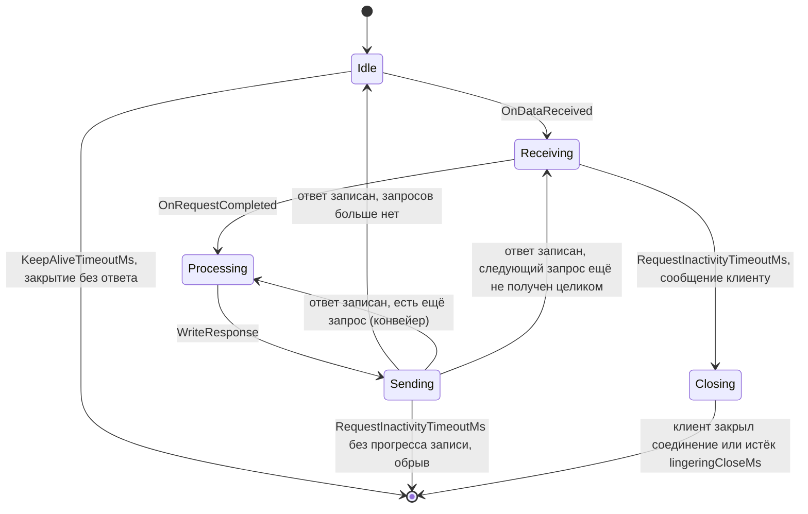

События, которые владелец соединения обязан передавать:

| Метод | Когда вызывать |
|---|---|
| `OnDataReceived()` | из сокета пришли данные (любое количество байт) |
| `OnRequestCompleted()` | запрос принят целиком и передан обработчику |
| `WriteResponse(data)` | для **каждого** ответа вместо `socket->write()`; в закрываемое соединение не пишет |
| `IsClosing()` | перед обработкой принятых данных: если `true`, данные надо прочитать и отбросить, а не разбирать |
| `GetPhase()` | текущая фаза (для диагностики и тестов) |
| сигнал `TimedOut(int action)` | сторож выполнил действие `CConnectionTimeoutTracker::Action` (для наблюдения и тестов) |

Пример использования (так сделано в `CSocket`):

```cpp
m_watcherPtr = new CSocketTimeoutWatcher(
			*m_socket,
			server.GetConnectionTimeoutConfig(),
			CConnectionTimeoutBehavior::CreateForProtocol(protocolTypeId),
			this);

void CSocket::HandleReadyRead()
{
	if (m_watcherPtr->IsClosing()){
		m_socket->readAll();

		return;
	}

	m_watcherPtr->OnDataReceived();

	// ... разбор запроса; если запрос ещё не полный — выйти

	m_watcherPtr->OnRequestCompleted();
	// ... передать запрос обработчику
}

void CSocket::OnSendResponse(const QByteArray& data)
{
	m_watcherPtr->WriteResponse(data);
}
```

На что обратить внимание.

- Ватчер не подписывается на `readyRead`: о данных и о полном запросе сообщает владелец. Иначе порядок слотов мог бы
  пометить уже завершённый запрос как неполный.
- Ответ надо писать только через `WriteResponse()`. Запись может сразу вызвать `bytesWritten`, поэтому ватчер переводит фазу
  в «отправка» до `write()`. Запись напрямую в сокет оставит соединение в фазе «обработка», где таймаута нет.
- Конвейер запросов учитывается: соединение считается простаивающим, только когда на все полученные запросы
  отправлены ответы и нет неполного следующего запроса.
- После закрытия сокета (`disconnected`) ватчер останавливается и больше ничего не делает; сокет хранится как `QPointer`,
  уничтоженный владельцем сокет безопасен.
- Сокет и ватчер должны жить в одном потоке.

Как добавить протокол. Описать его поведение в `CConnectionTimeoutBehavior::CreateForProtocol()` (или создать
`CConnectionTimeoutBehavior` в коде, который знает протокол) и вернуть его идентификатор из `IProtocolEngine::GetProtocolTypeId()`.
Настроить надо два поля: `createRequestTimeoutMessage` (что отправить клиенту с неполным запросом; пусто — соединение просто
обрывается) и `isLimitedBeforeFirstMessageOnly` (`true` для постоянного канала без цикла «запрос — ответ»). Правки
`CSocket`, `CSocketThread` и `CSocketTimeoutWatcher` не нужны.

**Совместимость.**

- Для первого запроса вместо 5 с от accept действуют 15 с до первого байта и 30 с без данных после него. Медленные,
  но живые клиенты больше не обрываются.
- Неполный запрос раньше просто рвался без ответа, теперь клиент получает 408.
- Простаивающие соединения закрываются. Раньше клиент HTTP/1.0 должен был закрывать соединение сам, иначе оно
  держало поток сервера.
- Время обработки запроса по умолчанию не ограничено (как и раньше); необязательный лимит добавлен в 1.5.1.

**Не сделано в этом шаге.**

- Общее время приёма запроса не ограничен: клиент, присылающий по байту реже, чем раз в 30 с, держит поток
  (защита типа «slowloris» — минимальная скорость приёма или общий лимит — в стандартах не описана).
- Ошибка разбора запроса по-прежнему не отвечает `400` и не закрывает соединение сразу (RFC 9112 §2.2 и §9.6) — это
  шаг 1.5; до него такое соединение закрывается таймаутом как неполный запрос.

**Проверка.**

`CConnectionTimeoutTrackerTest` (без ожидания, со значениями времени): значения по умолчанию; границы дедлайнов
(на миллисекунду раньше — нет действия, в срок — есть); бездействие считается от открытия соединения;
первый байт отменяет keep-alive; медленный клиент не закрывается, пока идут данные; обработка без таймаута;
отправка ответа: обрыв при остановке, отсрочка при прогрессе записи; keep-alive считается от конца ответа;
многократное использование соединения; отключенные (0 и отрицательные) таймауты; данные следующего запроса
во время обработки и отправки; конвейер запросов; запрос, завершённый во время отправки; сообщение сервера
без запроса; ответ до конца запроса; закрытие (в том числе мгновенное при 0 и отрицательном
значении), игнорирование событий при закрытии; неожиданные события; повторное открытие; большие значения
времени.

`CConnectionTimeoutBehaviorTest`: точные байты 408 (даты из примера RFC, нулевой эпохи и 29 февраля; не зависит от часового
пояса, в том числе для времени со смещением); значения констант `ProtocolTypeIds`; поведение по умолчанию; `http` в любом регистре
даёт 408 и отсутствие ограничения «только до первого сообщения», дата берётся в момент вызова; `tcp`, `ws`, `ftp`, `smtp` и пустой
идентификатор дают поведение без сообщения.

`CSocketTimeoutWatcherTest` (на настоящих сокетах, таймауты в десятках и сотнях миллисекунд): простаивающее соединение
закрывается без ответа и не закрывается раньше срока; медленный клиент не закрывается; неполный запрос получает
408 с заголовками `Date`, `Connection: close`, `Content-Length: 0`, соединение после него остаётся открытым до
закрытия клиентом; если клиент не закрывает — обрыв по таймауту; поведение без сообщения — обрыв; собственное поведение
(произвольный протокол) отправляет своё сообщение и так же ждёт закрытия клиентом; пустое сообщение — обрыв; обработка
без таймаута; после ответа действует keep-alive; многократное использование соединения; ответ 16 МиБ, который
клиент не читает, обрывается; не-HTTP: закрытие до первого сообщения и отсутствие ограничений
после него (в том числе в середине следующего сообщения); после разрыва соединения таймер не действует.
Жизненный цикл: фазы приём — обработка — отправка — ожидание; конвейер из двух запросов (до второго ответа таймаута нет,
после него — keep-alive); неполный второй запрос на том же соединении получает 408; неполный следующий запрос,
начатый во время обработки, получает 408 после ответа. Закрытие и пределы: закрываемое соединение игнорирует события и
ничего не пишет; нулевой `lingeringCloseMs` обрывает сразу после сообщения; нулевые таймауты не срабатывают;
функция сообщения вызывается один раз и только при таймауте; уничтоженный сокет не вызывает падения.

**Не покрыто тестами.** Связка `CSocket` → `CSocketTimeoutWatcher` (вызовы на приёме данных, полном запросе, записи ответа и
отбрасывание данных после 408) и передача атрибутов `CTcpServerComp`: `CSocket` создаётся внутри
`CSocketThread` и `CMultiThreadServer`, а тестов с сборкой компонентов `imtrest` пока нет. Связка тонкая (один вызов
на событие), вся логика проверена в двух классах выше. Сквозная проверка собранного сервера запланирована на последний
этап (9.1).

## 1.4. HTTP/1.1 — `CHttpSender`

**Проблема.** `CHttpSender::BuildResponseData` пишет статус-строку `HTTP/1.0`, всегда добавляет `Content-Length` и
`Content-Type`, даже если сервлет задал их сам, не добавляет `Date`, пишет тело в ответах, где его быть не может (204, 304,
ответ на `HEAD`), и не защищает от заголовков с переводом строки. Соединение после ответа не закрывается, даже если клиент
просил `Connection: close` или прислал запрос HTTP/1.0.

**Зачем.**

- Ответ HTTP/1.0 без `Connection: keep-alive` для клиента означает закрытие соединения: каждый запрос — новое TCP- и
  TLS-рукопожатие.
- В HTTP/1.0 нет `Transfer-Encoding: chunked`, поэтому нельзя отдать поток неизвестной длины (1.9, 1.11).
- Повторный `Content-Length` клиент вправе отвергнуть, а с разными значениями ответ некорректен (RFC 9110, §8.6;
  RFC 9112, §6.3).
- На постоянном соединении (HTTP/1.1) ошибка в границах сообщения ломает следующий ответ: лишнее тело после 204, 304 или
  `HEAD`, неверный `Content-Length`. С HTTP/1.0 такие ошибки скрывало закрытие соединения после каждого ответа.
- Значение заголовка с `CR` или `LF` позволяет подставить чужие заголовки и ответы (внедрение, OWASP A03).

**Решение.** `BuildResponseData(response, data, options)` собирает ответ по правилам RFC 9110 и 9112:

| Правило | Стандарт |
|---|---|
| Статус-строка `HTTP/1.1` | RFC 9112 §2.3, §4 |
| `Content-Length` — размер тела. Значение, заданное сервлетом, заменяется: неверное длина ломает следующий ответ. Не добавляется в 1xx и 204, не добавляется при `Transfer-Encoding` | RFC 9110 §8.6; RFC 9112 §6.2 |
| Для 304 и ответа на `HEAD` значение сервлета (длина представления) сохраняется; число проверяется, иначе заголовок не отправляется | RFC 9110 §8.6, §9.3.2, §15.4.5 |
| 1xx, 204, 304 — без тела, даже если сервлет его передал; 205 — без тела и с `Content-Length: 0`; ответ на `HEAD` — заголовки без тела | RFC 9110 §6.4.1, §9.3.2, §15.3.6; RFC 9112 §6.3 |
| `Content-Type` добавляется, только если сервлет его не задал, тип данных не пуст и в ответе есть тело | RFC 9110 §8.3 |
| `Date` добавляется во все ответы 2xx–5xx, если сервлет не задал его; в 1xx не добавляется | RFC 9110 §6.6.1 |
| `Connection` задаёт сервер: `close` и `keep-alive`, заданные сервлетом, убираются, при закрытии соединения добавляется `close`; прочие значения (`Upgrade`) сохраняются | RFC 9110 §7.6.1; RFC 9112 §9.3, §9.6 |
| Заголовок с именем, не являющимся token, и значением с `CR`, `LF` или `NUL` пропускается | RFC 9110 §5.5, §5.6.2 |
| Имена заголовков сервлета сравниваются без учёта регистра (`content-length` и `Content-Length` — один заголовок) | RFC 9110 §5.1 |

`CHttpDateTools` — даты заголовков (RFC 9110 §5.6.7). `ToImfFixdate()` создаёт значение в формате IMF-fixdate (отправитель должен
выдавать только его), его же использует ответ 408 из 1.3. `FromHttpDate()` разбирает дату из заголовка: получатель
обязан принимать все три формата HTTP-date: IMF-fixdate, устаревший RFC 850 (двузначный год: год, который выглядит
более чем на 50 лет в будущем, переходит в прошлое) и asctime. Разбор нужен в роли сервера
(`If-Modified-Since`, `If-Unmodified-Since`, `If-Range` — шаг 1.8) и в роли клиента (`Date`, `Last-Modified`, `Expires`,
`Retry-After` в ответах). Разбор строгий, не зависит от локали и часового пояса, возвращает время UTC
или недействительное время; секунда 60 (високосная) принимается, имя дня недели с датой не сравнивается.

**Закрытие соединения (RFC 9112 §9.3, §9.6).** Сервер обязан закрыть соединение после ответа на запрос с
`Connection: close` и должен сообщить об этом в ответе. HTTP/1.0 без `Connection: keep-alive` закрывается всегда.

- `IRequest` получил две чисто виртуальные функции: `IsConnectionPersistent()` и `IsResponseBodyOmitted()` (реализации по
  умолчанию в интерфейсе не нужны). Реализации в ImtCore: `CHttpRequest` отвечает по
  разобранному запросу (`http_should_keep_alive()`: версия и заголовок `Connection`, метод `HEAD`), `CTcpRequest`,
  `CUdpRequest` и `CWebSocketRequest` — всегда «постоянное, с телом» (сообщения не являются запросами HTTP). Других
  реализаций `IRequest` в IMTD нет; внешним реализациям нужно добавить две функции.
- `CSocket` после приёма запроса передаёт ответы потоку `CSocketThread::SetResponseHints()`, а при закрытии вызывает
  `CSocketTimeoutWatcher::CloseAfterResponse()`. `CMultiThreadServer::SendResponse()` читает признаки потока и передаёт их
  в `CHttpSender::ResponseOptions`.
- Сторож закрывает соединение (`disconnectFromHost()`: данные дописываются, потом закрытие), когда ответ записан и других
  запросов в обработке нет. Данные после такого запроса не являются запросом (клиент не должен их присылать), они
  отбрасываются. Закрытие сразу, без ожидания закрытия клиентом (в отличие от 408): запрос принят целиком, клиент ничего
  не досылает, поэтому сброс соединения, описанный в §9.6, не угрожает.

**Совместимость.**

- Клиенты начнут держать соединения открытыми — нужен шаг 1.3 (таймауты; он сделан раньше).
- `Content-Type` не добавляется, если тип данных пуст или тела нет (раньше добавлялся и пустой заголовок).
- Заголовок `Content-Length`, заданный сервлетом, заменяется длиной тела; ранее выдавалось два заголовка.
- Заголовки с недопустимыми именем или значением пропускаются, раньше они отправлялись как есть.
- Ответ на `HEAD` — без тела (раньше тело передавалось, и это ломало бы постоянное соединение).
- Заголовок `Connection` сервлета: `close` и `keep-alive` игнорируются, решение принимает сервер.
- Запрос HTTP/1.0 или с `Connection: close` закрывает соединение после ответа; раньше закрывал клиент.

**Не сделано в этом шаге.**

- `Keep-Alive: timeout=N` (MDN) не отправляется: он не входит в RFC 9110 и 9112. Клиент обрабатывает закрытие
  простаивающего соединения по RFC 9112 §9.3.1 (повтор неизменяемых запросов). Вне текущей сессии и PR, см. П.1.
- Конвейер запросов (несколько запросов подряд до первого ответа) остаётся ограниченным: `CMultiThreadServer::SendResponse()`
  ищет поток по идентификатору последнего запроса соединения, поэтому ответ на более ранний запрос не находит свой поток.
  Автомат таймаутов и сторож конвейер учитывают, исправление маршрутизации — вне 1.4. Признаки ответа (закрытие, `HEAD`)
  относятся к последнему принятому запросу. С шага 1.5 запросы одного соединения обрабатываются по одному, поэтому
  потеря ответов не возникает; остаток — в П.2, вне текущей сессии и PR.
- Ответ `100 Continue` на `Expect: 100-continue` не отправляется — решается вместе с 1.6.
- Ответ на `HEAD` без тела и без заданной длины не получает `Content-Length` (длину нельзя придумать). Сервлеты по
  умолчанию могут отвечать на `HEAD` ошибкой с телом: тело при этом отбрасывается, длина берётся из этого тела.

**Проверка.**

`CHttpSenderTest`: точные байты ответа; пустое и двоичное тело (в том числе с концом заголовков внутри); неизвестный статус;
отсутствие `Content-Type` без типа данных; собственный `Content-Length` сервлета в любом регистре и с неверным значением
заменяется, ровно один заголовок; `Transfer-Encoding` без `Content-Length`; 100, 204 и 304 без тела, длины и типа;
`Date` у 100 нет, у остальных есть; 304 сохраняет собственную длину (число, с пробелами; текст, пустая, отрицательная,
со знаком и переполняющая отбрасываются); 205 с длиной 0; ответ на `HEAD` с длиной тела, с собственной длиной, без длины;
собственный `Content-Type` не дублируется в любом регистре; прочие заголовки сохраняются; `Date` для 2xx–5xx, собственный
`Date` сохраняется, дата берётся из часов; `Connection: close` при закрытии и без него; значения `Connection` сервлета
(`keep-alive`, `close`, `Upgrade`, списки с пробелами и регистром); пропуск заголовков с `LF`, `CRLF`, `CR`, `NUL` в
значении и с пробелом, двоеточием, переводом строки и пустым именем; недопустимый тип данных; разбор ряда подряд
идущих ответов (200, 204, 404, 304 с длиной, 205, 201, двоичное тело) настоящим `http_parser` в роли клиента — все границы
найдены; клиент видит `close` и не ждёт следующего ответа.

`CHttpDateToolsTest`: примеры RFC, нулевая эпоха, 29 февраля, последняя секунда века, время после 2038 года; часовые пояса;
названия всех месяцев и дней недели; английские названия при немецкой локали; фиксированная длина. Разбор: все три формата
(пример RFC, нулевая эпоха, до эпохи, 29 февраля, время после 2038 года, asctime с двузначным и нулём перед днём);
результат в UTC; обратное преобразование для ряда моментов (до 9999 года); двузначный год RFC 850 (граница в 50 лет до
секунды, конец века для дат вперёд); високосная секунда; пробелы вокруг значения; имя дня не сравнивается с датой;
неправильные значения (пустое, ISO 8601, другая зона, день 0 и 32, 30 февраля, час 24, минута 60, секунда 61,
неизвестные месяц и день, регистр, одна цифра в дне, знак, чужие разделители) отклоняются; значение, обрезанное в
любой позиции, недействительно, парсер не читает после конца; повреждение любого символа даёт время UTC или
недействительное время.

`CHttpRequestTest`: постоянство соединения (HTTP/1.1 по умолчанию, `close` в любом регистре, HTTP/1.0 с `keep-alive` и без
него, запрос с телом); заголовок, разорванный между чтениями на любой границе; `HEAD` без тела ответа, `GET`, `POST`,
`OPTIONS` с телом; сообщения `CTcpRequest` не закрывают канал.

`CSocketTimeoutWatcherTest`: соединение закрывается после ответа на запрос с `close`, весь ответ доставлен до закрытия, это не
таймаут; до ответа не закрывается; данные после такого запроса не считаются запросом; ответ на более ранний запрос
конвейера не закрывает соединение; большой ответ (4 МиБ) доставляется целиком до закрытия.

**Не покрыто тестами.** Передача признаков ответа цепочкой `CSocket` → `CSocketThread` → `CMultiThreadServer` → `CHttpSender`
проверяется на последнем этапе (9.1): отдельные классы покрыты, но для проверки цепочки нужно собранное соединение.

## 1.5. Чтение без транзакций, ответ на ошибку разбора — `CSocket`

**Проблема.** `CSocket::HandleReadyRead` начинает транзакцию чтения `QIODevice` и фиксирует её только после разбора всего
запроса. Для отката `QIODevice` хранит всё прочитанное, а `CHttpRequest` копирует тело в `m_body`. `ParseDeviceData()`
забирает из сокета все данные, а не только запрос: если в одном чтении пришли конец запроса и начало следующего, парсер
продолжает разбор в тот же объект и портит уже готовый запрос. При ошибке разбора транзакция откатывается, данные снова
лежат в сокете, парсер остался в состоянии ошибки, а новых данных нет — соединение подвисает без ответа.

**Зачем.**

- Тело запроса лежит в памяти дважды.
- Первый из двух запросов, пришедших подряд, обрабатывается неверно.
- Клиент с неправильным запросом ничего не получает, пока не сработает таймаут. RFC 9112 §2.2: получив данные, не
  соответствующие грамматике сообщения, сервер отвечает `400 Bad Request` и закрывает соединение.

**Решение.**

- Транзакции убраны. `CHttpRequest::ParseDeviceData()` смотрит данные устройства (`peek`), разбирает их и убирает из
  устройства (`skip`) ровно столько байтов, сколько заняло сообщение. Остальное остаётся в сокете для следующего запроса.
  Для этого `http_parser` ставится на паузу в конце сообщения (`http_parser_pause()` в `OnMessageComplete()`), а
  `ExecuteHttpParser(data, socket, consumedCount)` возвращает число байтов запроса. Данные живут в сокете только до разбора,
  тело хранится один раз. `IRequest::ParseDeviceData()` описывает этот контракт.
- Ошибка разбора: `CSocket::RejectRequest()` отбрасывает остаток данных и вызывает `CSocketTimeoutWatcher::RejectRequest()`.
  Клиент получает сообщение поведения протокола (для HTTP — `400 Bad Request` с `Date`, `Connection: close` и
  `Content-Length: 0`, `CConnectionTimeoutBehavior::createBadRequestMessage`), затем соединение закрывается так же, как после 408:
  сервер ждёт закрытия клиентом (RFC 9112 §9.6), данные отбрасываются, по истечении `lingeringCloseMs` — обрыв. Протоколы без
  сообщения обрываются сразу.
- По одному запросу за раз для протоколов с циклом «запрос — ответ» (`CConnectionTimeoutBehavior::IsRequestResponseCycle()`,
  сейчас HTTP). Пока ответ на запрос не записан (`m_isRequestInProgress`), следующий запрос не разбирается, его данные ждут в
  сокете. После ответа `CSocket::OnSendResponse()` ставит в очередь повторный разбор. Ответы идут в порядке запросов (RFC 9112
  §9.3.2). Для других протоколов (сообщения TCP, WebSocket) ничего не меняется: ответов может быть ноль или несколько.

**Совместимость.**

- Запрос, на который сервлет не отвечает, блокирует остальные запросы соединения (раньше они обрабатывались, а клиент получал
  ответы не на свои запросы). Сервлет обязан ответить на каждый запрос ровно один раз через диспетчер ответов.
- Запросы, присланные подряд, обрабатываются по очереди.
- Неправильный запрос получает `400` и закрытие вместо ожидания таймаута.
- Реализации `IRequest` должны брать из устройства только свои данные; `CTcpRequest` по-прежнему берёт все данные (одно
  сообщение за чтение).

**Побочный эффект для П.2.** Потеря ответа на запрос конвейера (идентификатор запроса соединения менялся при разборе
следующего запроса, пока обработчик первого ещё работал) после 1.5 не возникает: следующий запрос разбирается после ответа на
предыдущий. Остальное в П.2 проверит 9.1.

**Не сделано в этом шаге.**

- Ограничения чтения (`setReadBufferSize`, обратное давление): данные следующего запроса, пока обработчик работает, копятся в
  буфере сокета без ограничения. Ограничение тела и обратное давление — шаги 1.6, 1.7 и 1.9.
- Ошибки разбора всегда дают `400`. Более точные коды (`414` для длинного адреса, `431` для больших заголовков, `505` для
  неподдерживаемой версии, RFC 9112 §3 и RFC 6585) не различаются: `SHOULD` для `400` выполнен.
- Ограничение общего времени приёма запроса (slowloris) — вне стандартов, см. 1.3.

**Проверка.**

`CHttpRequestTest`: запрос останавливается на своём конце, когда за ним идёт следующий (без тела, с телом, с пустым телом,
с `chunked`, `Connection: close`, HTTP/1.0); число принятых байтов одного и неполного запроса; завершённый запрос ничего больше
не берёт; следующий запрос разбирается другим объектом; поток из четырёх запросов подряд, поданный порциями любого размера от
1 байта до всего потока, даёт все четыре запроса с правильными адресами и телами; `ParseDeviceData()` на `QBuffer` и на
настоящем сокете оставляет в устройстве данные следующего запроса, берёт все данные неполного запроса, принимает пустое
устройство и отклоняет неправильный запрос.

`CSocketTimeoutWatcherTest`: отклонённый запрос получает `400` с `Date`, `Connection: close`, `Content-Length: 0`, соединение
ждёт закрытия клиентом; клиент не закрывает — обрыв по таймауту; протокол без сообщения — обрыв без данных; собственное
сообщение произвольного протокола; закрываемое соединение игнорирует события и ничего не пишет; повторное отклонение и
отклонение после 408 не отправляют второго ответа.

`CConnectionTimeoutBehaviorTest`: точные байты `400`; сообщение создаётся в момент вызова; у других протоколов сообщения нет;
`IsRequestResponseCycle()` истинно только для HTTP.

**Не покрыто тестами.** Сам `CSocket` (порядок: разбор, обработчик, ожидание ответа, повторный разбор) — на последнем этапе (9.1):
сценарии «два запроса в одном сегменте», «неправильный запрос», «медленный обработчик».

## 1.5.1. Отказоустойчивость: ошибка сервлета не должна ронять и подвешивать сервер

**Проблема.** Сервлеты пишутся разными командами, и ошибка в одном из них не должна выводить из строя весь сервер. Анализ
цепочки `CSocket` → `CWorkerManagerComp` → `CWorkerThread` → `CWorker` → сервлет → `CMultiThreadServer::SendResponse` нашёл места,
где сбой сервлета или настройки приводит к падению процесса либо к «паразитному простою» (клиент ждёт ответ, поток или соединение
заняты навсегда):

| Место | Что происходило | Что теперь |
|---|---|---|
| Исключение сервлета в потоке обработчика (`CWorker`) | Не перехватывается в потоке `QThread`: `std::terminate`, падение всего процесса | Перехватывается (`std::exception` и любое другое), пишется предупреждение, клиент получает `500` |
| Сервлет вернул пустой ответ | В отладке `Q_ASSERT`, в релизе ответа нет: клиент ждёт, соединение блокировано (с 1.5 следующий запрос ждёт ответа) | Клиент получает `500` |
| Не удалось создать сервлет (`CWorkerManagerComp`) | `Q_ASSERT`; запрос терялся, слот потока занят навсегда | Рабочий слот освобождается, клиент получает `500` |
| В `CWorkerThread` нет сервлета или рабочего объекта | Поток завершался, запросы повисали в очереди | Запрос отклоняется с `500`, поток закрывается |
| `CHttpSender::BuildResponseData()` не смог собрать ответ (например, движок не знает статус) | Ответа нет | Клиент получает `500` без тела (`CConnectionTimeoutBehavior::CreateHttpInternalServerErrorResponse()`) |
| Пустой указатель ответа или потока в `CMultiThreadServer::SendResponse()` | Разыменование нуля | Проверка, возвращается `false` |
| Исключение из `IRequestServlet::ProcessRequest` в `CSocket` (когда обработчик вызывается в потоке сокета) | Падение процесса | Перехватывается, клиент получает `500` |
| Нет обработчика запросов или не создан запрос (`CSocket`, `CSocketThread`) | `Q_ASSERT` / разыменование нуля | Предупреждение, данные отбрасываются |

**Правила.** Сервлет по-прежнему обязан ответить на каждый запрос один раз. Но защита от нарушения этого правила — на стороне
фреймворка (`CWorker`, `CWorkerThread`, `CWorkerManagerComp`, `CSocket`), а не сервлетов: их код не меняется.

- Только запросы протокола с ответом на каждый запрос (HTTP: `CConnectionTimeoutBehavior::IsRequestResponseCycle()`) получают
  `500`. Для сообщений канала (TCP, WebSocket) ответ может не быть вовсе или быть несколько, выдуманный ответ сломал бы канал:
  сбой только пишется в журнал.
- `500` без тела: текст исключения может содержать внутренности сервера, клиенту их не показываем (RFC 9110 §15.6.1).
- Запрос после сбоя не повторяется (у него могут быть побочные эффекты), сервлет не помечается сломанным.

**Таймаут обработки.** Атрибут `CTcpServerComp::RequestProcessingTimeoutMs` (по умолчанию 0 — **без ограничения**: долгие
расчёты — штатный случай). Если задан, то отсчитывается с конца приёма запроса (или с конца ответа на предыдущий запрос
конвейера); данные следующего запроса его не продлевают. По истечении клиент получает `503 Service Unavailable` с
`Connection: close` (RFC 9110 §15.6.4), соединение закрывается так же, как после `408` (ожидание закрытия клиентом,
RFC 9112 §9.6), а поздний ответ сервлета отбрасывается (`WriteResponse()` в закрываемое соединение не пишет). Реализовано в
`CConnectionTimeoutTracker` (`A_PROCESSING_TIMEOUT`), `CSocketTimeoutWatcher`, `CConnectionTimeoutBehavior`
(`createProcessingTimeoutMessage`, `createServerErrorMessage`). Протоколы без цикла «запрос — ответ» не ограничиваются.

**Ограничения, которые остаются.**

- Лимит освобождает **соединение**, но не **рабочий поток**: сервлет, который зациклился, продолжает занимать слот
  `CWorkerThread` (поток нельзя безопасно прервать из C++). Запросы, стоящие в очереди, обработает следующий слот. Если зацикливаются
  все слоты, очередь ждёт; от этого защищает только исправление сервлета или более строгий внешний контроль.
- Запрос, который стоял в очереди дольше лимита, всё равно будет выполнен позже, а его ответ отброшен.
- `Q_ASSERT` внутри самих сервлетов (базовые классы сервлетов) не менялись: они срабатывают только в отладочной сборке.

**Проверка.**

`CWorkerTest` (заглушки движка и сервлета): корректный ответ возвращается без замены; сервлет получает запрос и
подкоманду; вызов один (нет повторов); исключение `std::exception`, посторонний тип исключения, пустой ответ и отсутствие сервлета
дают `500`; ответ без тела и типа; используется движок запроса; сбой не влияет на следующий запрос; движок, не создающий
ответ, даёт пустой указатель без падения; для протоколов `tcp` и `ws` вместо `500` пустой указатель, а штатный ответ
возвращается.

`CConnectionTimeoutTrackerTest`: лимит по умолчанию отключён; граница дедлайна; отсчёт от конца запроса, а не от первого байта;
данные следующего запроса не продлевают; ответ в срок переводит в отправку; отсчёт для запроса из конвейера идёт от конца
предыдущего ответа; отрицательное значение отключает; закрытие после лимита.

`CSocketTimeoutWatcherTest` (настоящие сокеты): `503` с `Date`, `Connection: close`, `Content-Length: 0`, ожидание закрытия клиентом;
обрыв по `lingeringCloseMs`; поздний ответ не пишется; ответ в срок отменяет лимит; по умолчанию лимита нет, поздний ответ
доставляется; поведение без сообщения закрывает соединение; своё сообщение поведения; лимит для запроса конвейера.

`CConnectionTimeoutBehaviorTest`: точные байты `503` и `500` (с `Connection: close` и без), сообщение создаётся в момент вызова,
у других протоколов сообщений нет.

**Не покрыто тестами.** `CWorkerThread`, `CWorkerManagerComp` (очередь, слоты, создание сервлета), `CMultiThreadServer::SendResponse()` и
ветки `CSocket` с проверками на пустые указатели: они завязаны на потоки и компоненты. Сценарии добавлены в 9.1.

## 1.6. Решение о теле до его чтения — `IHttpRequestBodyPolicy`, `CHttpBodyPolicyRouterComp`, `MaxBodySize`

**Проблема.** Сервлет получает запрос только после приёма всего тела; размер тела не ограничен. `CHttpRequest::OnBody`
заранее резервирует память по `Content-Length` клиента.

**Зачем.** Нельзя ответить 413 (слишком большое тело) или 401 (нет доступа), не приняв тело целиком. Одним заголовком
`Content-Length` клиент заставляет сервер запросить столько же памяти.

Клиент с `Expect: 100-continue` ждёт решения сервера до отправки тела. RFC 9110 §10.1.1 требует: получив полные заголовки с
таким ожиданием, сервер сразу отправляет либо финальный статус, если он известен по методу, адресу и заголовкам, либо
`100 Continue`. Сейчас сервер не отправляет ничего до приёма тела — это нарушение стандарта. Клиент не обязан ждать вечно
(RFC 9110 §10.1.1), поэтому данные не теряются, но, например, curl задерживает каждую большую загрузку примерно на секунду.
Реализовать ответ без политики тела нельзя: решать, принимать тело или отказать, было бы нечем.

**Что такое `Expect: 100-continue`.** Клиент хочет загрузить большое тело (например, 5 ГБ), но не знает, примет ли его сервер
(нет прав — `401`/`403`, слишком большой файл — `413`, неверный адрес — `404`). Поэтому он отправляет только
заголовки с `Expect: 100-continue` и ждёт решения сервера:

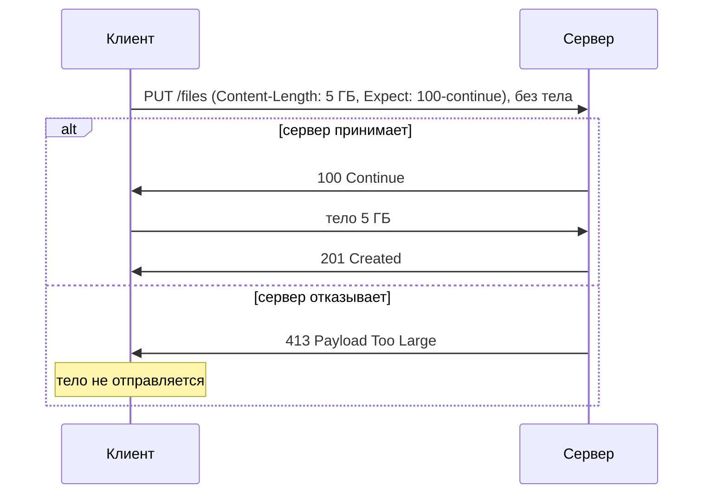

`100 Continue` — промежуточный ответ (`1xx`), за ним следует обычный финальный ответ.
Если клиент уже прислал часть тела, сервер может не отправлять `100` (RFC 9110 §10.1.1). К клиенту
`HTTP/1.0` сервер `1xx` не отправляет и ожидание `100-continue` игнорирует (RFC 9110 §10.1.1, §15.2).

**Решение.**

- `IHttpRequestBodyPolicy::DecideBody()` вызывается в `CHttpRequest::OnHeadersComplete()`, после заголовков и до чтения
  тела. Она получает метод, адрес и заголовки и выбирает режим: буфер с лимитом (`BM_BUFFER`) или
  немедленный ответ без чтения тела с закрытием соединения (`BM_REJECT`, статус и заголовки ответа
  задает политика, например `WWW-Authenticate` для `401`). Режим `BM_STREAM` (поток в приёмник) добавляется
  в 1.7.
- Лимит тела `maxBodySize` решения: меньше 0 — берётся атрибут `MaxBodySize` сервера, 0 — без лимита, больше 0 —
  лимит в байтах. Если `Content-Length` больше лимита — `413` до чтения тела; для `chunked` (длина неизвестна)
  проверяется накопленный размер, превышение даёт `413` в середине тела. Память заранее по
  `Content-Length` клиента больше не резервируется без ограничения (не больше 16 МиБ), раньше значение
  обрезалось до `int`.
- `CHttpBodyPolicyRouterComp` выбирает политику по префиксу пути (по границам сегментов: `/files` подходит
  к `/files` и `/files/a`, но не к `/files2`; побеждает самый длинный префикс). Если ни один префикс не подошёл,
  решает политика `DefaultPolicy`. Это обязательная ссылка: политика для путей, которым никто её не выбрал, задаётся явно, а не
  подразумевается. Если ссылку не задали (ошибка настройки сервера), такой запрос отклоняется с `500`, а не принимается неизвестно как.
  Пустой префикс по-прежнему подходит ко всем путям и решает раньше `DefaultPolicy`.
- Атрибуты `MaxBodySize` (по умолчанию 0 — без лимита) и ссылка `BodyPolicy` (необязательная) задаются
  у `CHttpProtocolEngineComp`, а не у `CTcpServerComp`, как было запланировано: политика тела — это часть HTTP, а TCP-сервер
  протоколов не знает; запрос создаёт именно движок протокола и передаёт их запросу.
- `Expect: 100-continue` (RFC 9110 §10.1.1): решение берётся из `DecideBody()` до чтения тела. `BM_BUFFER` —
  отправляется `100 Continue`, `BM_REJECT` — финальный статус (`413`, `401`) без `100`. Промежуточный ответ не
  должен менять фазу автомата таймаутов: запрос ещё принимается, поэтому он пишется не через
  `WriteResponse()` (который переводит фазу в «отправку ответа»), а через `CSocketTimeoutWatcher::WriteInterim()`. Другое
  значение `Expect` — `417 Expectation Failed`. `100` не отправляется, если тела нет, если клиент
  уже прислал часть тела и если запрос `HTTP/1.0`. `CHttpSender` уже не добавляет `Date` в 1xx.

**Как решение доходит до сокета.** Парсер уже прочитал заголовки, а ответ пишет `CSocket`, который не
знает протоколов. Поэтому в `IRequest` добавлен метод `TakeHeadAction(message)`: после каждого разбора
`CSocket` спрашивает запрос, нужно ли реагировать на заголовки до приёма тела, и получает готовые байты:

| Действие | Что делает `CSocket` |
|---|---|
| `HA_NONE` | Ничего, запрос принимается как обычно |
| `HA_SEND_INTERIM` | Пишет промежуточный ответ (`100 Continue`) через `WriteInterim()` и продолжает приём |
| `HA_REJECT` | Отбрасывает запрос и его данные, пишет финальный ответ с `Connection: close` и закрывает соединение так же, как после `400` (ожидание закрытия клиентом, RFC 9112 §9.6). Обработчик запроса не вызывается |

При отказе парсер ставится на паузу на конце заголовков и тело не буферизуется.

**Совместимость.** Без политики и лимита — как сейчас. Клиенты с `Expect: 100-continue` перестают ждать таймаут.
Запрос с неизвестным значением `Expect` теперь получает `417` (раньше обрабатывался без учёта ожидания).
`IRequest` получил чисто виртуальный `TakeHeadAction()` (реализован в `CHttpRequest`, от которого наследуют
`CTcpRequest` и `CUdpRequest`, и в `CWebSocketRequest`; другие реализации `IRequest` в IMTD отсутствуют).

**Проверка.**

`CHttpRequestBodyPolicyTest`: без политики и лимита запрос принимается как раньше; `Content-Length` в 4 ГБ не резервирует память
и не обрезается до `int`; `Content-Length` больше лимита — `413` до тела (тело, присланное вместе с заголовками, не хранится);
равный лимиту принимается; `chunked` сверх лимита — `413` посреди тела, в пределах — принимается; лимит политики, лимит
сервера, «без лимита» и их сочетания (таблица); отказ политики со статусом и заголовками (`401` с `WWW-Authenticate`),
политика без статуса — `500`; политика видит метод, адрес, запрос и заголовки, но не тело; вызывается один раз при любом дроблении
и не вызывается до конца заголовков; решает и для запроса без тела; ответ об отказе — финальный, с `Date`,
`Connection: close`, `Content-Length: 0`; статус, неизвестный движку, и движок без ответа дают `500`; отказ сохраняется;
`ResetData()` его снимает. `Expect: 100-continue`: `100 Continue` для заголовков без тела (регистр и пробелы не важны,
также для `chunked`); сообщение выдаётся один раз; нет `100` без тела, для `HTTP/1.0`, если часть тела уже пришла; тело после `100`
принимается; неизвестное значение — `417`; `100` не отправляется при отказе политики или лимита; отказ политики важнее
`417`; политика принимает — `100`.

`CHttpBodyPolicyRouterTest`: сопоставление префикса по границам сегментов (в том числе слэши и регистр), самый длинный
префикс, первый из равных, пустой префикс, пустой список. Сам компонент (в собранном виде, с политиками-заглушками): политика
префикса и самый длинный префикс; `DefaultPolicy`, если префикс не подошёл и если префиксов нет, и она получает тот же запрос; пустой
префикс решает раньше `DefaultPolicy`; без `DefaultPolicy` запрос без префикса отклоняется с `500`, запросы префиксов не страдают.

`CSocketTimeoutWatcherTest`: промежуточное сообщение пишется, не меняет фазу и не запускает keep-alive, не пишется в закрываемое
соединение, не нарушает порядок с ответом; отказ со своим сообщением (ожидание закрытия клиентом, обрыв по таймауту, пустое
сообщение — обрыв, повторный отказ не пишет второй ответ).

**Не покрыто тестами.** `CSocket` (вызов `TakeHeadAction()` и реакция на `HA_REJECT` и `HA_SEND_INTERIM`) и
передача атрибутов `CHttpProtocolEngineComp` запросу. Сценарии добавлены в 9.1: `413` и `401` до тела на настоящем соединении, клиент с `Expect`
получает `100`, соединение закрывается после отказа, клиент без ожидания шлёт тело сразу.

## 1.7. Потоковое тело запроса — `IHttpRequestBodySink`

**Проблема.** Тело запроса всегда целиком в памяти (`m_body`), и сервлет получает его только после приёма.

**Зачем.** Части файла по 16 МиБ в нескольких параллельных соединениях — сотни МиБ памяти; запись на диск и подсчёт хэша
начинаются только после приёма всей части.

### Что такое `IHttpRequestBodySink`

`Sink` («сток», приёмник) — объект, куда стекают данные и дальше не идут. `IHttpRequestBodySink` получает тело HTTP-запроса
**по частям, по мере его прихода из сети**, и сам решает, что с ними делать: записать в файл, посчитать хэш, переслать
дальше. Тело при этом не накапливается в памяти запроса: в любой момент в памяти только текущий
кусок, а не всё тело, поэтому загрузка файла в гигабайты не требует гигабайтов памяти. Его пара — `source` («источник»)
для ответа: `IResponseBodySource` из шага 1.9, откуда тело ответа читается по частям.

Разница между двумя режимами приёма тела:

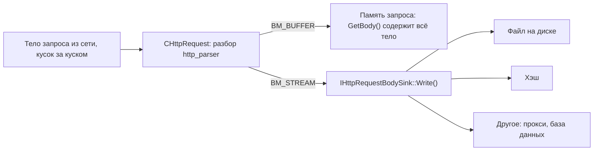

### Когда использовать

| Ситуация | Режим |
|---|---|
| Маленькое тело, которое сервлету нужно разобрать целиком: JSON, запрос GraphQL, форма | `BM_BUFFER` (по умолчанию) с лимитом `MaxBodySize` |
| Большое тело, которое нужно сохранить: файл, часть файла, видео | `BM_STREAM` + `CHttpFileBodySink` |
| Тело любого размера: маленькое нужно в памяти, большое — в файле, имя которого выбирает приёмник | `CHttpDynamicBodyPolicyComp`: сама выбирает `BM_BUFFER` или `BM_STREAM` + `CHttpTemporaryFileBodySink` (шаг 1.16) |
| Тело нужно не сохранить, а вычислить: хэш, размер, антивирусная проверка | `BM_STREAM` + свой приёмник (пример ниже) |
| Тело нужно переслать другому серверу без накопления | `BM_STREAM` + свой приёмник прокси (шаг 1.11) |
| Решить, принимать ли запрос вообще (права, размер) | Это работа политики (`BM_REJECT`), а не приёмника: приёмник создаётся уже после этого решения |

Приёмник **не видит заголовки и адрес запроса** и не формирует ответ. Всё, что зависит от запроса (куда писать, какой
лимит), политика знает и передаёт приёмнику при создании. Ответ клиенту формирует сервлет.

### Как это работает: от клиента до ответа

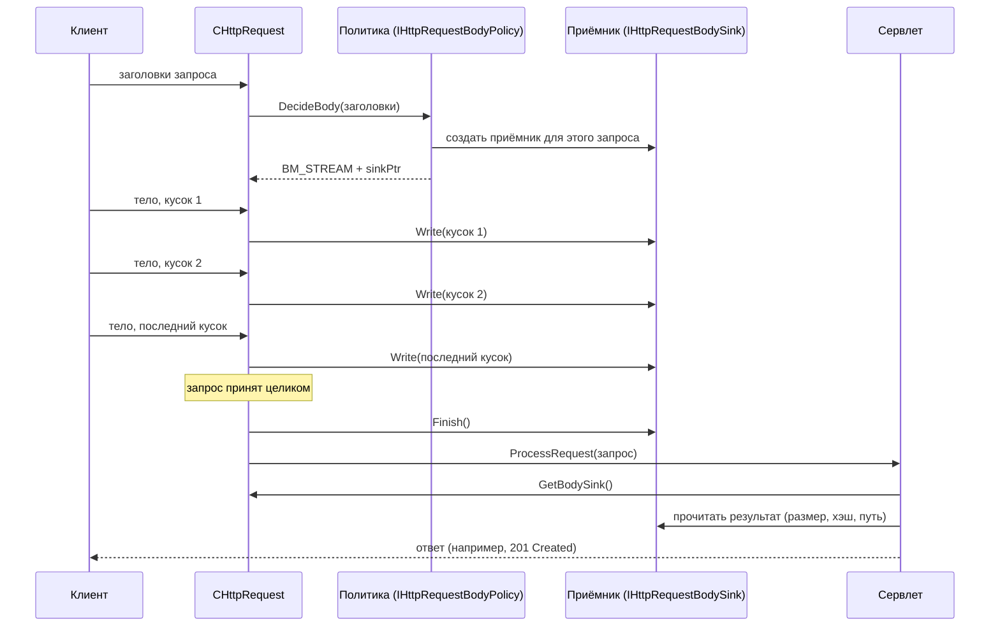

Сервлет запускается только после `Finish()`, как и раньше — после приёма всего запроса. Выигрыш — память
(тело не накапливается) и то, что запись в файл идёт по мере приёма, а не одним куском в конце.

### Жизненный цикл приёмника

У каждого приёмника есть ровно один конец: **`Finish()`** (тело принято) или **`Abort()`** (не принято).
Два метода никогда не вызываются на одном приёмнике:

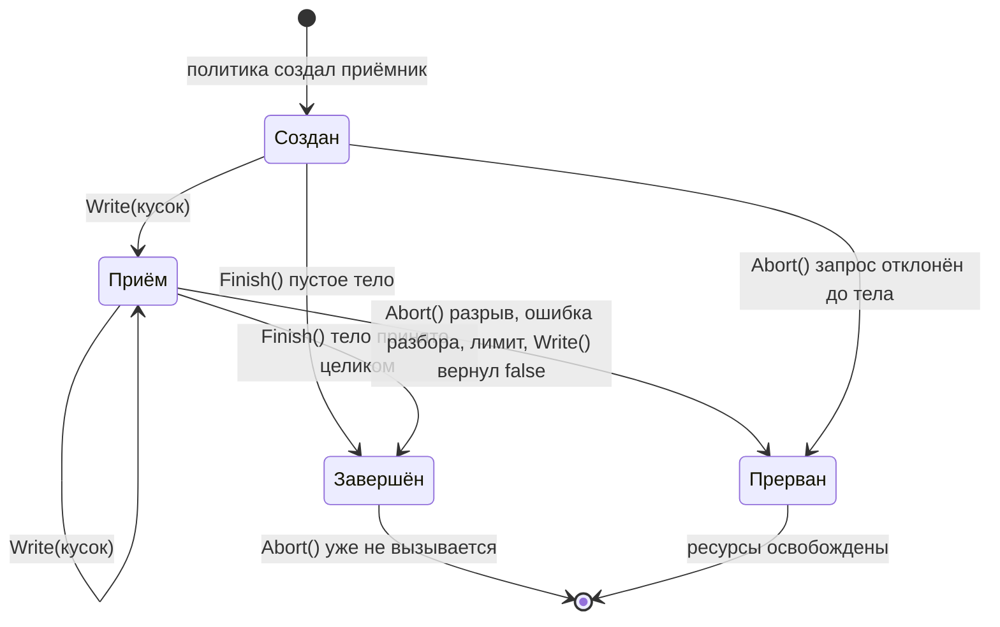

| Метод | Когда вызывается | Что делать приёмнику | Если вернул `false` |
|---|---|---|---|
| `Write(data, size)` | Каждый кусок тела, всегда после предыдущего (по порядку) | Взять данные: `data` действителен только во время вызова, дальше нужна копия | Клиент получает `500`, вызывается `Abort()`, данных больше нет |
| `Finish()` | Один раз, когда всё тело принято (даже если тело пустое) | Завершить работу: закрыть файл, зафиксировать хэш, зафиксировать результат | `500`, запрос не обрабатывается; `Abort()` после него не вызывается |
| `Abort()` | Тело не принято до конца или запрос отклонён; не больше одного раза и никогда после `Finish()` | Освободить всё, что взято: удалить неполный файл, отменить резерв | — (тип возврата `void`) |

Запрос сам вызывает `Abort()` в деструкторе для незавершённого приёмника, поэтому обрыв соединения в середине
загрузки не оставляет мусора: никому не нужно помнить об этом в каждом пути ошибки.

### Кто чем владеет

Приёмником владеют две стороны, поэтому это `std::shared_ptr`. Политикой никто из них не владеет:
её создаёт и уничтожает контекст компонентов ACF, а запрос держит на неё ссылку.

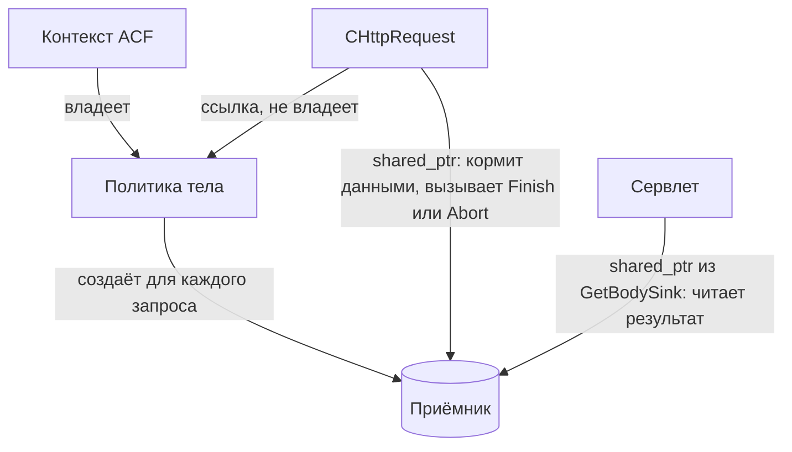

Приёмник живёт, пока его держит хотя бы один владелец: запрос может быть уже уничтожен, а сервлет всё ещё
читает результат (путь к файлу, размер).

### Пример использования: политика и сервлет загрузки файла

Политика решает, принимать ли запрос и куда писать, и даёт `CHttpRequest` приёмник:

```cpp
class CUploadPolicy: virtual public imtrest::IHttpRequestBodyPolicy
{
public:
	// reimplemented (imtrest::IHttpRequestBodyPolicy)
	BodyDecision DecideBody(const imtrest::CHttpRequest& requestHead) const override
	{
		BodyDecision decision;

		// 1. Решение по заголовкам: права и адрес запроса видны, тела ещё нет
		if (!IsUploadAllowed(requestHead)){
			decision.mode = BM_REJECT;
			decision.rejectStatusCode = imtrest::IProtocolEngine::SC_FORBIDDEN;

			return decision;
		}

		// 2. Приёмник для этого запроса. Если файл нельзя создать, клиент узнает об этом сразу
		std::shared_ptr<imtrest::CHttpFileBodySink> sinkPtr = std::make_shared<imtrest::CHttpFileBodySink>(GetTargetPath(requestHead));
		if (!sinkPtr->Open()){
			decision.mode = BM_REJECT;
			decision.rejectStatusCode = imtrest::IProtocolEngine::SC_INTERNAL_SERVER_ERROR;

			return decision;
		}

		decision.mode = BM_STREAM;
		decision.maxBodySize = 16 * 1024 * 1024;
		decision.sinkPtr = sinkPtr;

		return decision;
	}
};
```

Сервлет запускается после `Finish()`, тело уже в файле; ему остаётся взять результат и ответить:

```cpp
imtrest::ConstResponsePtr CUploadServlet::ProcessRequest(const imtrest::IRequest& request, const QByteArray& /*subCommandId*/) const
{
	const imtrest::CHttpRequest* httpRequestPtr = dynamic_cast<const imtrest::CHttpRequest*>(&request);

	std::shared_ptr<imtrest::CHttpFileBodySink> sinkPtr;
	if (httpRequestPtr != nullptr){
		sinkPtr = std::dynamic_pointer_cast<imtrest::CHttpFileBodySink>(httpRequestPtr->GetBodySink());
	}

	if (!sinkPtr){
		// Политика не настроена для этого адреса
		return CreateErrorResponse(request, imtrest::IProtocolEngine::SC_INTERNAL_SERVER_ERROR);
	}

	// sinkPtr->GetFilePath(), sinkPtr->GetReceivedSize(): файл уже записан, можно зарегистрировать его
	return CreateResponse(request, imtrest::IProtocolEngine::SC_CREATED);
}
```

`CreateErrorResponse()` и `CreateResponse()` здесь — вспомогательные функции сервлета (обычно
`request.GetProtocolEngine().CreateResponse(...)`). Чтобы связать адрес с политикой, см. `CHttpBodyPolicyRouterComp` (шаг 1.6).

### Как написать свой приёмник

Нужно реализовать три метода. Пример: подсчёт хэша без сохранения тела:

```cpp
class CHashBodySink: virtual public imtrest::IHttpRequestBodySink
{
public:
	CHashBodySink()
		:m_hash(QCryptographicHash::Sha256)
	{
	}

	QByteArray GetHash() const
	{
		return m_result;
	}

	// reimplemented (imtrest::IHttpRequestBodySink)
	bool Write(const char* data, qint64 size) override
	{
		m_hash.addData(QByteArrayView(data, qsizetype(size)));

		return true;
	}

	bool Finish() override
	{
		m_result = m_hash.result();

		return true;
	}

	void Abort() override
	{
		m_hash.reset();
	}

private:
	QCryptographicHash m_hash;
	QByteArray m_result;
};
```

Правила для реализаций:

- **Поток.** Все методы вызываются из потока соединения, один приёмник — один запрос, поэтому блокировок
  внутри не нужно. Результат читается после `Finish()`, когда запись уже закончена.
- **Скорость.** `Write()` блокирует чтение из сокета: медленный диск замедляет клиента природным образом (TCP
  сам притормаживает отправку). Тяжёлую работу (сжатие, долгий сетевой вызов) в `Write()` лучше не делать.
- **Данные.** Указатель `data` действителен только во время вызова: что нужно, надо скопировать.
- **Ошибки.** Ошибку сообщает возвратом `false`, а **не исключением**: методы вызываются из разборщика `http_parser`
  (код на C), и исключение, прошедшее через него, — неопределённое поведение.
- **Очистка.** Ресурсы освобождаются в `Abort()` и в деструкторе (на случай, если ни один из методов не
  был вызван). `CHttpFileBodySink` так и делает: временный файл удаляется в обоих случаях.
- **Результат.** Сервлету результат отдаётся собственными методами приёмника (`GetHash()`, `GetReceivedSize()`):
  в интерфейсе их нет, интерфейс описывает только приём.

**Решение.**

- Режим `BM_STREAM` решения `IHttpRequestBodyPolicy`: политика создаёт приёмник для конкретного запроса и даёт
  его в `BodyDecision::sinkPtr` (`std::shared_ptr`: приёмником владеют две стороны — запрос и тот, кто потом читает результат
  приёма, например хэш). Сервлет получает приёмник из запроса: `CHttpRequest::GetBodySink()`.
- Каждый кусок тела из `on_body` сразу уходит в `Write()`; у запроса `GetBody()` пуст. Для `chunked` передаётся
  только содержимое кусков, без разметки. `Finish()` вызывается один раз в конце сообщения, в том
  числе для пустого тела. Сервлет запускается только после `Finish()`, как и раньше — после приёма всего
  запроса; выигрыш — память, а не время до запуска.
- Лимит `maxBodySize` решения работает и для потока: считается всё, что передано приёмнику
  (`413`, часть, не влезшая в лимит, приёмнику не передаётся).

| Событие | Что делает запрос |
|---|---|
| `Write()` вернул `false` (нет места на диске) | Клиент получает `500` с закрытием соединения, вызывается `Abort()` |
| `Finish()` вернул `false` | `500`, запрос не обрабатывается, `Abort()` после `Finish()` не вызывается |
| `BM_STREAM` без `sinkPtr` | `500` (ошибка политики) |
| Тело не принято до конца: разрыв соединения, ошибка разбора, отказ (`413`, `417`), `ResetData()`, уничтожение запроса | Вызывается `Abort()` не больше одного раза; приёмник удаляет неполный файл. Для этого запрос сам в деструкторе вызывает `Abort()` незавершённого приёмника, поэтому никто не должен помнить об этом в каждом пути |

Приёмник, созданный политикой, но не нужный (запрос отклонён по другой причине), тоже получает `Abort()`,
чтобы освободить ресурсы (темпорарный файл, резерв места).

**`CHttpFileBodySink` — готовый приёмник для записи тела в файл.** Нужен любому серверу загрузки, поэтому
он в `imtrest`, а не в продукте. Пишет тело во временный файл в каталоге целевого файла (`QSaveFile`):

| Метод | Что делает |
|---|---|
| `Open()` | Создаёт временный файл. Вызывается политикой, уже в `DecideBody()`: если файл нельзя создать (нет каталога, нет прав), политика отказывает запрос, и клиент не присылает тело, которое нельзя сохранить |
| `Write()` | Пишет часть в временный файл; ошибка записи (нет места) — `false`, клиент получает `500` |
| `Finish()` | Закрывает временный файл и атомарно ставит его на место целевого: так неполный файл никогда не появляется под именем целевого |
| `Abort()` или уничтожение приёмника | Удаляет временный файл; старый целевой файл остаётся как был |

Если целевой файл уже есть, он не тронут, пока новое тело принимается, и заменяется только полным телом:
обрыв загрузки не портит файл, загруженный раньше. `GetReceivedSize()` и `IsFinished()` нужны тому, кто читает
результат. Всё, что специфично для конкретного сервиса (сессии загрузки, квоты, хэш части), остаётся
в политике и сервлете этого сервиса.

**Совместимость.** Без политики или с `BM_BUFFER` всё как раньше. `IRequest` не менялся: приёмник — часть
`CHttpRequest`. Если сервлет для потокового запроса читает `GetBody()`, то получит пустое тело — это
контракт режима, сервлет выбирается той же политикой, что и режим.

**Проверка.** `CHttpRequestBodyStreamTest`: тело уходит приёмнику целиком, по байтам, `chunked` (без
разметки), пустое тело завершается `Finish()`; тело 1 МиБ не буферизуется; режим `BM_BUFFER` игнорирует
приёмник; `GetBodySink()`; следующий запрос того же объекта решается заново; лимиты (по `Content-Length`
до тела, `chunked` посреди тела, накопление по частям); сбои `Write()` и `Finish()`, отсутствие приёмника — `500`;
`Abort()`: при уничтожении незавершённого запроса, отказе, неизвестном `Expect`, `ResetData()`, не больше
одного раза и никогда после `Finish()`; `Expect: 100-continue` с потоком.

`CHttpFileBodySinkTest` (настоящие файлы во временном каталоге): целевой файл появляется только после
`Finish()`, временный файл исчезает; части, пустое тело (пустой файл), тело 16 МиБ (сравнение по SHA-256), размер
принятого; старый файл не тронут до `Finish()` и заменяется после, сохраняется при `Abort()`; `Abort()` и уничтожение
без `Finish()` удаляют временный файл, повторный `Abort()` и `Abort()` после `Finish()` невредны; каталога нет —
`Open()` возвращает `false`; работа до `Open()` и после `Finish()` отклоняется; повторный `Open()`.
С запросом: часть 16 МиБ пишется на диск потоком через `CHttpRequest` (тело запроса пусто, файл
совпадает по хэшу), `chunked`, пустое тело; обрыв запроса и отказ по лимиту не оставляют файлов
(приёмник ещё жив, его читает владелец), старый файл при обрыве сохраняется.

**Не покрыто тестами.** Ошибка записи (диск переполнен) и сборка с компонентами: переполнение диска
нельзя надёжно воспроизвести в unit-тесте. Сценарий добавлен в 9.1.

## 1.8. `Range` и условные запросы — `CHttpRangeTools`, `CHttpConditionalTools`

**Проблема.** Сервер не разбирает `Range`, `If-Range`, `If-Match`, `If-None-Match`, `If-Modified-Since`,
`If-Unmodified-Since` и не умеет сравнивать `ETag`.

**Зачем.** Без них нет докачки: оборванное скачивание файла в 10 ГБ начинается заново, и нельзя ответить 304, 206, 412 или 416.
Каждый сервлет, который отдаёт файлы, иначе сам разбирал бы эти заголовки, и каждый разбирал бы их по-своему.

**Решение.** Две функциональные библиотеки без состояния. Они получают значения заголовков и сведения о представлении
(размер, `ETag`, время изменения) и возвращают решение. Объект запроса им не нужен, поэтому их можно проверять без сети.
Сервлет применяет решения в шаге 1.10 (`CHttpFileServletComp`). Разбор и создание `Content-Range` уже есть с шага 1.2.

| Класс | Методы | Что делает |
|---|---|---|
| `CHttpRangeTools` | `ParseRange()` | Разбирает `Range` (RFC 9110, §14.1–14.2) для представления известного размера |
| `CHttpRangeTools` | `CoalesceRanges()` | Сортирует диапазоны и объединяет пересекающиеся и соприкасающиеся |
| `CHttpConditionalTools` | `EvaluatePreconditions()` | Шаги 1–4 порядка проверки условий (RFC 9110, §13.2.2): 304, 412 или продолжить |
| `CHttpConditionalTools` | `EvaluateIfRange()` | Шаг 5: действует ли `Range` (RFC 9110, §13.1.5) |
| `CHttpConditionalTools` | `ParseEntityTag()`, `CreateEntityTag()`, `MatchEntityTagList()` | Разбор, создание и сравнение `ETag` (RFC 9110, §8.8.3) |

### Что такое условные запросы: общая идея

**Условный запрос** — обычный запрос с добавленным условием: «выполни это, только если ресурс сейчас такой-то». Сервер
проверяет условие по текущему состоянию ресурса и, если оно не выполнено, не делает обычное действие, а отвечает
`304 Not Modified` или `412 Precondition Failed`. Проверка и действие выполняются сервером вместе, поэтому между ними никто не
успевает изменить ресурс. Клиент сам этого сделать не может: «посмотреть, потом изменить» — два отдельных запроса.

Чтобы сформулировать условие, нужно описать «версию» ресурса. Для этого сервер в ответе отдаёт **валидаторы**:

| Валидатор | Заголовок ответа | Что это | Точность |
|---|---|---|---|
| Тег сущности | `ETag: "5a8-18f3c2d1"` | Идентификатор версии содержимого | Любая: меняется при каждом изменении |
| Время изменения | `Last-Modified: Sun, 06 Nov 1994 08:49:37 GMT` | Когда ресурс менялся последний раз | Секунда: две правки в одну секунду неотличимы |

Клиент запоминает валидатор и возвращает его в следующем запросе в одном из пяти заголовков `If-*`. Заголовки делятся по
назначению: **чтение** (кэш и докачка) и **запись** (защита от потерянных обновлений).

#### `ETag`: что это

`ETag` (entity tag) — часть стандарта HTTP (RFC 9110, §8.8.3): непрозрачный идентификатор версии содержимого. Клиент не
разбирает его, а только сравнивает на равенство. Как строить тег — решает сервер: хэш содержимого, размер и время изменения,
номер версии. Если содержимое изменилось, тег должен измениться.

| Вид | Запись | Значение |
|---|---|---|
| Сильный | `"abc"` | Содержимое совпадает побайтово |
| Слабый | `W/"abc"` | Содержимое равнозначно по смыслу, но не обязательно побайтово |

Слабый тег годится для кэша (например, у страницы изменилось только время генерации в подвале). Для `If-Match` и `If-Range`
нужен только сильный: нельзя докачивать файл по «примерно тому же» содержимому.

#### Пять заголовков

| Заголовок | Как понимать | Типичный сценарий | Условие не выполнено |
|---|---|---|---|
| `If-None-Match: "тег"` | «Выполни, только если у ресурса **другой** тег» (список тегов или `*`) | Кэш: у клиента есть копия, он спрашивает, не устарела ли она | `GET`, `HEAD`: `304` без тела; другие методы: `412` |
| `If-Modified-Since: дата` | «Выполни, только если ресурс **изменялся после** даты» | То же, что `If-None-Match`, но по времени; нужен, когда у ресурса нет `ETag` | `GET`, `HEAD`: `304`. Для других методов игнорируется |
| `If-Match: "тег"` | «Выполни, только если у ресурса **тот же** тег» (список тегов или `*`) | Запись: клиент прочитал версию, изменил и отправляет обратно | `412`: за это время ресурс изменили |
| `If-Unmodified-Since: дата` | «Выполни, только если ресурс **не изменялся после** даты» | То же, что `If-Match`, но по времени | `412` |
| `If-Range: "тег"` или `If-Range: дата` | «Если ресурс **не изменился**, отдай запрошенную часть (`Range`), иначе отдай **всё**» | Докачка: клиент скачал 3 ГБ из 10 и продолжает | `Range` игнорируется, ответ `200` с полным телом |

Запомнить различие можно так: `If-Match` — «только если **то же**», `If-None-Match` — «только если **не то же**». Слова
`Modified` и `Unmodified` говорят о времени изменения ресурса относительно даты, а `Match` — о совпадении тега.

Значение `*` в `If-Match` и `If-None-Match` означает «любая существующая версия» (даже без `ETag`). `If-None-Match: *` в `PUT`
значит «создай, только если ресурса ещё нет»: если он есть — `412`.

#### Чтение: кэш и `304`

Без условия клиент каждый раз скачивает файл целиком. С условием сервер отвечает коротким `304`, если ничего не изменилось:

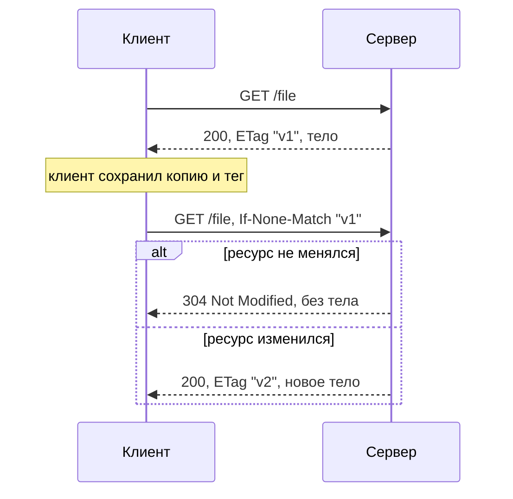

#### Запись: защита от потерянных обновлений

Двое прочитали одну версию, оба изменили и отправили. Без условия вторая запись молча затирает первую. С `If-Match` вторая
запись получает `412` и клиент узнаёт, что ресурс уже изменили:

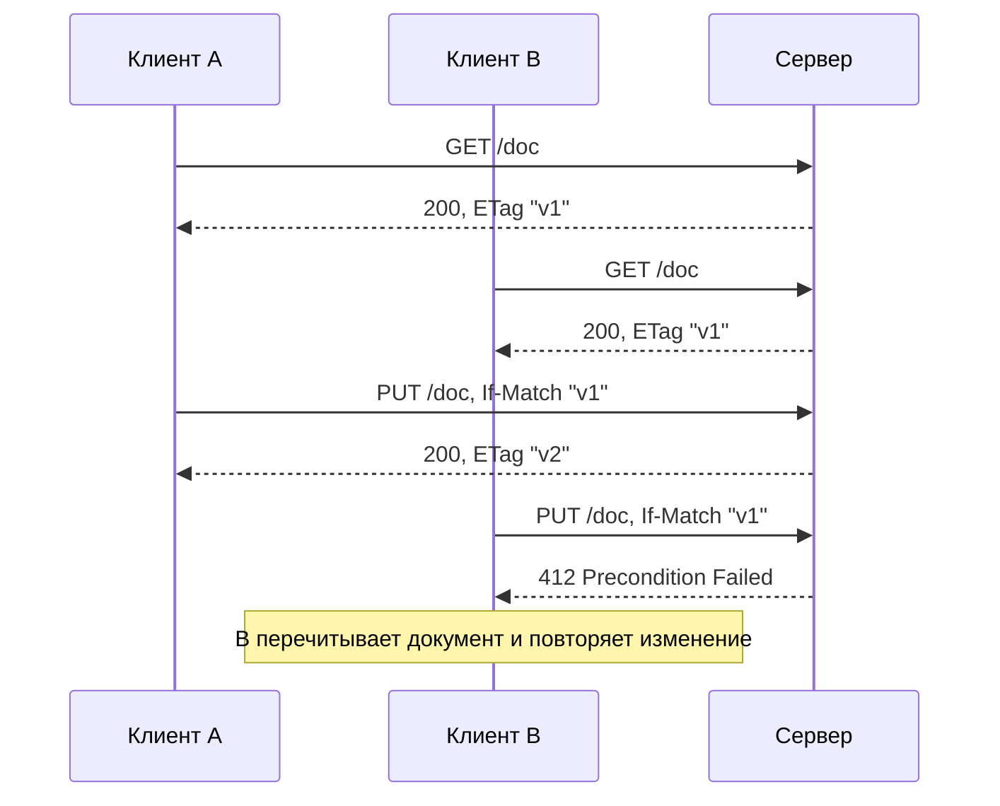

#### Докачка: `Range` и `If-Range`

Клиент скачал часть файла, соединение оборвалось. Он просит остаток (`Range`), но только если файл не изменился: иначе он
склеил бы начало старого файла с концом нового. `If-Range` объединяет оба условия в одном запросе, без лишнего круга:

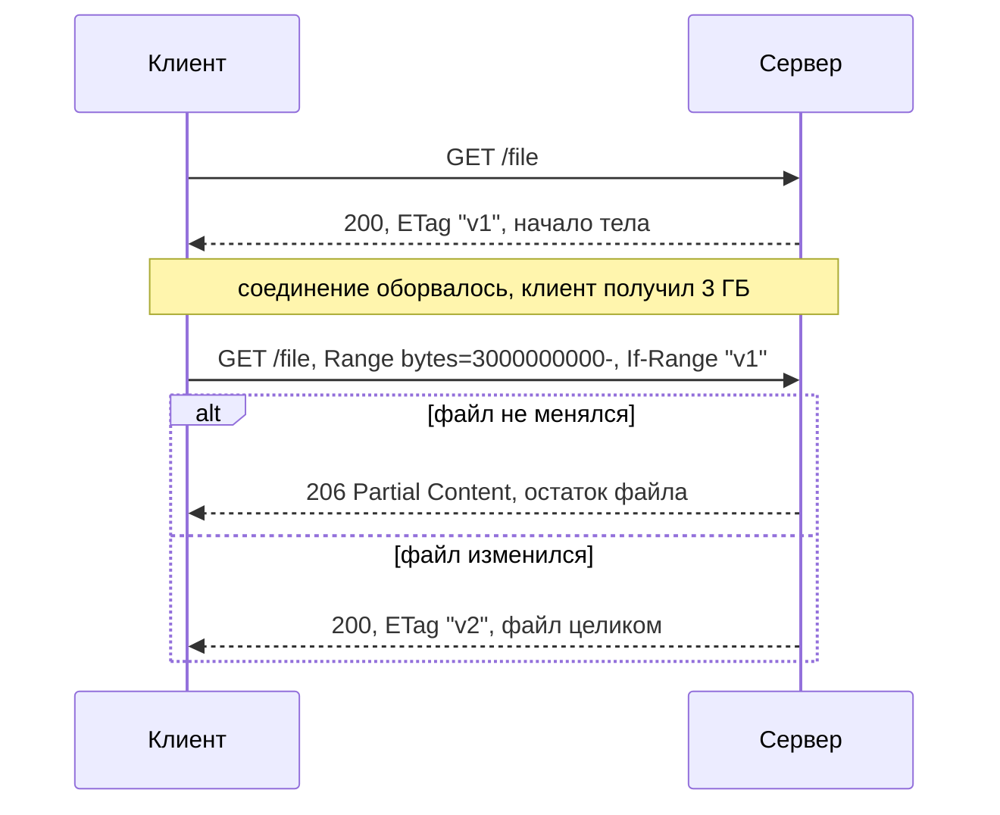

У `If-Range` нет ветки с ошибкой: если условие не выполнено, клиент просто получает весь файл. Поэтому проверка точная: тег
должен быть сильным, дата должна равняться времени изменения (а не «не позже»).

#### Что выбрать

- Предпочтителен `ETag`: он точнее времени и не зависит от часов. Время изменения — запасной вариант и совместимость со старыми
  клиентами. Сервер отдаёт оба валидатора, клиент использует тот, что поддерживает.
- Для кэша (`If-None-Match`, `If-Modified-Since`) подходит слабое сравнение, для записи и докачки (`If-Match`, `If-Range`) —
  только сильное.
- Если заголовка `If-*` в запросе нет, поведение сервера не меняется.

### Как сервлет применяет решения

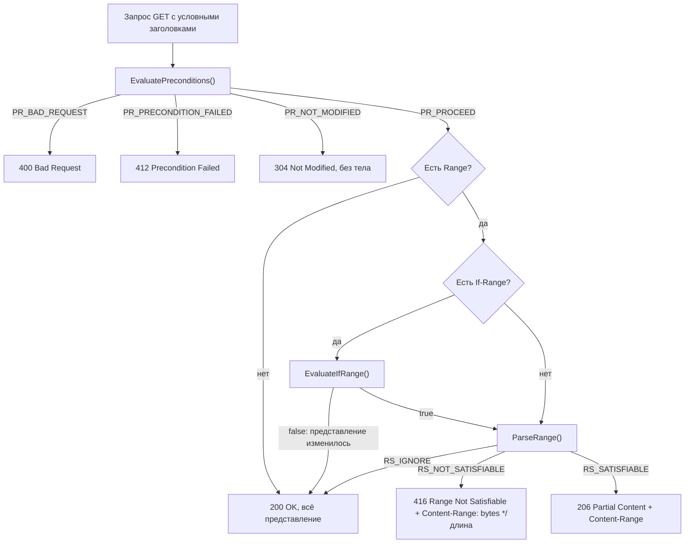

Условия проверяются раньше `Range`: клиент, у которого есть актуальная копия, получает `304`, а не часть файла.

### `Range`: как читается заголовок

`ParseRange(value, completeLength, ranges, maxRangeCount = 16)` возвращает одно из трёх решений:

| Результат | Когда | Ответ сервера |
|---|---|---|
| `RS_IGNORE` | Единица не `bytes`, неправильный синтаксис хотя бы одного элемента, диапазонов больше `maxRangeCount`, размер неизвестен (`completeLength < 0`) | `200`, заголовок игнорируется (RFC 9110, §14.2) |
| `RS_SATISFIABLE` | Хотя бы один диапазон попадает в представление | `206`; `ranges` содержит диапазоны в порядке запроса |
| `RS_NOT_SATISFIABLE` | Ни один диапазон не попадает в представление | `416` с `Content-Range: bytes */длина` |

Примеры для представления в 1000 байт (позиции включительные):

| Заголовок | Диапазон | Примечание |
|---|---|---|
| `bytes=0-499` | `0-499` | первые 500 байт |
| `bytes=500-` | `500-999` | от позиции до конца |
| `bytes=-500` | `500-999` | последние 500 байт (суффикс) |
| `bytes=-5000` | `0-999` | суффикс длиннее представления — всё представление |
| `bytes=900-5000` | `900-999` | конец за пределами обрезается |
| `bytes=0-99,200-299` | `0-99`, `200-299` | несколько диапазонов, порядок запроса |
| `bytes=0-99,2000-` | `0-99` | недостижимый диапазон пропускается, если есть достижимый |
| `bytes=1000-` | `416` | начало не меньше размера |
| `bytes=-0` | `416` | суффикс из нуля байт |
| `bytes=5-1` | `RS_IGNORE` | конец меньше начала: синтаксическая ошибка |
| `bytes=0-9,x` | `RS_IGNORE` | плохой элемент отменяет весь заголовок |

Решения, которые стоит знать:

- **Плохой элемент отменяет весь заголовок.** RFC разрешает игнорировать неправильный `Range`; ответ `200` безопаснее, чем частичный ответ на неверно понятый запрос.
- **Пустое представление (размер 0).** Любой диапазон недостижим, ответ `416`. RFC считает суффикс ненулевой длины достижимым, но выразить пустую часть в `Content-Range` нельзя.
- **Слишком большие числа** (больше `qint64`) не ошибка: они означают наибольшее число. `bytes=0-99999999999999999999` обрезается до конца представления, `bytes=99999999999999999999-` недостижим.
- **Строгая грамматика.** Только десятичные цифры; пробелы допускаются вокруг элементов списка и всего значения, но не внутри диапазона и не вокруг `=`. Пустые элементы списка (`bytes=,0-9,,`) допустимы по правилу `#` RFC; список без элементов недопустим. Единица `bytes` не зависит от регистра.
- **Защита от перегрузки.** Больше `maxRangeCount` (16) диапазонов — `RS_IGNORE` (RFC 9110, §14.2). Недостижимые диапазоны тоже считаются. Пересекающиеся диапазоны `ParseRange()` не объединяет (порядок запроса важен для `multipart/byteranges`); для одного ответа `CoalesceRanges()` сортирует их и объединяет пересекающиеся и соприкасающиеся (`0-99,100-199` → `0-199`), не вызывая переполнения у наибольших позиций.

Сервлет 1.10 отвечает одним диапазоном; при нескольких диапазонах он вызывает `CoalesceRanges()` и, если остался один, отвечает `206`, иначе — `200` (RFC 9110, §14.2 разрешает не поддерживать несколько диапазонов).

### Условные запросы

`EvaluatePreconditions(method, preconditions, validators)` проверяет заголовки в порядке RFC 9110, §13.2.2:

| Шаг | Заголовок | Условие | Результат |
|---|---|---|---|
| 1 | `If-Match` | Ни один тег не совпал по сильному сравнению | `412` |
| 2 | `If-Unmodified-Since` (только если нет `If-Match`) | Представление изменено после даты | `412` |
| 3 | `If-None-Match` | Тег совпал по слабому сравнению | `304` для GET и HEAD, `412` для остальных методов |
| 4 | `If-Modified-Since` (только для GET и HEAD и если нет `If-None-Match`) | Представление не изменялось после даты | `304` |
| 5 | `If-Range` (отдельный вызов `EvaluateIfRange()`, только если есть `Range`) | Тег не совпал или дата не равна времени изменения | `Range` игнорируется, ответ `200` |

Если заголовка нет, шаг пропускается (пустой массив означает отсутствие заголовка). `method` задаётся прописными буквами (`GET`).

Сравнение `ETag` (RFC 9110, §8.8.3.2):

| Тег запроса | Тег представления | Сильное (`If-Match`, `If-Range`) | Слабое (`If-None-Match`) |
|---|---|---|---|
| `"a"` | `"a"` | совпал | совпал |
| `W/"a"` | `"a"` | нет | совпал |
| `W/"a"` | `W/"a"` | нет | совпал |
| `"a"` | `"b"` | нет | нет |

Значение `*` совпадает с любым представлением, даже без `ETag`. Запятая внутри тега (`"a,b"`) не разделитель: разбор списка учитывает кавычки.

Решения, которые стоит знать:

- **Неправильный список тегов в `If-Match` и `If-None-Match` — `400`.** RFC этого не определяет; игнорировать `If-Match` небезопасно (изменение прошло бы без проверки), поэтому такой запрос отклоняется. Список проверяется до конца, даже если тег уже совпал: `"a",x` — ошибка.
- **Неправильная дата в `If-Modified-Since` и `If-Unmodified-Since` игнорируется** (RFC 9110, §13.1.3–13.1.4). Принимаются все три формата HTTP-date (`CHttpDateTools`). Если время изменения представления неизвестно (`lastModified` недействительно), условие тоже не проверяется.
- **Доли секунды отбрасываются.** Файловая система хранит миллисекунды, HTTP-date — секунды. Без этого `If-Modified-Since`, взятый из `Last-Modified`, никогда бы не совпадал с файлом.
- **`If-Range` — только точное совпадение.** С датой: время изменения равно дате (не «не позже»). С тегом: только сильный тег с обеих сторон. Всё остальное, включая неправильное значение, означает «выдать всё представление»: это безопасно, клиент получит полные данные.

`CreateEntityTag(opaqueTag, isWeak)` строит значение `ETag` с кавычками и проверяет символы (`0x21`, `0x23–0x7E`, `0x80–0xFF`); при недопустимом символе возвращает пустой массив. Тег для файла нужно строить из того, что меняется при изменении содержимого (например, размер и время изменения с точностью до миллисекунд), а не из одного времени в секундах.

### Пример

```cpp
imtrest::CHttpConditionalTools::Validators validators;
validators.eTag = imtrest::CHttpConditionalTools::CreateEntityTag("5a8-18f3c2d1");
validators.lastModified = fileInfo.lastModified();

imtrest::CHttpConditionalTools::Preconditions preconditions;
preconditions.ifMatch = request.GetHeader("If-Match");
preconditions.ifNoneMatch = request.GetHeader("If-None-Match");
preconditions.ifModifiedSince = request.GetHeader("If-Modified-Since");
preconditions.ifUnmodifiedSince = request.GetHeader("If-Unmodified-Since");

switch (imtrest::CHttpConditionalTools::EvaluatePreconditions("GET", preconditions, validators)){
case imtrest::CHttpConditionalTools::PR_NOT_MODIFIED:
	return Respond(304);
case imtrest::CHttpConditionalTools::PR_PRECONDITION_FAILED:
	return Respond(412);
case imtrest::CHttpConditionalTools::PR_BAD_REQUEST:
	return Respond(400);
case imtrest::CHttpConditionalTools::PR_PROCEED:
	break;
}

const QByteArray ifRange = request.GetHeader("If-Range");
const bool isRangeUsed = ifRange.isEmpty() || imtrest::CHttpConditionalTools::EvaluateIfRange(ifRange, validators);

QList<imtrest::CHttpRangeTools::ByteRange> ranges;
const auto status = isRangeUsed ? imtrest::CHttpRangeTools::ParseRange(request.GetHeader("Range"), fileSize, ranges) : imtrest::CHttpRangeTools::RS_IGNORE;
```

`Respond()` и `GetHeader()` в примере условные: имена зависят от сервлета. Для ответов 206 и 416 заголовок `Content-Range` создаётся через `CHttpRangeTools::CreateContentRange()`.

**Проверка.** Unit-тесты (без сети):

- `CHttpRangeToolsTest`, `ParseRange()`: формы `a-b`, `a-`, `-n`, одиночные байты, обрезка конца, суффикс длиннее представления, большие числа (в том числе больше `qint64`), регистр единицы, пробелы, ведущие нули, позиции больше 4 ГиБ, несколько диапазонов, пустые элементы списка, порядок запроса, пропуск недостижимых диапазонов; все случаи `416` (в том числе пустое представление и суффикс из нуля байт); больше двадцати вариантов, при которых заголовок игнорируется (другая единица, пробелы вокруг `=` и дефиса, знаки, шестнадцатеричные числа, конец меньше начала, плохой элемент в любой позиции); результат не меняется при `RS_IGNORE` и `416`, заменяется при `206`; лимит числа диапазонов (по умолчанию и параметром; недостижимые считаются, пустые элементы нет); построение `Content-Range` по результату; `CoalesceRanges()`: пустой список, пересечение, касание, зазор в один байт, вложенные, одинаковые, цепочка, неотсортированные, наибольшие позиции `qint64`;
- `CHttpConditionalToolsTest`: разбор `ETag` (сильный, слабый, пустой, запятая внутри, обратная косая черта, байты `0x80+`, пробелы вокруг) и 23 ошибочных значения (нет кавычек, `w/` в нижнем регистре, пробел, табуляция, `0x7F`, `NUL`, кавычка внутри, список вместо одного тега, `*`); создание тега и обратный разбор; сравнение со списком — сильное и слабое для всех комбинаций, `*`, регистр, запятая внутри тега, пустые элементы, нет тега у представления; 18 недопустимых списков, в том числе плохой элемент после совпавшего; порядок проверок (74 строки: каждый заголовок отдельно, для GET, HEAD, PUT, POST и DELETE, три формата даты, неизвестное время изменения, неправильные даты, комбинации заголовков и приоритет шагов); доли секунды; `If-Range` с тегом (только сильное сравнение) и с датой (точное совпадение, три формата), неправильные значения.

**Не покрыто тестами.** Применение решений к настоящему запросу и ответу: сервлет появится в шаге 1.10, сценарии `200`, `206`, `304`, `412` и `416` на настоящем соединении добавлены в 9.1. Ответ `multipart/byteranges` не поддерживается.

## 1.9. Потоковый ответ — `IResponseBodySource`, `IStreamingResponse`, `CHttpResponseBodyStreamer`

**Проблема.** Тело ответа — один `QByteArray` (`IResponse::GetData()`). `CSocket::OnSendResponse` пишет его одним
`write()`, не глядя на `bytesToWrite()`.

**Зачем.** Ответ 10 ГБ требует 10 ГБ памяти. Медленный клиент не тормозит отправку: всё, что не ушло в сеть, копится в
буфере `QTcpSocket`. Отключение клиента не останавливает подготовку ответа.

### Что это такое

**Потоковый ответ** — ответ, тело которого не лежит целиком в памяти: сервер сразу отправляет клиенту заголовки, а тело
читает из **источника** по частям и отправляет, **пока клиент его принимает**. Это зеркало шага 1.7: там тело *запроса*
по частям уходит в приёмник (`IHttpRequestBodySink`), здесь тело *ответа* по частям берётся из источника
(`IResponseBodySource`).

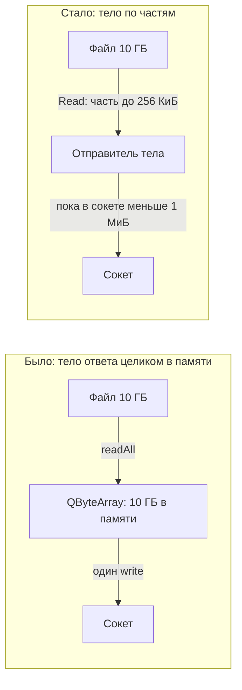

В памяти в любой момент находятся только данные, которые ещё не ушли в сеть (не больше `WriteHighWatermark`, 1 МиБ,
и одной части в 256 КиБ), поэтому память не зависит от размера ответа.

| Сущность | Роль |
|---|---|
| `IStreamingResponse` | Наследник `IResponse`: статус, заголовки и тип данных те же, а вместо `GetData()` два метода — `GetBodySize()` (размер тела или −1) и `CreateBodySource()` (создаёт источник). Сервлет возвращает его, как любой другой ответ: `IRequestServlet` и `IResponseDispatcher` не менялись |
| `IResponseBodySource` | Источник тела: `Read(data, maxSize)` отдаёт следующую часть, `Abort()` освобождает всё, `SetDataAvailableHandler()` нужен источникам, которым приходится ждать данные (прокси) |
| `CHttpResponseBodyStreamer` (отправитель тела ответа) | Читает источник, пока в сокете не накопилось больше `WriteHighWatermark`, пишет части в сокет, продолжает, когда данные ушли в сеть (`bytesWritten`). Один отправитель — один ответ |
| `IStreamingResponseSender` | Протоколо-нейтральный интерфейс «отправить потоковый ответ»: `Start(ответ, признаки, обработчик завершения)` возвращает `SR_STARTED`, `SR_COMPLETED` (только голова, всё записано), `SR_FAILED` (ничего не записано, клиенту нужна ошибка) или `SR_DROPPED` (соединение закрыто или закрывается, ответ не нужен). `CSocket` работает только с ним |
| `CHttpStreamingResponseSender` | Реализация для HTTP: строит голову (`CHttpSender::BuildStreamingResponseHead()`), создаёт источник, запускает `CHttpResponseBodyStreamer`, вызывает обработчик, когда тело отправлено или отправка прервана. Создаётся для соединения через `CConnectionTimeoutBehavior::createStreamingResponseSender` (`CreateForProtocol("http")`) |
| `CHttpSender::BuildStreamingResponseHead()` | Строит голову ответа (статус, заголовки, `Date`, `Content-Length` или `Transfer-Encoding: chunked`) и решает, как клиент найдёт конец тела |
| `CSocketTimeoutWatcher` | `BeginStreamingResponse()`, `WriteStreamingData()`, `EndStreamingResponse()`: пока тело не закончено, ответ не считается завершённым, а таймаут бездействия следит за прогрессом записи |

### Как это работает

Сервлет работает в потоке обработчика, а сокет и источник живут в потоке соединения. Поэтому ответ передаётся между потоками,
а источник создаётся уже на месте: файл открывается и читается в том потоке, который его отправляет.

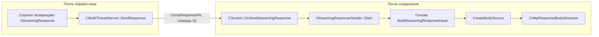

`CSocket` (транспортный уровень) не знает, что такое HTTP: он передаёт ответ интерфейсу `IStreamingResponseSender`, который
создан для протокола соединения. Голова, `Content-Length`, `chunked` и закрытие соединения — дело `CHttpStreamingResponseSender`.

Ответ передаётся умным указателем, голова (статус и заголовки) строится в потоке соединения. Запрос к этому моменту может быть
уже уничтожен, поэтому ответ и источник **не должны ссылаться на запрос**: всё нужное копируется в них.

### Сценарии использования

#### 1. Отдача большого файла (размер известен)

Сервлет знает размер файла (`QFileInfo::size()`), не читая его. Клиент получает `Content-Length` и может показывать прогресс:

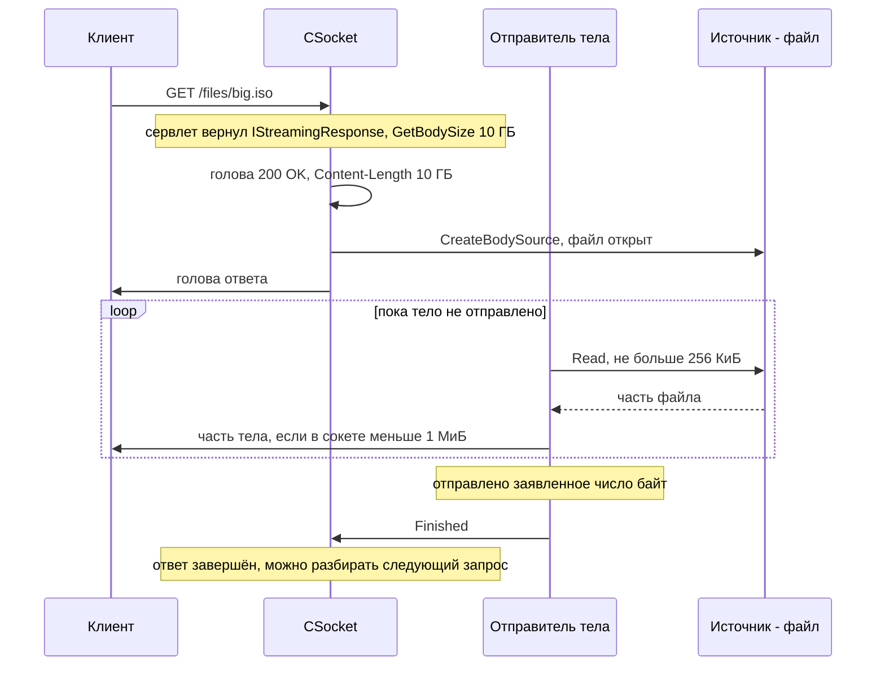

#### 2. Медленный клиент: источник тормозит вслед за сетью

Отправитель не читает источник «про запас». Пока клиент не успевает принимать, данные не читаются, и память сервера не растёт:

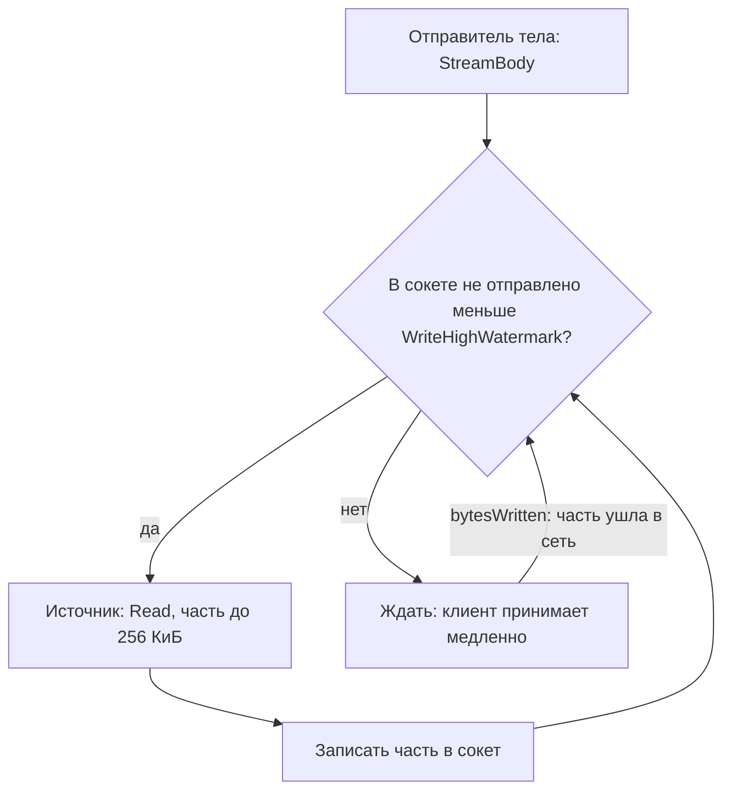

Тот же механизм работает для прокси (шаг 1.11): медленный клиент задерживает чтение из соединения с upstream.

#### 3. Размер неизвестен: `chunked` или до закрытия соединения

Если размер заранее не известен (ответ генерируется или пересылается от другого сервера), `Content-Length` указать нельзя.
Как клиент найдёт конец тела, выбирается автоматически (RFC 9112, §6.3):

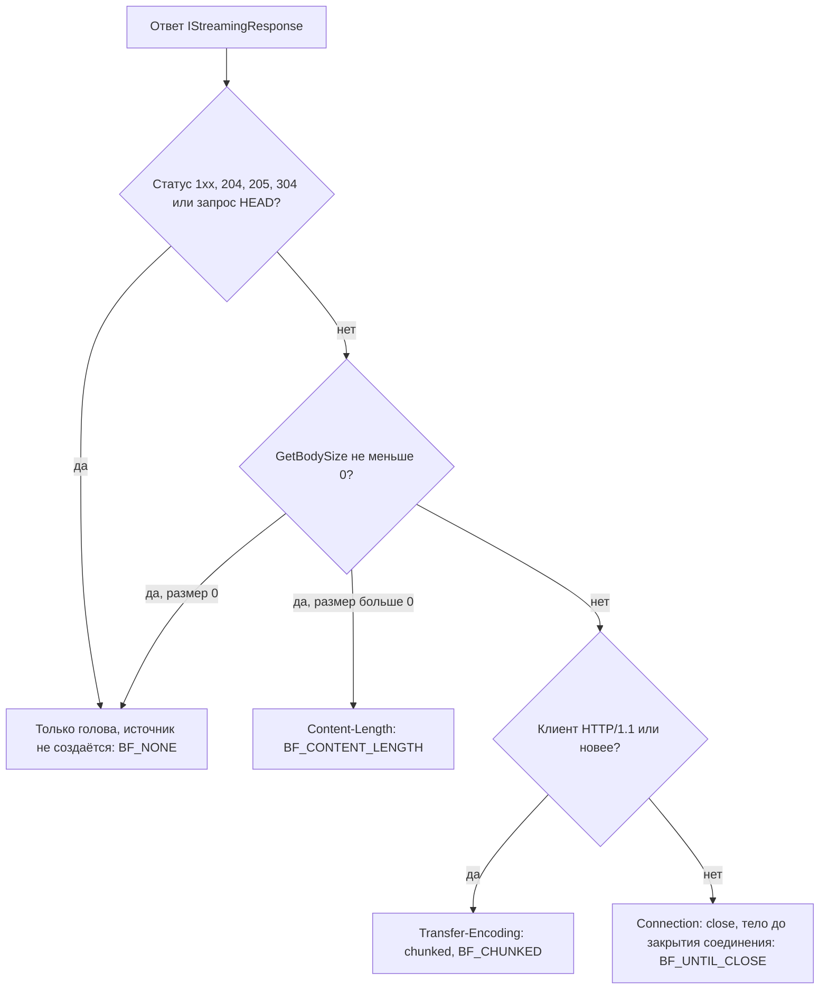

- `chunked`: каждая часть источника отправляется как кусок (размер в шестнадцатеричном виде, данные, CRLF), в конце — кусок
  размера 0. Пустой кусок — это конец тела, поэтому источник не может отдавать пустые части.
- Клиент `HTTP/1.0` не знает `chunked` (RFC 9112, §6.1): тело отправляется как есть, ответ имеет `Connection: close`, и конец
  тела — закрытие соединения после последнего байта.

#### 4. `HEAD`, `304` и ответы без тела

Для ответов без тела источник не нужен, и файл не открывается. `HEAD` получает те же заголовки, что и `GET`, включая
`Content-Length` — размер берётся из `GetBodySize()`; если он неизвестен, остаётся значение заголовка `Content-Length`, заданное
ответом. Правила для `1xx`, `204`, `205` и `304` те же, что у обычных ответов (шаг 1.4).

#### 5. Источник ждёт данные (`RR_WAIT`)

Источнику, которому данные приходят извне (ответ upstream-сервера, ожидание вычисления), нечего отдать прямо сейчас.
Он отвечает `RR_WAIT`, отправитель ждёт, а когда данные появились, источник вызывает обработчик, который ему дали:

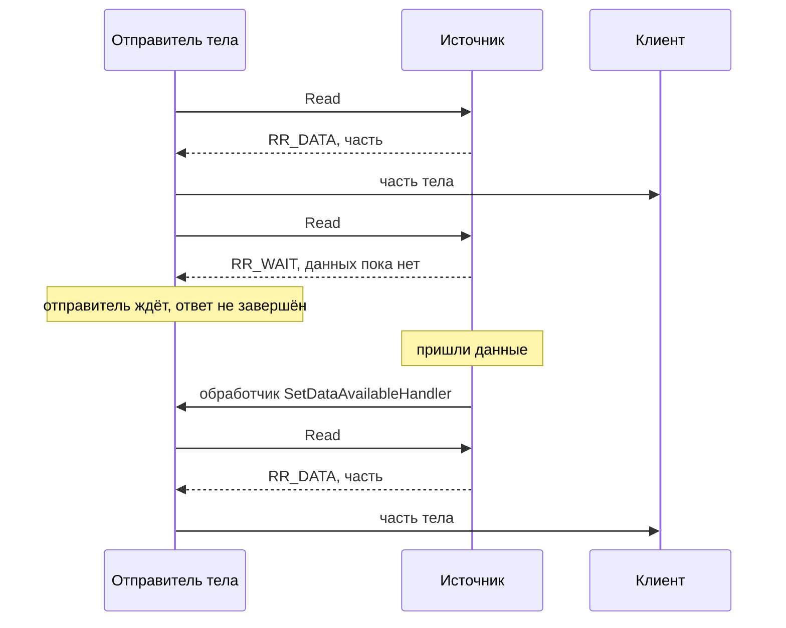

Пока отправитель ждёт источник, соединение не считается простаивающим (таймаут keep-alive не идёт), но таймаут бездействия отправки
(`RequestInactivityTimeoutMs`) действует: источник, который молчит дольше, обрывает соединение, как и клиент, который не читает.
Источник с долгим ожиданием должен сам ограничивать его меньшим временем.

#### 6. Клиент ушёл или источник сломался

Заголовки уже отправлены, поэтому сообщить клиенту об ошибке нельзя: единственный способ показать, что тело неполное, — оборвать
соединение (у клиента получится меньше байтов, чем в `Content-Length`, или не придёт последний кусок `chunked`).
Источник при этом получает `Abort()` и освобождает всё, что держал (закрывает файл, отменяет запрос к другому серверу).

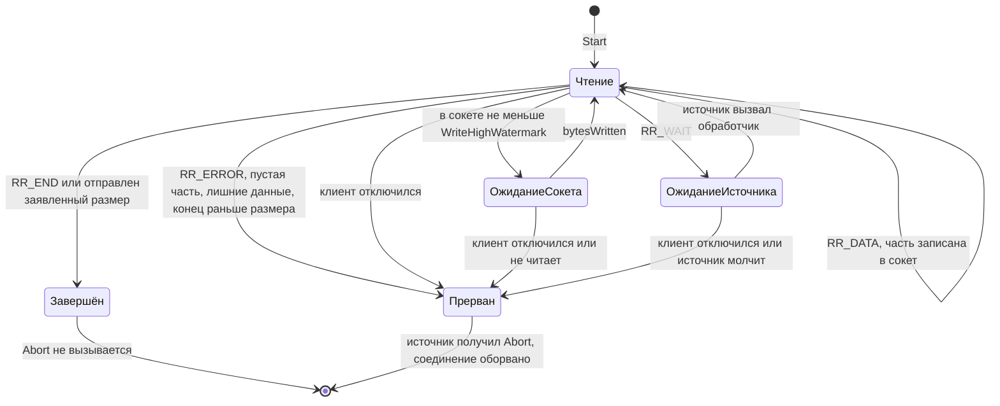

| Событие | Что происходит |
|---|---|
| Клиент отключился посреди ответа | `Abort()` источника сразу, а не по таймауту |
| Клиент не читает дольше `RequestInactivityTimeoutMs` | Сторож обрывает соединение, источник получает `Abort()` |
| `Read()` вернул `RR_ERROR` | Соединение обрывается, `Abort()` |
| Источник закончился раньше `GetBodySize()` | Соединение обрывается: голова обещала больше. `Abort()` |
| Источник отдал больше, чем просили (`maxSize`) или пустую часть | Соединение обрывается: нарушен контракт. `Abort()` |
| Источник имеет больше данных, чем `GetBodySize()` | Лишнее не читается: отправитель не просит больше, чем осталось до заявленного размера |
| `CreateBodySource()` вернул `nullptr` (нет файла, нет прав) | Заголовки ещё не отправлены, клиент получает `500` |
| Ответ получен, когда соединение уже закрывается (например, `503` по таймауту обработки) | Ответ отбрасывается, источник не создаётся |

#### 7. Следующий запрос после потокового ответа

Запросы одного соединения обрабатываются по одному (шаг 1.5), поэтому следующий запрос разбирается, когда **всё** тело
отправлено. Данные следующего запроса ждут в сокете. Если клиент прислал запрос раньше, чем получил тело, он не теряется.

### Как реализовать свой источник и ответ

Пример: ответ из файла. Общий готовый вариант (`CFileRangeBodySource`, `CHttpStreamingResponse`) появится в шаге 1.10,
здесь — минимальный, чтобы показать контракт:

```cpp
class CFileBodySource: virtual public imtrest::IResponseBodySource
{
public:
	explicit CFileBodySource(std::unique_ptr<QFile>&& filePtr)
		:m_filePtr(std::move(filePtr))
	{
	}

	// reimplemented (imtrest::IResponseBodySource)
	ReadResult Read(QByteArray& data, qint64 maxSize) override
	{
		data.resize(qsizetype(maxSize));

		const qint64 count = m_filePtr->read(data.data(), maxSize);
		if (count < 0){
			return RR_ERROR;
		}

		if (count == 0){
			return RR_END;
		}

		data.resize(qsizetype(count));

		return RR_DATA;
	}

	void SetDataAvailableHandler(const DataAvailableHandler& /*handler*/) override
	{
		// Файл всегда готов, ждать нечего
	}

	void Abort() override
	{
		m_filePtr->close();
	}

private:
	std::unique_ptr<QFile> m_filePtr;
};


class CFileResponse: public imtrest::CHttpResponse, virtual public imtrest::IStreamingResponse
{
public:
	CFileResponse(const QString& filePath, qint64 size, const imtrest::IProtocolEngine& engine)
		:imtrest::CHttpResponse(imtrest::IProtocolEngine::SC_OK, QByteArray(), "application/octet-stream", engine),
		m_filePath(filePath),
		m_size(size)
	{
	}

	// reimplemented (imtrest::IStreamingResponse)
	qint64 GetBodySize() const override
	{
		return m_size;
	}

	imtrest::IResponseBodySourcePtr CreateBodySource() const override
	{
		std::unique_ptr<QFile> filePtr(new QFile(m_filePath));
		if (!filePtr->open(QIODevice::ReadOnly)){
			return nullptr;
		}

		return imtrest::IResponseBodySourcePtr(new CFileBodySource(std::move(filePtr)));
	}

private:
	QString m_filePath;
	qint64 m_size;
};
```

Сервлет возвращает такой ответ, как любой другой: `return imtrest::ConstResponsePtr(new CFileResponse(path, QFileInfo(path).size(), engine));`.

Правила для реализаций:

- **Поток.** Все методы источника и `CreateBodySource()` вызываются из потока соединения, поэтому блокировки не нужны, а объекты Qt
  (файлы, сетевые ответы) создаются в том потоке, где ими пользуются.
- **Без ссылки на запрос и ответ.** Ответ может быть удалён сразу после `CreateBodySource()`, запрос — раньше. Источник
  держит всё нужное сам (открытый файл, а не имя файла запроса).
- **Размер.** Источник отдаёт ровно `GetBodySize()` байт. Для неизвестного размера `GetBodySize()` возвращает −1, и источник заканчивает
  ответ `RR_END`.
- **Части.** `RR_DATA` — не меньше одного байта и не больше `maxSize`. Пустая часть — ошибка: в `chunked` она означала бы конец тела.
- **Ожидание.** Если данных нет, `RR_WAIT` и вызов обработчика позже; опрос в цикле не нужен и бесполезен: отправитель не повторяет
  запрос сам, пока обработчик не вызван (или не уйдут данные в сеть).
- **Освобождение.** `Abort()` вызывается не больше одного раза и не вызывается после полного чтения; освобождать ресурсы нужно
  и в деструкторе: источник, который не обрывали, тоже уничтожается.
- **Ошибки.** Ошибку источник сообщает возвратом `RR_ERROR`, а не исключением.

### Настройка

| Атрибут `CTcpServerComp` | По умолчанию | Что делает |
|---|---|---|
| `WriteHighWatermark` | 1 МиБ | Отправитель не читает источник, пока в сокете больше неотправленных данных. Меньше — меньше памяти на соединение и точнее обратное давление, больше — выше пропускная способность на быстрых каналах |

Размер одной части, которую отправитель читает из источника за раз, — 256 КиБ (`CHttpResponseBodyStreamer::s_maxPartSize`).
Максимум неотправленных данных соединения — `WriteHighWatermark` плюс одна часть с рамкой `chunked`.

#### Как работает порог `WriteHighWatermark`

В настройке участвуют два числа, и их часто путают:

| Число | Что это |
|---|---|
| 256 КиБ | Размер **порции**: сколько отправитель за один раз читает из источника и кладёт в буфер сокета. Это не размер пакета в сети и не скорость |
| 1 МиБ (`WriteHighWatermark`) | **Порог**: сколько неотправленных данных может лежать в буфере сокета, пока отправитель продолжает читать источник |

Запись в сокет не блокирует поток: `write()` кладёт данные во внутренний буфер, а в сеть они уходят по мере того, как клиент их
принимает. Сокет сам режет буфер на TCP-сегменты (около 1,5 КБ) и отправляет их непрерывно. Поэтому передача не идёт по схеме
«порция, ожидание, порция»: пока сеть отправляет начало, в буфере уже лежат следующие порции.

Порог защищает от того, что буфер вырастет до размера всего файла. Это происходит, когда сервер читает быстрее, чем клиент
принимает:

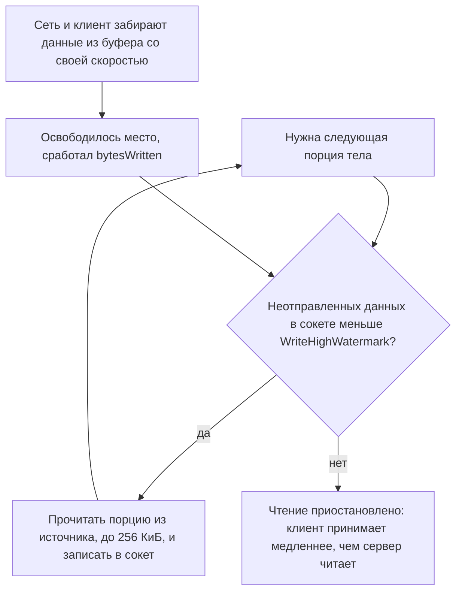

Чтение приостанавливается, когда в буфере **накопилось** `WriteHighWatermark` и больше, и возобновляется, когда в нём снова
**меньше** этого значения. Пример для порога 1 МиБ и медленного клиента:

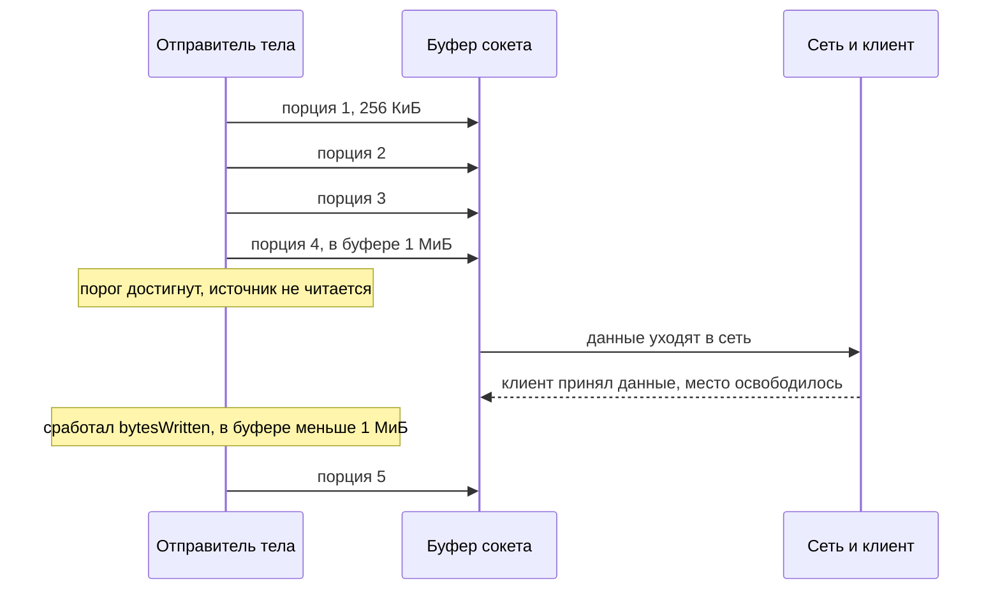

Что из этого следует:

- **Скорость.** Если клиент и сеть быстрые, буфер почти пуст, пауз нет, и сервер передаёт со скоростью канала. Чтение порции 256 КиБ из файла
  занимает порядка миллисекунды, а её передача по каналу в 1 Гбит/с (около 100 МБ/с) — около 2,5 мс, поэтому скорость ограничивает сеть,
  а не схема чтения. Пауза нужна только медленным клиентам.
- **Память.** На одно соединение приходится не больше `WriteHighWatermark` плюс одна порция, то есть около 1,25 МиБ, независимо от размера
  файла. Сто одновременных скачиваний — около 125 МБ, а не сумма размеров всех файлов.
- **Когда порог становится узким местом.** Если данных «в полёте» между сервером и клиентом (произведение пропускной способности на задержку)
  больше `WriteHighWatermark`: чтобы канал был занят полностью, неотправленных данных должно быть не меньше. Например, канал 10 Гбит/с
  (около 1,25 ГБ/с) с задержкой 10 мс: в полёте около 12 МБ, и порог 1 МиБ ограничит скорость. Для обычных каналов до 1 Гбит/с 1 МиБ с запасом
  достаточно; для очень быстрых и дальних каналов атрибут увеличивают. Это оценка по расчёту, замеров скорости нет: реальную
  пропускную способность нужно проверить сценариями 9.1 на файле большого размера.

  Рекомендуемые значения для разных каналов. Расчёт: объём данных в пути (пропускная способность × время кругового обхода RTT),
  округлённый вверх до степени двойки, но не меньше 1 МиБ. RTT 1 мс — локальная сеть, 10 мс — в пределах региона, 50 мс — между регионами.

  | Канал | Скорость | Данных в пути при RTT 1 мс | при RTT 10 мс | при RTT 50 мс | Рекомендуемое значение при RTT 1 / 10 / 50 мс |
  |---|---|---|---|---|---|
  | 1 Гбит/с | около 119 МиБ/с | 0,12 МиБ | 1,2 МиБ | 6 МиБ | 1 МиБ / 2 МиБ / 8 МиБ |
  | 2,5 Гбит/с | около 298 МиБ/с | 0,3 МиБ | 3 МиБ | 15 МиБ | 1 МиБ / 4 МиБ / 16 МиБ |
  | 10 Гбит/с | около 1190 МиБ/с | 1,2 МиБ | 12 МиБ | 60 МиБ | 2 МиБ / 16 МиБ / 64 МиБ |

  Как пользоваться таблицей:
  - **Значение по умолчанию (1 МиБ)** подходит для канала 1 Гбит/с в локальной сети и в пределах региона до 8 мс, а также для 2,5 Гбит/с
    в локальной сети. В остальных случаях значение нужно увеличить.
  - **Память умножается на число одновременных скачиваний.** Порог относится к одному соединению: при 64 МиБ сто скачиваний займут
    около 6,4 ГиБ (плюс по одной части в 256 КиБ). Поэтому порог выбирают по самому быстрому и дальнему каналу, который действительно
    нужно загрузить полностью, а не «с запасом на всякий случай».
  - **Атрибут один на сервер**, а не на клиента: для смешанной нагрузки (быстрые и медленные клиенты) берётся значение для быстрых,
    а медленные клиенты не раздувают память, потому что для них порог всё равно упирается в скорость канала.
  - **Это верхняя оценка.** Часть данных в пути держит и сама операционная система в своём буфере отправки (он подстраивается
    автоматически), поэтому реально достаточное значение может оказаться меньше. Таблица даёт безопасную точку отсчёта; точное значение
    определяют замером в 9.1 (скорость на файле большого размера при разных значениях).
- **Не особенность HTTP/1.1.** Ограничение работает на уровне TCP-сокета и не зависит от версии HTTP: обратное давление (медленный получатель
  тормозит отправителя) есть в любом протоколе поверх TCP. От версии HTTP зависит только способ обозначить конец тела (`Content-Length`, `chunked`).
- **Обычные ответы не затрагиваются.** Они по-прежнему пишутся в сокет целиком. Атрибут ограничивает память только при отдаче ответа по частям.

#### Размер порции (256 КиБ): почему он не настраивается

В отличие от порога, размер порции — константа `CHttpResponseBodyStreamer::s_maxPartSize`, а не атрибут. Сейчас увеличивать его нет смысла.

**Почему сейчас нет смысла.**

- Скорость определяют байты, а не число порций. Копирование данных (чтение в `QByteArray`, буфер сокета, ядро) занимает время,
  пропорциональное объёму. На порцию приходятся только фиксированные накладные расходы: один `read`, один `write` и один оборот цикла
  событий, то есть десятки микросекунд. На канале 10 Гбит/с (около 1,25 ГБ/с) это порядка 5000 порций в секунду; порция в 1 или 4 МиБ
  ускорила бы передачу заметно меньше чем на процент.
- Диск не всегда быстрее сети, но от порции это не зависит. NVMe (2–7 ГБ/с) быстрее даже 10 Гбит/с, SATA SSD (около 0,5 ГБ/с)
  медленнее 10 и 2,5 Гбит/с, HDD (около 150 МБ/с) и сетевое хранилище — медленнее всех каналов, кроме 1 Гбит/с. Узкое место в этих случаях —
  скорость самого носителя, а не размер запроса: порция 256 КиБ уже достаточно велика для последовательного чтения, а ОС
  читает файл вперёд (read-ahead) и держит его в кэше страниц.
- Большая порция вредит: `Read()` источника синхронный и блокирует поток соединения, поэтому чем больше порция, тем дольше цикл событий
  не реагирует на разрыв соединения, `bytesWritten` и таймеры (на HDD и сетевом диске это заметно). Память соединения растёт: порог плюс одна порция.
- Для `chunked` размер куска равен порции, но накладные расходы куска ничтожны (около 10 байт на 256 КиБ): ни выигрыша, ни потери.

**Когда это можно будет пересмотреть.** Только по результатам замеров в 9.1, а не по расчёту. Повод — один из случаев:

| Случай | Что смотреть | Что делать |
|---|---|---|
| Быстрое локальное хранилище (NVMe) и канал 10 Гбит/с и выше, скорость ниже ожидаемой, ядро процессора занято | Профиль: доля времени на цикл событий и вызовы `read`/`write`, а не на копирование данных | Увеличить порцию (например, до 1 МиБ) и сравнить скорость |
| Источник с большими накладными расходами на каждый `Read()` (например, прокси 1.11: каждый вызов — обращение к другому серверу или буферу сетевого ответа) | Число вызовов `Read()` в секунду и их стоимость | Источник может сам копить данные и отдавать крупнее, либо увеличить порцию |
| Включённый TLS на скоростях 10 Гбит/с и выше | Стоимость шифрования части (оно может ограничивать скорость раньше, чем порция) | Проверить зависимость от размера записи; сначала измерить, потом менять |

Если замеры покажут пользу, константу можно сделать атрибутом `CTcpServerComp` рядом с `WriteHighWatermark` (значение по умолчанию остаётся
256 КиБ). Порог при этом нужно держать не меньше одной порции, иначе отправитель будет приостанавливаться после каждой порции.

### Решения, которые стоит знать

- **Голова строится по тем же правилам, что у обычного ответа** (шаг 1.4): `Date`, `Connection`, защита заголовков, `Content-Type`
  по типу данных. Отличие одно: заголовки `Content-Length` и `Transfer-Encoding`, заданные ответом, не используются — как закончить
  тело, решает отправитель, иначе значения могли бы не совпасть с реально отправленными данными.
- **`IRequest::IsChunkedResponseAllowed()`.** Клиентам `HTTP/1.0` `chunked` отправлять нельзя (RFC 9112, §6.1), поэтому запрос
  сообщает версию клиента. Для сообщений каналов (TCP, UDP, WebSocket) метод возвращает `false`: потоковые ответы только для HTTP.
- **`CHttpRootServletComp` не сжимает** потоковые ответы (тела нет в памяти) и ответы с `Content-Range`: заголовок описывает
  позиции несжатого представления (RFC 9110, §14.4), сжатие превратило бы его в неверный.
- **Таймаут обработки (1.5.1).** Если сервер уже ответил `503` на запрос по таймауту, поздний потоковый ответ отбрасывается, источник не создаётся.
- **Только протоколы «запрос — ответ».** Для TCP и WebSocket у поведения соединения нет `createStreamingResponseSender`: `CSocket`
  пишет предупреждение в журнал и отвечает ошибкой протокола, если она у него есть (`SendServerError()`).
- **Статус и заголовки известны сразу.** Они берутся у `IStreamingResponse` как у обычного ответа, до создания источника: голова нужна, чтобы
  выбрать способ передачи тела. Для файла это естественно. Прокси (шаг 1.11), у которого статус и заголовки приходят от другого сервера позже,
  потребует асинхронной головы: это расширение интерфейса делается в шаге 1.11, а не здесь.
- **Не поддерживается:** трейлеры `chunked`, `multipart/byteranges` (шаг 1.8 отвечает одним диапазоном), HTTP/2.

**Совместимость.** Обычные ответы не меняются. `IRequest` получил чисто виртуальный `IsChunkedResponseAllowed()` (реализован в
`CHttpRequest`, `CTcpRequest`, `CUdpRequest`, `CWebSocketRequest`; других реализаций `IRequest` в IMTD нет, внешним реализациям нужно
добавить функцию). `CSocketThread::SetResponseHints()` получил третий параметр. Ответы, не являющиеся `IStreamingResponse`,
отправляются как раньше.

**Проверка.**

`CHttpResponseBodyStreamerTest` (настоящие сокеты, источник с настраиваемым сценарием):

- полное тело: 1 МиБ с известным размером (части источника больше части отправителя; данные совпадают побайтно; источник не просят больше 256 КиБ);
  `chunked` (разбор кусков, все данные, последний кусок в конце, размер без рамки); до закрытия соединения (без рамки, соединение закрывается
  после последнего байта); неположительный `WriteHighWatermark` заменяется значением по умолчанию;
- обратное давление: клиент с маленьким буфером не читает, 32 МиБ тела не читаются заранее (источник прочитан меньше чем наполовину,
  в сокете не больше `WriteHighWatermark` и одной части), после чтения клиентом приходит всё, данные совпадают;
- источник ждёт: `RR_WAIT` в середине, отправлено только доступное, ответ не завершён (фаза «отправка»), после вызова обработчика приходит
  остальное и ответ завершается; отправитель уничтожен до конца ответа — источник получает `Abort()`, а поздний вызов обработчика безвреден;
- заявленный размер: источник с избытком данных читается ровно до заявленного размера; источник закончился раньше — обрыв;
  источник отдал больше просимого — обрыв;
- сбои: `RR_ERROR` (для `chunked` не приходит последний кусок), пустая часть;
- соединение: клиент оборвал соединение посреди ответа (`Abort()` источника сразу), сокет закрыт до старта, клиент не читает и сторож
  обрывает ответ, завершённый отправитель не вызывает `Abort()` при уничтожении и закрытии соединения.

`CSocketTimeoutWatcherTest` (потоковый ответ): голова пишется, фаза «отправка»; пока тело не закончено, ответ не завершён и keep-alive не идёт
даже когда всё записанное ушло; конец тела завершает ответ после отправки последнего байта (в том числе 4 МиБ); ответ в закрываемом соединении
отбрасывается; данные и конец без начала игнорируются; закрытие соединения после тела (`CloseAfterResponse()`); молчание после головы обрывает
ответ; медленное, но идущее тело не обрывается; следующий запрос соединения после потокового ответа.

`CHttpSenderTest` (голова потокового ответа): известный размер (в том числе больше 4 ГиБ), размер 0, неизвестный размер (`chunked`), отрицательный
размер, клиент `HTTP/1.0` (до закрытия, один `Connection`), заданные ответом `Content-Length` и `Transfer-Encoding` не используются, прочие заголовки
(`ETag`, `Content-Range`, `Accept-Ranges`, `Content-Type`) сохраняются, `Connection: close`, ответ на `HEAD` (известный и неизвестный размер, значение ответа),
статусы без тела (`204`, `304`, `205`, `100`), неизвестный статус, недопустимые заголовки; куски `chunked` (текст, один байт, конец строки внутри, двоичные,
границы 255, 256 и 256 КиБ, пустые данные, последний кусок); потоковый ответ разбирается настоящим `http_parser` как клиентом (куски с текстом куска внутри,
300 000 байт, следующий ответ того же соединения).

`CHttpRequestTest`: `IsChunkedResponseAllowed()` для HTTP/1.1 и HTTP/1.0 (с `keep-alive` и без), любые разрывы заголовка между чтениями; сообщения канала — `false`.

`CHttpStreamingResponseSenderTest` (настоящие сокеты и сторож): известный размер (`Content-Length`, данные совпадают), `chunked`, до закрытия соединения
(клиент `HTTP/1.0`: `Connection: close`, без `Content-Length` и `Transfer-Encoding`), признак закрытия соединения; только голова без создания источника
(`HEAD`, размер 0, `304` → `SR_COMPLETED`); отказы без записи (не потоковый ответ, неизвестный статус, источник не создан → `SR_FAILED`; закрытый сокет,
закрываемое соединение → `SR_DROPPED`, источник не создаётся); второй ответ при незавершённом первом отклоняется, а незавершённый источник получает `Abort()`
при уничтожении; обработчик завершения вызывается один раз (в том числе при ошибке источника); следующий ответ после завершённого.

**Не покрыто тестами.** `CSocket::OnSendStreamingResponse()` (вызов отправителя и реакция на `SR_FAILED`, `SR_COMPLETED`, `SR_DROPPED`, следующий запрос),
передача ответа между потоками (`CMultiThreadServer::SendResponse()` → `CSocketThread` → `CSocket`) и атрибут `WriteHighWatermark`: для них нужна собранная
цепочка компонентов. Сценарии добавлены в 9.1.

## 1.10. Отдача файлов — `CHttpFileServletComp`, `IHttpFileResolver`, `CFileRangeBodySource`, `CHttpStreamingResponse`

**Проблема.** Файловые сервлеты читают файл в память целиком (`CHttpHtmlFolderBasedServletComp` — `readAll()`,
`CHttpFileProviderBasedServletComp` — `IBinaryDataProvider::GetData()` в `QByteArray`); `Range` и условные запросы не
поддерживаются.

**Зачем.** Общая основа для сервлетов, отдающих файлы: память не зависит от размера файла, есть докачка и проверка
изменений. Каждый сервлет, который отдаёт файлы, иначе сам разбирал бы `Range`, `If-Range` и условные заголовки, и каждый разбирал бы их
по-своему. Шаги 1.8 (правила) и 1.9 (потоковый ответ) здесь собираются в готовый сервлет.

### Что это такое

| Сущность | Роль |
|---|---|
| `CFileRangeBodySource` | Источник тела (`IResponseBodySource`): отдаёт диапазон байтов файла по частям, не загружая его в память. Файл открывается в `CreateForFile()`, закрывается, когда диапазон прочитан, при `Abort()` и в деструкторе |
| `CHttpStreamingResponse` | `CHttpResponse` + `IStreamingResponse`: статус, заголовки и тип данных как у обычного ответа, а тело создаётся функцией-фабрикой при отправке |
| `CHttpFileServletComp` | Готовый сервлет: `GET`, `HEAD`, `Range`, `If-Range`, условные запросы. Какой файл отдать и можно ли его отдавать, он узнаёт у резолвера по ссылке `FileResolver`; зарегистрирован в `ImtRestPck` как `HttpFileServlet` |
| `IHttpFileResolver` | Интерфейс «найти файл запроса и решить, можно ли его отдать»: один метод `ResolveFile(request, file)` возвращает `SC_OK` и описание файла (путь, тип данных, `ETag`, свои заголовки) или статус отказа. Резолвер пишет заказчик сервлета |

Сервлет не знает ни сокетов, ни потоков, ни того, где лежат файлы и кто имеет право на них: он возвращает ответ, как любой другой сервлет, а отправка по частям — дело `CHttpStreamingResponseSender`
(шаг 1.9). Правила доступа и поиск файла — в резолвере, поэтому один сервлет работает с разными хранилищами, а резолвер проверяется отдельно от HTTP.

### Как сервлет решает, что ответить

Условия проверяются раньше `Range`, как требует RFC 9110, §13.2.2: клиент, у которого есть актуальная копия, получает `304`, а не часть файла.

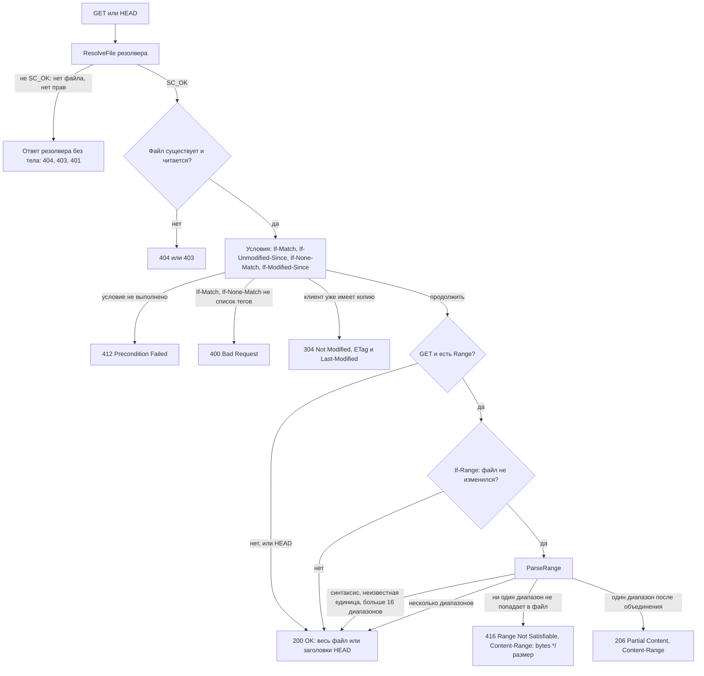

| Ответ | Когда | Тело |
|---|---|---|
| `200` | Нет `Range`, `Range` нельзя применить (неизвестная единица, ошибка синтаксиса, больше 16 диапазонов), `If-Range` не совпал, несколько диапазонов, `HEAD` | Весь файл (для `HEAD` без тела) |
| `206` | Один диапазон (несколько пересекающихся или соприкасающихся объединяются) | Часть файла, `Content-Range: bytes first-last/размер` |
| `304` | `If-None-Match` совпал или `If-Modified-Since` не раньше изменения файла | Нет; `ETag`, `Last-Modified` и заголовки резолвера |
| `412` | `If-Match` не совпал или файл изменён после `If-Unmodified-Since` | Нет |
| `416` | Ни один диапазон не попадает в файл (в том числе любой диапазон пустого файла) | Нет; `Content-Range: bytes */размер` |
| `400` | `If-Match` или `If-None-Match` не список тегов | Нет |
| Статус резолвера | `ResolveFile()` вернул не `SC_OK` | Нет; заголовки, заданные резолвером (например, `WWW-Authenticate`) |
| `404`, `403` | Файла нет или это каталог (`404`), файл нельзя прочитать (`403`) | Нет |
| `500` | К сервлету не подключён резолвер (ошибка сборки) | Нет; в журнале ошибка |

Во всех ответах с описанием файла (`200`, `206`, `304`, `416`) есть `Accept-Ranges: bytes`; для `200`, `206` и `304` — ещё `ETag` и `Last-Modified`.

### Сценарии

#### 1. Докачка файла

Клиент скачал часть файла и просит остаток. `If-Range` защищает от склейки начала старой версии с концом новой:

```mermaid
sequenceDiagram
	participant C as Клиент
	participant S as Сервлет
	C->>S: GET /files/big.iso
	S-->>C: 200, ETag "5a8-1f", Content-Length 10 ГБ, начало тела
	Note over C,S: соединение оборвалось на 3 ГБ
	C->>S: GET, Range bytes=3000000000-, If-Range "5a8-1f"
	alt файл не менялся
		S-->>C: 206, Content-Range bytes 3000000000-9999999999/10000000000, остаток
	else файл заменили
		S-->>C: 200, новый ETag, файл целиком
	end
```

#### 2. Кэш

Клиент хранит копию и спрашивает, не устарела ли она; файл не читается и не открывается, нужны только его размер и время изменения:

```mermaid
sequenceDiagram
	participant C as Клиент
	participant S as Сервлет
	C->>S: GET /files/logo.png, If-None-Match "5a8-1f"
	S-->>C: 304, ETag "5a8-1f", Last-Modified, без тела
```

#### 3. Размер файла: `HEAD` и `416`

`HEAD` возвращает те же заголовки, что и `GET`, включая размер (`Content-Length`), без тела; файл не открывается. Диапазон за пределами файла
получает `416` с размером в `Content-Range: bytes */размер`, по нему клиент может повторить запрос правильно.

### Как подключить свои файлы: резолвер

Свой C++-сервлет писать не нужно: достаточно реализовать `IHttpFileResolver` (какой файл отдать и какими заголовками его сопроводить), подключить его к
`HttpFileServlet` ссылкой `FileResolver` и зарегистрировать сервлет в корневом сервлете. Всё остальное делает сервлет.

```cpp
class CDownloadFileResolverComp:
			public ilog::CLoggerComponentBase,
			virtual public imtrest::IHttpFileResolver
{
public:
	typedef ilog::CLoggerComponentBase BaseClass;

	I_BEGIN_COMPONENT(CDownloadFileResolverComp);
		I_REGISTER_INTERFACE(imtrest::IHttpFileResolver);
		I_ASSIGN(m_rootDirAttrPtr, "RootDir", "Directory of the files", true, "");
	I_END_COMPONENT;

	// reimplemented (imtrest::IHttpFileResolver)
	imtrest::IProtocolEngine::StatusCode ResolveFile(const imtrest::CHttpRequest& request, FileDescription& file) const override
	{
		// 1. Права: только заголовки запроса, тела у GET нет
		if (request.GetHeaderValue("authorization").isEmpty()){
			file.headers.insert("WWW-Authenticate", "Bearer");

			return imtrest::IProtocolEngine::SC_UNAUTHORIZED;
		}

		// 2. Путь: имя файла последний сегмент пути, никаких вложенных каталогов и ".."
		const QByteArray commandId = request.GetCommandId();
		const QString name = QString::fromUtf8(commandId.mid(commandId.lastIndexOf('/') + 1));
		if (name.isEmpty() || (name == QStringLiteral("..")) || name.contains(QLatin1Char('\\'))){
			return imtrest::IProtocolEngine::SC_NOT_FOUND;
		}

		file.filePath = QDir(*m_rootDirAttrPtr).filePath(name);
		file.dataTypeId = "application/octet-stream";
		file.headers.insert("Content-Disposition", "attachment; filename=\"" + name.toUtf8() + "\"");

		return imtrest::IProtocolEngine::SC_OK;
	}

private:
	I_ATTR(QString, m_rootDirAttrPtr);
};
```

Правила для резолвера:

- **Путь файла — ответственность резолвера.** Сервлет отдаёт тот файл, который ему назвали. Защита от `../`, абсолютных путей, символьных
  ссылок за пределы каталога — в `ResolveFile()`. Сервлет проверяет только, что это существующий читаемый файл.
- **Потокобезопасность.** Резолвер вызывается в потоках обработчиков (как любой сервлет), поэтому не должен менять своё состояние без защиты.
- **Размер и время изменения берутся из файловой системы**, а `ETag` по умолчанию — из них (`CreateDefaultETag()`: время изменения с точностью до
  миллисекунды и размер в шестнадцатеричном виде). Резолвер может задать свой `ETag` (например, хэш содержимого, он должен быть сильным: он
  используется для `If-Range`). Тег меняется при замене или правке файла.
- **Свои заголовки** (`Content-Disposition`, `Cache-Control`) кладутся в `file.headers`; не нужно задавать `ETag`, `Last-Modified`, `Content-Range`, `Accept-Ranges`: их
  делает сервлет.
- **Тип данных** — `file.dataTypeId`; пустое значение даёт `application/octet-stream`.
- **Отказ** — вернуть статус вместо `SC_OK`; ответ без тела, заголовки из `file.headers` (например, `WWW-Authenticate`) отправляются и при отказе.
- **Поток.** `ResolveFile()` вызывается в потоке обработчика, а файл открывается позже, в потоке соединения, когда
  отправляется тело. Поэтому ответ держит путь, а не открытый файл, и не ссылается на запрос.

### Решения, которые стоит знать

- **Если файл изменился, пока отправляется ответ.** Длина уже объявлена в голове, поэтому размер файла проверяется при открытии
  (`CFileRangeBodySource::Create()`): если файл стал короче, чем объявлено, источник не создаётся и клиент получает `500`, а не оборванный ответ.
  Если файл укоротили уже во время отправки, соединение обрывается (`RR_ERROR`), и клиент видит неполное тело. Подмена файла на другой того же
  размера не обнаруживается: это то, от чего защищает `ETag` при следующем запросе.
- **`HEAD` не открывает файл.** Ответ собирается из размера и времени изменения; источник тела не создаётся.
- **Несколько диапазонов.** `multipart/byteranges` не поддерживается: пересекающиеся и соприкасающиеся диапазоны объединяются в один (`206`), несколько
  отдельных — `200` со всем файлом (RFC 9110, §14.2 разрешает не поддерживать несколько диапазонов).
- **`Range` только для `GET`.** Для `HEAD` он игнорируется (RFC 9110, §14.2).
- **Пустой файл.** `GET` — `200` с `Content-Length: 0`; любой `Range` — `416`.
- **Другие методы** (`POST`, `PUT`, `DELETE`) отвечают как в `CHttpServletCompBase` (ответ «метод не доступен», без заголовка `Allow`): это отдельная доработка.
- **Старые файловые сервлеты не менялись.** `CHttpHtmlFolderBasedServletComp` и `CHttpFileProviderBasedServletComp` по-прежнему читают
  файл в память; перевод их на новую основу — отдельная работа, она меняет их поведение (заголовки, статусы).
- **Сжатие.** Ответ `CHttpRootServletComp` не сжимает потоковые ответы (шаг 1.9).

**Совместимость.** Только новые сущности, существующие сервлеты и интерфейсы не менялись. `CHttpFileServletComp` — обычный конкретный компонент,
зарегистрирован в `ImtRestPck` как `HttpFileServlet` (не путать с прежним `HttpFileBasedServlet`).

**Проверка.**

`CFileRangeBodySourceTest` (устройства в памяти и настоящие файлы): диапазоны (весь, начало, середина, конец, один байт, пустой), порции
не больше просимого, 3 МиБ файла с диапазоном без выравнивания (побайтное сравнение), чтение с позиции, отличной от начала; отказ
создания (нет устройства, не открыто, нельзя читать, смещение или длина вне файла, отрицательные значения, переполнение суммы, нет файла, каталог);
файл стал короче после создания (ошибка, а не конец); неположительный размер порции; `Abort()`, конец диапазона и деструктор освобождают файл сразу.

`CHttpStreamingResponseTest`: статус, тип данных, размер (в том числе −1) и движок; заголовки; источник создаётся функцией при каждом вызове и не раньше
отправки тела; отсутствие функции и функция, не создавшая источник, дают `nullptr`; источник не зависит от ответа (ответ можно удалить); ответ отправляется
через `IStreamingResponse`.

`CHttpFileStreamingServletTest` (решения без сети, настоящие временные файлы и запросы, разобранные `CHttpRequest`):
- что отправляется: весь файл (заголовки, тело по байтам), `HEAD` (файл не нужен, `Range` игнорируется), диапазоны (начало, с позиции, суффикс,
  конец за файлом, один байт, последний байт, суффикс длиннее файла, единица в верхнем регистре, недостижимый диапазон пропускается), игнорируемые
  значения (неизвестная единица, не число, конец раньше начала, плохой элемент, пустой список, два отдельных диапазона, 17 диапазонов),
  объединение пересекающихся и соприкасающихся, `416` (с `Content-Range: bytes */размер`), пустой файл;
- условия: `If-Range` (тот же тег, другой, слабый, та же дата, позже, раньше, не дата, без `Range`), `If-None-Match` и `If-Match` (тот же, другой, слабый, `*`, список,
  не список), `If-Modified-Since` и `If-Unmodified-Since` (те же, раньше, позже, не дата), `HEAD`, порядок: условие раньше `Range`;
- заголовки: заголовки резолвера в `200`, `206` и `304`, валидаторы только если известны, тип данных, точные байты головы `200`, `206`, `HEAD`, `416`, источник файла,
  ставшего короче или удалённого после ответа (нет источника), `ETag` по умолчанию (стабильный, зависит от размера и времени с точностью до миллисекунды,
  допустимый сильный тег, неизвестное и старое время);
- сервлет (резолвер-заглушка, запросы разобраны `CHttpRequest`): `GET`, `HEAD`, резолвер получает путь запроса, заголовки запроса (регистр имён), `ETag` и `Last-Modified` из файловой системы, свой `ETag`, отказы резолвера (`404`, `403`, `401`)
  без тела, файл не существует или каталог (`404`), заголовки отказа сохраняются; сервлет, собранный без резолвера, отвечает
  `500` на `GET` и `HEAD`.

**Не покрыто тестами.** Отправка настоящему клиенту по сокету (сквозная цепочка `CSocket` → отправитель → источник): сценарии `200`, `206`, `304`, `412`, `416`,
докачка и файл 10 ГБ без роста памяти добавлены в 9.1. Файл, ставший короче во время отправки, проверен на уровне источника, но не на соединении.

## 1.11. Потоковый прокси — `CHttpReverseProxyServletCompBase`, `CHttpUpstreamBodySource`

**Статус: отдельный PR, в текущем PR не делается** (см. П.3). Описание ниже — план.

**Проблема.** Нет способа потоком ретранслировать запрос другому HTTP-серверу.

**Зачем.** Клиент, которому узел недоступен напрямую (NAT, сегментированная сеть), получает и отправляет данные через
центральный сервер. Буферизовать гигабайты на прокси нельзя, а медленный клиент должен тормозить чтение из upstream.

**Решение.** Потомок `CHttpReverseProxyServletCompBase` реализует `ResolveUpstream()` (адрес и дополнительные заголовки);
пересылаются только заголовки из белого списка; `Range` передаётся upstream. `CHttpUpstreamBodySource` — источник ответа
поверх `QNetworkReply` в потоке соединения с ограниченным `setReadBufferSize`, поэтому обратное давление доходит до upstream.

**Проверка.** Ретрансляция с `Range` и обратным давлением.

## 1.13а. TLS сервера: отказ работать без шифрования и цепочка сертификатов — `CTcpServerComp`, `CServerSslTools`, `CSslConfigurationManagerComp`

Сам по себе TLS в `imtrest` работает: сертификат, ключ и протокол из `QSslConfiguration` применяются к принятому соединению
(`CSocket`, `startServerEncryption()`). В 1.13а исправлены три дефекта, которые не зависят от требований конкретных продуктов.

**Проблема.**

- Если при запуске TLS включён, а SSL-конфигурацию создать не удалось (нет файла сертификата или ключа),
  `CTcpServerComp::EnsureServerStarted()` пишет ошибку в журнал и всё равно запускает слушатель, причём без шифрования.
- `CSocket` применял из `QSslConfiguration` только сертификат, ключ и протокол (`setLocalCertificate()`, `setPrivateKey()`, `setProtocol()`):
  цепочка сертификатов и CA терялись, даже если конфигурация их содержала.
- `imtcom::CSslConfigurationManagerComp`, который создаёт конфигурацию из настроек, цепочку не устанавливал: из файла сертификата он брал только первый
  сертификат, а параметры цепочки (`LocalCertChain`, `CaChainCert`) были заглушкой (`\todo`), которая писала «not supported yet» и всегда делала
  конфигурацию неудачной. Нечитаемый файл давал нулевой сертификат без ошибки.

**Зачем.**

- Незаметный переход на HTTP — токены и данные открытым текстом: администратор включил шифрование, а клиенты
  могут не заметить, что его нет. Ошибка запуска лучше тихого нарушения защиты.
- Сертификат, выданный через промежуточный УЦ, клиенты без промежуточного сертификата (в том числе Qt-клиенты) проверить не
  могут: сервер должен отдавать цепочку вместе с своим сертификатом.

**Решение.**

- `EnsureServerStarted()` возвращает `false` и не запускает слушатель, если TLS включён, а конфигурация не создана;
  ошибка записывается в журнал. Если TLS выключен или параметра нет, сервер работает по HTTP, как и раньше.
- `CServerSslTools::ApplyConfiguration(socket, configuration)` заменил три сеттера в `CSocket`. Он берёт конфигурацию самого сокета (в нём
  шифры по умолчанию) и накладывает на неё цепочку сертификатов (первый — сертификат сервера), закрытый ключ, протокол и
  CA-сертификаты. Поле, которого в конфигурации нет, не меняется.
- Почему не `socket.setSslConfiguration(configuration)` целиком: конфигурация сервера создаётся «с нуля» (`QSslConfiguration()`, а не на основе
  `QSslConfiguration::defaultConfiguration()`), её пустой список шифров заменил бы шифры по умолчанию, и рукопожатие не нашло бы
  общего шифра. Поэтому поля переносятся по одному.
- Режим проверки клиента не меняется: для сервера он остаётся автоматическим (клиентский сертификат не запрашивается), а
  отдельная настройка появится в 1.13б, чтобы не изменить поведение существующих серверов.
- Менеджер конфигурации устанавливает цепочку (`CSslConfigurationManagerComp::CreateSslConfiguration()`):
  - файл или данные `LocalCert` читаются целиком: в PEM-файле может быть цепочка, как в `fullchain.pem`. Первый сертификат — сертификат сервера,
    остальные — промежуточные, они идут за ним в том же порядке;
  - параметр `LocalCertChain` (список наборов параметров, каждый — файл или данные) добавляет промежуточные сертификаты после тех, что в файле;
    повторы пропускаются (`ComposeCertificateChain()`). Если `LocalCert` не задан, первый сертификат `LocalCertChain` считается сертификатом сервера.
    Пустой `LocalCertChain` — не ошибка;
  - так же читаются CA-сертификаты: все сертификаты файла `CaCert` и список `CaChainCert`;
  - нечитаемый файл и файл, в котором нет сертификатов, — ошибка конфигурации: сервер не запускается (раньше получался нулевой сертификат, и
    каждое рукопожатие заканчивалось отказом).
- Формат цепочки: сертификат сервера первым, затем промежуточные (RFC 8446, §4.4.2: каждый следующий сертификат удостоверяет предыдущий). Корневой УЦ
  в цепочку класть не нужно: он у клиента есть.

**Совместимость.** Сервер с включённым, но не настроенным TLS перестаёт запускаться без шифрования (раньше работал
по HTTP). Сервер, у которого сертификат не читается или не содержит сертификатов, тоже не запускается (раньше работал с нулевым сертификатом,
и рукопожатия не удавались). Для серверов с правильной конфигурацией поведение не меняется: сертификат, ключ и протокол применяются так же;
файл с несколькими сертификатами теперь отдаёт клиенту цепочку целиком, а не только первый сертификат.

**Проверка.** `CServerSslToolsTest` (сокет без соединения, два тестовых самоподписанных сертификата без закрытых ключей):
цепочка из двух сертификатов (порядок, сертификат сервера первый), одиночный сертификат, протокол, CA-сертификаты,
пустая конфигурация не заменяет шифры сокета, отсутствующие поля не меняют то, что было у сокета.

`CSslCertificateChainTest` (менеджер конфигурации, параметры из настоящих классов ACF, временные PEM-файлы): сборка цепочки (сертификат сервера первый,
повторы не добавляются, без сертификата сервера первым становится первый сертификат параметра, пустая); чтение всех сертификатов файла и данных,
одиночный сертификат, нет файла, файл без сертификатов; конфигурация: файл с цепочкой даёт цепочку из двух сертификатов, одиночный сертификат,
сертификат не задан, нет файла и файл без сертификатов — ошибка, файл CA с двумя сертификатами, пустой путь CA — не ошибка.

**Не покрыто тестами.** Закрытый ключ (в репозитории не хранятся ключи, даже тестовые; строка применения ключа та же, что
была), чтение списков `LocalCertChain` и `CaChainCert` (для менеджера параметров нужна его реализация или сборка компонентов), отказ
`EnsureServerStarted()` при ошибке конфигурации (нужна сборка компонентов) и настоящее TLS-рукопожатие с цепочкой
— в 9.1.

## 1.13б. TLS сервера: замена сертификата, самоподписанный сертификат, отпечаток

**Статус: отдельный PR, в текущем PR не делается** (см. П.4). Описание ниже — план. Это доработки по требованиям
продуктов, которым нужен TLS на всех каналах; на работу обычного сервера на `imtrest` они не влияют.

**Проблема.**

- Сертификат нельзя заменить на работающем слушателе: `CMultiThreadServer::SetSslConfiguration()` отказывает, поэтому
  `CTcpServerComp` при изменении SSL-параметров закрывает порт и открывает заново. Принятые соединения не обрываются,
  но пока порт закрыт, новые подключения отклоняются.
- Сертификата по умолчанию нет: без выпуска сертификата TLS не включить.
- Запрос не знает сертификат своего соединения: `CHttpRequest::ExecuteHttpParser()` видит `QSslSocket`, но использует его
  только для схемы URL.

**Зачем.**

- Сертификаты истекают и перевыпускаются; замена не должна закрывать порт.
- Сервисы, где TLS включён всегда, должны запускаться без ручного выпуска сертификата.
- Привязка аутентификации к каналу: клиент включает в доказательство SHA-256 сертификата, который видел на этом соединении
  (как `tls-server-end-point`, RFC 5929), а сервер сверяет его с сертификатом соединения. Посредник со своим сертификатом не
  сможет переслать доказательство.

**Решение.**

- Конфигурация заменяется на работающем слушателе: новые соединения получают новый сертификат, начатые не обрываются.
- Режим проверки клиента — отдельной
  настройкой, чтобы не изменить поведение существующих серверов.
- Самоподписанный сертификат, если сертификат не задан (включается явно).
- `CHttpRequest` отдаёт отпечаток (SHA-256) сертификата своего соединения.
- Минимальная версия протокола уже настраивается параметром `Protocol` (`imtcom::ISslConfigurationManager`), её
  дорабатывать не нужно.

**Проверка.** Подключение по TLS 1.3 с цепочкой; после замены сертификата новые соединения получают новый, начатые
не обрываются; порт при замене не закрывается; отпечаток в запросе совпадает с сертификатом соединения.

## 1.16. Динамическая политика тела — `CHttpDynamicBodyPolicyComp`, `CHttpTemporaryFileBodySink`

**Статус: реализовано в этом PR.** Работает на `IHttpRequestBodyPolicy` (1.6) и `IHttpRequestBodySink` (1.7), их не меняет.

**Проблема.** Режим приёма тела (в память или в файл) политика выбирает заранее, по пути запроса (1.6, 1.7). Сервер, на который
приходят и маленькие запросы (JSON, GraphQL), и большие файлы, оказывается между двух плохих вариантов:

- всё в память: один запрос в гигабайты занимает гигабайты памяти, поэтому лимит `MaxBodySize` приходится делать маленьким, и большие
  файлы не принимаются вовсе;
- всё в файл: каждый маленький запрос создаёт файл на диске, а сервлет не получает тело из `GetBody()`.

Кроме того, лимит размера — просто число и никак не связан с диском. Тело, которое не помещается, начинает приниматься и обрывается
посреди загрузки ошибкой записи (`500`), когда диск уже заполнен целиком.

**Зачем.** Размер тела известен из заголовков до его приёма, значит, режим можно выбирать по размеру: маленькое — в память, большое —
на диск. А размер большого тела нужно ограничивать реальным свободным местом, чтобы загрузка не заполнила диск: принимать можно только
то, что поместится так, чтобы на диске осталась заданная доля свободного места (по умолчанию 10%).

**Решение.** Компонент `CHttpDynamicBodyPolicyComp` (пакет `ImtRestPck`, компонент `HttpDynamicBodyPolicy`) — политика, которая
решает по размеру тела. Все значения — атрибуты компонента, их можно менять в Compositor:

| Атрибут | По умолчанию | Смысл |
|---|---|---|
| `MemoryBodyLimit` | `104857600` (100 МиБ) | Тело до этого размера включительно принимается в память, больше — в файл. `0` — каждое непустое тело идёт в файл |
| `MaxBodySize` | `0` | Размер тела, больше которого запрос отклоняется с `413` в любом режиме. `0` — другого лимита нет (остаётся лимит по свободному месту для тел, которые идут в файл) |
| `FreeSpaceReservePercent` | `10` | Доля диска (в процентах его размера), которая остаётся свободной после записи тела. `0` — диск можно заполнить целиком |
| `BodyDirectory` | нет, обязательная ссылка на `ifile::IFileNameParam` | Каталог файлов тел задаёт параметр-компонент, а не строка: например, `SystemLocation` (пакет `FilePck`) со значением `LocationType = 7` даёт каталог временных файлов системы. Свободное место диска каталога ограничивает размер тела. Путь читается один раз, при создании компонента; каталог создаётся, если его нет. Пустой путь или не заданная ссылка — ошибка настройки: в журнал пишется сообщение, а тела, которые не идут в память, отклоняются с `500` |

```mermaid
flowchart TD
	H[Заголовки запроса] --> N{Есть ли тело}
	N -->|нет тела или Content-Length 0| M[Память: BM_BUFFER]
	N -->|есть| X{Больше MaxBodySize}
	X -->|да| R1[413 до тела]
	X -->|нет| L{Размер известен}
	L -->|да, не больше MemoryBodyLimit| M
	L -->|chunked: размер неизвестен| F
	L -->|да, больше MemoryBodyLimit| D{Помещается на диск с резервом}
	D -->|да| F[Файл: BM_STREAM, тело пишется по частям]
	D -->|нет| R2[413 до тела]
```

Что решает политика:

| Тело (по заголовкам) | Решение |
|---|---|
| Нет тела (`GET`) или `Content-Length: 0` | Память. Диск не используется |
| Больше `MaxBodySize` (если он задан) | `413` до приёма тела |
| Не больше `MemoryBodyLimit` | Память (`BM_BUFFER`), лимит запроса — `MemoryBodyLimit`; тело читается через `CHttpRequest::GetBody()` |
| Больше `MemoryBodyLimit` и помещается на диск | Файл (`BM_STREAM`): файл создаётся до приёма тела, тело пишется по частям, память не растёт; тело читается через `CHttpRequest::GetBodySink()` |
| Больше `MemoryBodyLimit` и не помещается на диск | `413` до приёма тела: клиент его не отправляет |
| `Transfer-Encoding: chunked` (размер неизвестен) | Файл. Лимит проверяется во время приёма: как только принято больше лимита, запрос получает `413` и файл удаляется |
| Каталог недоступен или свободное место не определяется | `500`: это ошибка настройки сервера, а не клиента |

`Content-Length` читается по RFC 9112 (раздел 6.3): `Transfer-Encoding` отменяет `Content-Length`, значение, которое не состоит только из цифр
или не помещается в `qint64`, считается неизвестным размером.

**Как считается лимит по свободному месту.**

`лимит = свободно − (размер диска × FreeSpaceReservePercent / 100) − место, которое удерживают другие загрузки`

`свободно` — место, доступное программе (`QStorageInfo::bytesAvailable()`), `размер диска` — `QStorageInfo::bytesTotal()`. Пример:
диск 1 ТБ, свободно 300 ГБ, резерв 10% (100 ГБ) — принимается тело до 200 ГБ; после него на диске останется 100 ГБ, то есть 10%.
Если свободного места меньше резерва, лимит равен `0`, и тела, которые не помещаются в память, отклоняются. Диск читается только для тел,
которые идут в файл: маленькие запросы его не трогают.

**Параллельные загрузки.** Тела принимаются одновременно в разных потоках, и каждое по отдельности помещается в свободное место, а вместе —
нет. Поэтому политика ведёт счётчик места, которое ещё не занято телами, принимаемыми в файлы:

- тело с известным размером удерживает его целиком в момент решения; проверка и удержание — одна атомарная операция, поэтому
  одновременные запросы не могут удержать больше лимита;
- записанные байты снимаются со счётчика: диск уже учёл их в свободном месте, второй раз их считать нельзя;
- `Finish()`, `Abort()` и уничтожение приёмника освобождают остаток, поэтому обрыв, отказ и тело короче объявленного не оставляют
  удержанного места;
- счётчик живёт в `std::shared_ptr`, который держат и политика, и приёмники: приёмник, который сервлет оставил себе, безопасно
  переживает политику;
- тело неизвестного размера (`chunked`) место не удерживает, но не занимает то, что удержали другие.

Лимит — «лучшее усилие»: пока тело принимается, диск могут заполнять другие программы.

### Приёмник `CHttpTemporaryFileBodySink`

Режим «в файл» нужен без заранее известного имени файла, поэтому добавлен приёмник, который пишет тело в новый временный файл
(`QTemporaryFile`) каталога `BodyDirectory`. Отличие от `CHttpFileBodySink` (1.7): у того имя целевого файла задаёт политика, и файл
появляется при `Finish()` атомарной заменой; у этого имя выбирается при создании, а файлом владеет сам приёмник, пока не отдаст его.

| Метод | Что делает |
|---|---|
| `Open()` | Создаёт файл (на Unix с правами только владельца) и даёт ему имя. Политика вызывает его до приёма тела: если файл создать нельзя (нет каталога или прав), запрос отклоняется с `500`, и клиент не отправляет тело. Повторный вызов ничего не делает |
| `Write()`, `Finish()`, `Abort()` | Контракт `IHttpRequestBodySink` (1.7). `Finish()` закрывает файл и сообщает об ошибке записи последней порции; `Abort()` удаляет файл, если его не забрали |
| `GetFilePath()` | Путь к файлу, пока он у приёмника. Пуст до `Open()`, после `Abort()` и после `TakeFile()` |
| `GetReceivedSize()`, `IsFinished()`, `GetErrorString()` | Сколько байтов записано; принято ли тело целиком (остаётся `true` и после `TakeFile()`); описание последней ошибки |
| `TakeFile()` | Отдаёт файл новому владельцу объектом `std::unique_ptr<QTemporaryFile>`. Только после `Finish()`, иначе `nullptr` |

**Имя файла: параллельные приёмы не мешают друг другу.** `temp-file-body-XXXXXX` — не имя файла, а шаблон. `QTemporaryFile` заменяет
`XXXXXX` шестью случайными символами (например, `temp-file-body-FNgCss`) и создаёт файл, только если файла с таким именем ещё нет:
существующий файл не открывается и не перезаписывается, а если имя занято, подбирается другое. Это гарантия Qt: имя временного файла
уникально, перезаписать существующий файл нельзя. Поэтому:

- любое число одновременных приёмов получает разные файлы: 50 загрузок в один момент — 50 файлов, в каждом своё тело, и затереть
  чужой файл приёмник не может;
- это верно для потоков одного сервера и для нескольких процессов с общим `BodyDirectory`: уникальность обеспечивает создание файла, а
  не проверка «нет ли такого имени» перед ним.

Файл с таким именем создаётся при `Open()` и остаётся в `BodyDirectory`, пока им владеет приёмник (или тот, кому его передали). Qt на Linux
сначала создаёт файл без имени и называет его при первом запросе имени; приёмник называет файл сразу в `Open()`, поэтому на любой системе
файл виден в каталоге с момента создания, а если имя дать нельзя, отказ видит политика, а не сервлет.

**Кто владеет файлом и когда он удаляется.**

```mermaid
stateDiagram-v2
	[*] --> Создан: политика создала приёмник, файл создан, место удержано
	Создан --> Приём: Write()
	Приём --> Принят: Finish(), место освобождено, файл остаётся для сервлета
	Приём --> Удалён: Abort(), файл удалён, место освобождено
	Принят --> Удалён: запрос уничтожен, файл удалён вместе с приёмником
	Принят --> Передан: TakeFile(), файл у нового владельца, приёмник его больше не трогает
	Удалён --> [*]
	Передан --> [*]
```

| Ситуация | Что с файлом |
|---|---|
| Обрыв соединения, отказ во время приёма (`413`), ошибка записи | Удаляется сразу: запрос вызывает `Abort()` |
| Тело принято, сервлет файл не взял | Остаётся, пока жив приёмник, и удаляется вместе с ним. Приёмник держит запрос, а запрос после обработки уничтожает `CWorkerManagerComp`; помнить об удалении никому не нужно |
| Сервлет вызвал `TakeFile()` | Файл принадлежит новому владельцу. Приёмник его больше не трогает: ни `Abort()`, ни уничтожение приёмника файл не удаляют |
| Процесс завершён аварийно | Файл остаётся на диске (см. «Ресурсы и аварийное завершение») |

**`TakeFile()`: передать файл другому владельцу.** Если сервлет хочет оставить файл себе (переместить в хранилище, передать другому
компоненту), он забирает его объектом:

```cpp
std::unique_ptr<QTemporaryFile> TakeFile();   // nullptr, пока тело не принято целиком
```

- Файл неполного тела отдать нельзя: до `Finish()`, после `Abort()` и при повторном вызове метод возвращает `nullptr`. Это защита в коде,
  а не договорённость между разработчиками.
- После вызова приёмник файл не трогает: `GetFilePath()` пуст, а `Write()`, `Finish()` и `Open()` возвращают `false` и новый файл
  взамен забранного не создают. `IsFinished()` и `GetReceivedSize()` по-прежнему описывают принятое тело.
- Владение выражено типом: у кого `std::unique_ptr`, тот и отвечает за файл. Если результат отбросить, файл удалится вместе с объектом
  (так устроен `QTemporaryFile`), а не останется на диске, как остался бы при передаче голого пути.
- Файл можно читать через тот же объект, не открывая его заново по пути.
- **Вызов не меняет состояние `QTemporaryFile`.** Это тот же объект, который приёмник записал и закрыл в `Finish()`: файл закрыт
  (`open()` открывает тот же файл заново), имя прежнее, удаление файла при уничтожении объекта включено (`autoRemove()` равно `true`).
  Что новый владелец сделает с файлом дальше, зависит только от него: приёмник об этом не заботится.

**Как сервлет читает тело.** Тело либо в памяти запроса, либо в файле приёмника:

```cpp
const std::shared_ptr<imtrest::CHttpTemporaryFileBodySink> sinkPtr =
			std::dynamic_pointer_cast<imtrest::CHttpTemporaryFileBodySink>(request.GetBodySink());
if (sinkPtr == nullptr){
	// Тело небольшое и принято в память
	const QByteArray body = request.GetBody();
}
else{
	// Тело большое и записано в файл: sinkPtr->GetFilePath(), sinkPtr->GetReceivedSize().
	// Читать его нужно по частям, не загружая в память целиком. Файл удалится вместе с запросом.
	// Чтобы оставить файл себе, его нужно забрать вместе с ответственностью за него:
	std::unique_ptr<QTemporaryFile> filePtr = sinkPtr->TakeFile();
}
```

**Ресурсы и аварийное завершение.**

- Дескриптор. `QTemporaryFile` держит файл открытым, пока существует объект, в том числе после `close()` (так написано в документации Qt).
  Поэтому каждый приём, который ещё не освобождён, занимает один дескриптор, и 50 одновременных приёмов — это 50 дескрипторов в
  дополнение к сокетам. Серверу с большим числом параллельных загрузок нужен достаточный лимит дескрипторов процесса (`ulimit -n`).
- Потоки. Файл создаётся в потоке соединения, а освобождается там, где уничтожается запрос (`CWorkerManagerComp`), то есть в другом
  потоке. `QTemporaryFile` — `QObject`: передача из потока в поток по очереди (создал один, уничтожил другой) работает и проверена
  тестом, а одновременное использование одного объекта из двух потоков, как и любого `QIODevice`, запрещено. Приёмник не потокобезопасен:
  им пользуется одно соединение.
- Аварийное завершение. При нормальной работе файлы не остаются. Если процесс убит (`kill -9`, падение, отключение питания), деструкторы
  не выполняются, и файлы принимаемых тел остаются в `BodyDirectory`. Автоматической очистки при запуске нет: каталог могут делить
  другие процессы, и чужие файлы удалять нельзя. Поэтому `BodyDirectory` стоит выделять только под тела, а старые файлы
  `temp-file-body-*` убирать средствами эксплуатации (например, по расписанию).

**Как подключить.** Политика — обычный компонент `IHttpRequestBodyPolicy`: ссылка `BodyPolicy` у `HttpProtocolEngine` либо элемент
`Policies` у `HttpBodyPolicyRouter` (1.6), когда динамическая политика нужна только части путей (остальным путям решает
`DefaultPolicy` роутера). Каталог для файлов подключается обязательной ссылкой `BodyDirectory`: для каталога временных файлов системы
достаточно компонента `SystemLocation` со значением `7`. Значения по умолчанию подходят для
сервера с файлами в гигабайты; для проверки на маленьких файлах `MemoryBodyLimit` и `MaxBodySize` уменьшают. Пример — демонстрационный
сервер (9).

**Решения, которые стоит знать.**

- Тело `chunked` всегда идёт в файл, даже маленькое: размер заранее неизвестен, а память — ресурс, который нужно защищать. Клиенты, которые
  без нужды отправляют `chunked` (потоковые библиотеки), создают временный файл на каждый запрос; после запроса файл удаляется.
- Отказ — `413` (в RFC 9110, раздел 15.5.14, он называется Content Too Large, раньше — Payload Too Large): стандарт относит к нему и тело,
  которое сервер «не желает» принимать, и то, которое он «не способен» обработать; тот же статус запрос выдаёт при превышении лимита во
  время приёма, поэтому для клиента все отказы по размеру одинаковы. `507 Insufficient Storage` описан в RFC 4918 (WebDAV) и здесь не
  использован.
- Для запроса лимит `0` означает «без лимита», поэтому политика не может отдать запросу нулевой лимит: если для файла нет места, она
  отказывает сама. По той же причине при `MemoryBodyLimit = 0` пустому телу назначается лимит `1` (байтов в нём всё равно нет).
- `MemoryBodyLimit` и `MaxBodySize` — `int` в байтах, как `MaxBodySize` у `CHttpProtocolEngineComp`, поэтому не больше 2 ГиБ. Для файлов
  больше нужен лимит по свободному месту (`MaxBodySize = 0`): он считается в `qint64`.
- Каталог — не строка, а `ifile::IFileNameParam`, и ссылка обязательна: каталог задаётся явно, а не подразумевается. Поэтому пустой
  путь не означает «временный каталог системы» (раньше означал) и не означает «текущий каталог»: это ошибка настройки, и такие тела
  отклоняются с `500`. Путь читается один раз при создании компонента: политику вызывают из многих потоков, и каталог не должен
  меняться под принимаемым телом, поэтому позднее `SetPath()` параметра на неё не влияет. Параметр-компонент `SystemLocation` отдаёт путь,
  который вычислил при своём создании.
- Размер диска и свободное место читаются для каждого тела, которое идёт в файл, новым объектом `QStorageInfo` (общий объект
  потоками делить нельзя). Диск не читается для тел в памяти.
- Запись идёт через буфер `QFile`: последняя часть тела меньше 16 КиБ попадает на диск, когда файл закрывается в `Finish()`. Поэтому размер
  файла на диске во время приёма может быть меньше принятого на эту часть; ошибку записи последней части (например, на заполнившемся
  диске) приёмник сообщает из `Finish()`, и запрос получает `500`.

**Совместимость.** Новые классы; существующие интерфейсы, политики и приёмники не менялись. Поведение серверов без этой политики не
меняется.

**Проверка.** `CHttpDynamicBodyPolicyTest`: разбор размера тела из заголовков (в том числе `Transfer-Encoding`, не числа, переполнение),
расчёт лимита (границы, округление, диск размером 8 ЭиБ без переполнения), выбор режима на границах (`MemoryBodyLimit`, `MaxBodySize`,
`0`), `chunked`, резерв всего диска, тело, которое не помещается и помещается (по свободному месту диска теста), параллельные загрузки,
освобождение места при `Finish()`, `Abort()`, уничтожении приёмника и после `TakeFile()`, приёмник, переживший политику, каталог (создание, недоступный,
пустой путь и не заданная ссылка — `500`, `SystemLocation` как каталог, путь читается при создании компонента) и сквозные сценарии через
`CHttpRequest` (в том числе `Expect: 100-continue` и обрыв). `CHttpTemporaryFileBodySinkTest`: файл и его
уникальное имя (50 приёмников одновременно, в каждый пишется своё тело; 50 потоков создают файлы в один момент и освобождают их в другом
потоке), запись по частям, пустое и большое тело, права, удаление вместе с приёмником, `TakeFile()` (до `Finish()`, после `Abort()`,
повторный вызов, состояние объекта не меняется, файл удаляется вместе с новым владельцем, приёмник после передачи, файл переживает запрос),
`Abort()`, ошибки и
неправильное использование, сквозные сценарии через `CHttpRequest` (в том числе `chunked`, обрыв, отказ).

## CORS — `CHttpCorsPolicyComp` (по необходимости)

**Проблема.** Сервер не отвечает на preflight-запросы `OPTIONS` и не выставляет заголовки `Access-Control-*`.

**Зачем.** Браузер не даст веб-клиенту обратиться к серверу с другого origin (например, напрямую к узлу-хранилищу) и не
покажет скрипту `Content-Range` и `ETag`.

**Решение.** Компонент политики: разрешённые origin, методы и заголовки, `Access-Control-Expose-Headers`; включается явно.

## 9. Сквозное тестирование HTTP-инфраструктуры (последний этап)

**Статус: реализовано в этом PR** (что не покрыто — в конце раздела). Этап проверяет шаги 1.1–1.10 и 1.13а вместе, на собранном
сервере и на живых соединениях.

**Проблема.** Unit-тесты проверяют классы по отдельности (автомат таймаутов, сторож на паре сокетов, разбор запроса). Собранная
цепочка `CTcpServerComp` → `CMultiThreadServer` → `CSocketThread` → `CSocket` → сервлет → ответ оставалась без тестов: `CSocket`
создаётся внутри потока сокета, атрибуты компонента задаются при сборке, а ошибки на стыках (порядок событий, потоки, очередь
ответов между потоками) не видны ни одному unit-тесту.

**Зачем.** Это критичная часть фреймворка, и каждый шаг этапа 1 меняет поведение на стыке слоёв: таймауты, HTTP/1.1,
постоянные соединения, потоковые тела, `Range`. Один набор сценариев на настоящем сервере ловит регрессии, которые не ловит ни
один unit-тест, и служит исполняемым описанием поведения.

### Что сделано

Всё лежит в одной статической библиотеке `imtrestdemo` (`Include/imtrestdemo`), которую используют два приложения и тесты:

| Часть | Что это |
|---|---|
| `ImtRestDemoServer.acc` | Партитура демонстрационного сервера на `imtrest` (открывается в Compositor): компоненты `CTcpServerComp`, `CHttpProtocolEngineComp`, `CWorkerManagerComp`, `CHttpRootServletComp`, `CHttpBodyPolicyRouterComp`, `CHttpFileServletComp`, политики тел и сервлеты демонстрации, настройки TLS. Компоненты демонстрации — пакет `ImtRestDemoPck` (`Impl/ImtRestDemoPck`). Конфигурация — `Config/ImtCore.awc`. Главный файл сервера (класс `CImtRestDemoServer`) генерирует `arxc` при сборке `ImtRestDemoServer` (`ARXC_FILES`, `ARXC_CONFIG` в `Impl/ImtRestDemoServer/CMake/CMakeLists.txt`). Порт, каталоги, токен, таймауты, лимиты и параметры TLS — экспортируемые атрибуты партитуры |
| `CDemoServer` | Код вокруг сгенерированного класса (`Include/imtrestdemo`): задаёт атрибуты партитуры, запускает прослушивание, принимает изменения настроек через `/admin/settings` и перезапускает сервер; класс создаёт `DemoCompositionFactory` (`CreateDemoCompositionFactory<CImtRestDemoServer>()`), поэтому библиотека не зависит от сгенерированного файла: приложение и тесты (`Include/imtrestdemo/Test/CMake/CMakeLists.txt`) генерируют `CImtRestDemoServer` из одной и той же партитуры. Перед уничтожением компонентов закрываются соединения и останавливаются рабочие потоки (`IDemoComposition::ShutdownConnections()`) |
| Сервлеты демонстрации | `/echo` (разбор запроса сервером), `/info`, `/files/*` (`CHttpFileServletComp` и `CDemoFileResolverComp`), `/upload/*` (приём файла частями на диск, `CDemoBodyPolicyComp` и `CDemoUploadSink` с SHA-256), `/stream/<размер>` (генерируемое тело любой длины, в том числе медленное и без объявленной длины), `/behavior/*` (статусы, исключение сервлета, долгая обработка, заголовки, которыми должен управлять сервер, большое тело в памяти), `/refuse` (отказ до тела), `/admin/settings` (чтение и изменение настроек работающего сервера, нужен токен) |
| `ImtRestDemoServer` | Приложение: запускает сервер `CImtRestDemoServer`, сгенерированный из партитуры, с параметрами командной строки (`--port`, `--files-dir`, `--threads`, `--inactivity-timeout`, `--keep-alive-timeout`, `--processing-timeout`, `--max-body-size`, `--token`, `--log`, `--tls`, `--tls-cert`, `--tls-chain`, `--tls-key`, `--tls-preset`, `--tls-samples`, `--no-tls-presets`, `--tls-storage`, `--openssl`; те же настройки можно менять на работающем сервере через `/admin/settings`) |
| `CDemoClientController` | Логика клиента без зависимости от QML: отправка запросов (`QNetworkAccessManager`: текст, файл или генерируемые байты любого размера в теле; `Range`, условия, `Expect`), отправка сырых байтов по сокету (по частям, с паузами), загрузка чанками, проверка тела ответа (размер, SHA-256, образец сервера), журналы для отладочного просмотра |
| `CWireCaptureProxy` | Прозрачный TCP-прокси между клиентом и сервером: показывает точные байты соединения (заголовки, добавленные библиотекой, границы чанков, `100 Continue`, закрытие), не буферизует больше ограниченной части (медленный клиент замедляет сервер, как без прокси) |
| `ImtRestDemoClient` | Приложение с QML-интерфейсом (`Impl/ImtRestDemoClient`) над `CDemoClientController` |
| `imtrestdemoTest` | Автоматические тесты на живом сервере (`Include/imtrestdemo/Test`) |

### Как запустить

Сборка включается параметром `IMT_BUILD_REST_DEMO` (по умолчанию равен `BUILD_TESTING`; клиент собирается при `USE_QTQML`,
тесты — при `BUILD_TESTING` и `USE_QTDB`). Цели: `imtrestdemo`, `ImtRestDemoServer`, `ImtRestDemoClient`, `imtrestdemoTest`.
Исполняемые файлы — в `Bin/<конфигурация>`.

- Сервер: `ImtRestDemoServer --port 7400 --files-dir /tmp/demo-files --log`. Пути перечислены при запуске. Чтобы видеть таймауты
  сразу, а не через 30 с: `--inactivity-timeout 1000 --keep-alive-timeout 3000 --processing-timeout 1000`.
- Клиент: `ImtRestDemoClient --server-url http://localhost:7400`. Вкладки: «Scenarios» (готовые запросы на всё, что умеет сервер,
  с номерами шагов, кнопки «Load» и «Send»), «Request» (любой запрос с телом из текста, файла или генерируемых байтов, «Copy as curl»),
  «Raw bytes» (байты в сокет как есть: по частям, с паузами, неполные и неправильные запросы), «Server info». Внизу —
  **отладочный просмотр**: вкладка «Exchanges» (что отправило приложение и что получило: метод, заголовки, начало тел, время, результат
  проверки тела) и вкладка «Wire» (точные байты соединений: синим отправленное, зелёным полученное, события соединений).
  Параметры: `--token`, `--no-capture` (без прокси), `--probe` (спросить `/info` и завершиться с кодом 0 при успехе),
  `--send <json>` (отправить один запрос с параметрами `sendRequest()` в JSON, напечатать статус и скорость, завершиться; удобно
  для замера скорости при включённом и выключенном `--no-capture`),
  `--screenshot <файл>` (послать несколько запросов, сохранить снимок окна, для проверки интерфейса без человека).
- Вкладка клиента «Server settings» (**«Настройки сервера»**) и язык: см. подразделы «Настройки работающего сервера», «Скорость передачи» и
  «Язык интерфейса». Параметры клиента для этого: `--language <код>` (язык на этот запуск, `en` или `ru`; язык, выбранный в окне,
  запоминается), `--screenshot-main-tab <номер>` (какая вкладка верхней части на снимке; 4 — настройки сервера),
  `--screenshot-language <код>` (переключить язык во время работы перед снимком, проверка переключения без человека).
- Тесты: `imtrestdemoTest` (запуск без аргументов выполняет всё; тесты поднимают свой сервер на свободном порту, в каталоге
  во временной папке).
- Тест с curl: путь к программе задаётся аргументом `--curl <путь>` или переменной окружения `IMTREST_CURL`, иначе curl ищется
  в `PATH`. Если curl нет (или указанный путь неверен), весь класс `CCurlTest` пропускается с пояснением, остальные тесты идут.

### Тесты

Сервер работает в своём потоке (`CDemoServerThread`), поэтому тест может блокироваться на сокете и ждать завершения curl.
Порт выбирается автоматически, таймауты сервера короткие (1 с бездействия, 1,5 с keep-alive, 1 с обработки), тесты независимы.
Клиент теста — «сырой» (`CRawHttpClient`): отправляет ровно те байты, которые задал тест, читает ответы с `100`, `Content-Length`,
`chunked` и до закрытия соединения. Для проверки совместимости с настоящими клиентскими библиотеками есть тесты на
`QNetworkAccessManager` и на curl.

| Класс | Проверяется на живом сервере |
|---|---|
| `CLiveRequestTest` | 1.1: запрос, разорванный внутри пути и заголовков; повторные заголовки склеиваются, имена без учёта регистра; все методы. 1.3: `408` на неполный запрос, закрытие простаивающего соединения и соединения после ответа. 1.4: `Date`, `Content-Length`, `HEAD`, `204`, `205`, `304` без тела и без поломки следующего ответа, `Connection: close`, `HTTP/1.0`, заголовки, которыми управляет сервер (своя длина, внедрение заголовка). 1.5: несколько запросов подряд на соединении (50), конвейер из трёх запросов, `400` и закрытие, 12 параллельных соединений. 1.5.1: исключение сервлета — `500` и сервер жив, `503` по таймауту обработки |
| `CLiveBodyTest` | 1.6: `Expect: 100-continue` (получает `100` до тела), отказ без `100` и без отправки тела, неизвестное ожидание — `417`, `413` по `Content-Length` до тела и по `chunked` во время приёма, отказ пути. 1.7: загрузка 8 МиБ и `chunked` 3 МиБ напрямую на диск с проверкой SHA-256 и содержимого файла, замена файла, пустое тело, без токена и с неверным токеном, плохое имя, оборванная загрузка (файл не появляется, временных файлов нет), список и удаление |
| `CLiveFileTest` | 1.8 и 1.10: файл, `HEAD`, пустой файл, `Range` во всех формах (из таблицы RFC 9110: от-до, открытый конец, суффикс, один байт, обрезка конца, несколько диапазонов, чужая единица, ошибки синтаксиса, `416` с `bytes */N`), диапазон большого файла, `If-None-Match`, `If-Match`, `If-Modified-Since`, `If-Unmodified-Since`, `If-Range` (18 условий), «порядок: условия раньше диапазона», неправильное условие — `400`; закрытый каталог (`401`, неверный токен), попытки выйти из каталога (`..`, закодированные `%2e%2e`, обратная косая, диск, скрытый файл, ссылка за пределы корня) |
| `CLiveStreamTest` | 1.9: поток 2 МБ с `Content-Length`, нулевой, `chunked` (длина не объявлена, в том числе мелкими частями), `HTTP/1.0` (до закрытия), `HEAD` (источник не создаётся), плохие размеры, медленный источник (пауза между частями), медленный читатель (20 МиБ), 25 обрывов посреди ответа в 4 ГБ (потоки освобождаются, сервер жив), большое тело из памяти. Настоящий клиент (`QNetworkAccessManager`): `GET`/`POST`, загрузка 5 МиБ из устройства и скачивание, `Range`, три вида потока, статусы, `304`, перенаправление, повторное использование соединения |
| `CCurlTest` | То же через curl: методы, повторные и разные по регистру заголовки, одно соединение на три запроса (`num_connects`), `HEAD`, `HTTP/1.0`, скачивание, `Range`, докачка `-C -` (curl сам просит остаток), условия (`-z`), закрытый каталог, попытки выйти из каталога (`--path-as-is`), загрузка 5 МиБ (curl сам просит `100 Continue`), `chunked`, отказ без токена, `413`, отказ пути, потоки (в том числе для `HTTP/1.0`), статусы, перенаправление `-L`, `500` и `503`, параллельные запросы `--parallel` |
| `CClientControllerTest` | Логика клиентского приложения: журнал обменов и точные байты на проводе (запрос, ответ, `chunked`, `100 Continue` через сырой сокет, закрытие соединения), проверка тела по образцу сервера (в том числе обнаружение несовпадения), диапазоны, сохранение в файл, отправка частями и неполный запрос (`408`), ошибки (`404`, недоступный сервер), прокси выключен, команда curl, разбор текста сырого запроса, модель журнала проводов (склейка направлений, обрезка большого потока); TLS из клиента: пресет одним нажатием и файлы этого компьютера (`applyTlsPreset()`, `applyTlsFiles()`, `applyTlsSettings()`) — клиент следует за сервером на `https://`, доверие меняется вместе с настройками, нечитаемые файлы не отправляются, ключ не виден в журнале обменов |
| `CLiveSettingsTest` | Настройки работающего сервера (`/admin/settings`): без токена и с неверным токеном — `401` до тела, чтение настроек, 19 неправильных запросов (не JSON, не объект, дробь, текст вместо числа, выход за границы, пробел в токене, неизвестная и неизменяемая настройка, смесь верного и неверного) — `400` и ничего не меняется, одинаковые значения не перезапускают сервер, изменение таймаутов (закрытие простаивающего соединения происходит через новое время, `/info` показывает новые значения), смена токена (старый перестаёт работать на `/admin`, `/upload` и `/files/private`), смена порта (на старом никто не слушает), занятый порт (сервер возвращается к прежним настройкам, причина в `lastError`, следующая успешная смена очищает её), два быстрых запроса объединяются в один перезапуск, после перезапуска работают файлы, потоки, `/echo`, загрузка, `/refuse`, `/behavior` |
| `CLiveTlsTest` | TLS (нужна программа `openssl`, иначе тесты пропускаются): наборы сертификатов, сделанные `openssl` (один самоподписанный, цепочка с промежуточным, несколько сертификатов в отдельных файлах, склеенный файл `fullchain.pem`, ключ EC, сертификат другого хоста); сервер получает их на лету через `/admin/settings` и перезапускает TCP-сервер; клиент (`QNetworkAccessManager`) доверяет только этим сертификатам: ответ получен, сервер прислал нужное число сертификатов цепочки, работают файлы, тело в обе стороны (6 МБ и 4 МБ), токен; без доверия, с чужим корнем и при несовпадении имени хоста сертификат отвергается; обычный HTTP на порт TLS не получает ответа; переключение между наборами и возврат к HTTP; неверные файлы (нет файла, ключ вместо сертификата, не список) — `400`, ключ не от этого сертификата — сервер возвращается к HTTP и показывает причину Пресеты: каждый набор одним запросом (клиент берёт доверие из текста `trustedPem` в настройках), неизвестный пресет и пресет вместе с PEM — `400`. Сертификаты и ключ, отправленные клиентом (`tlsCertificatePem`): все наборы, файлы лежат в хранилище сервера вне раздаваемого каталога, ключ читается только владельцем и не возвращается в настройках, лишние подпапки удаляются (остаётся одна), мусор, ключ вместо сертификата, пара без ключа, слишком большой текст — `400` и ничего не остаётся на диске, ключ не от сертификата — откат к HTTP с причиной |
| `CLiveResumeTest` | Загрузка с докачкой (`PUT` с `Content-Range`): файл частями (`202` с `Upload-Offset`, последняя часть — `201` с SHA-256 всего файла), состояние (`GET /upload/<имя>`: `received`, `total`, `complete`, `inProgress`), обрыв соединения посреди части (полученное остаётся) и докачка остатка с совпадающим SHA-256, часть с неверной позиции — `409` (`Upload-State: offset-mismatch`) с верной позицией в `Upload-Offset`, другой общий размер — `409` (`total-mismatch`), второй запрос на тот же файл, пока первый пишет, — `409` (`in-progress`), неверный диапазон и длина тела, не равная длине диапазона, — `400` до чтения тела, удаление недокачанного файла, несуществующая загрузка — `404`, имена временных файлов отвергаются |

### Настройки работающего сервера (`/admin/settings`)

Настройки, которые сервер получает из командной строки, можно менять без ручного перезапуска: клиент отправляет их на сервер, сервер
перезапускается сам.

- `GET /admin/settings` — настройки работающего сервера (JSON): `port`, `token`, `threadsLimit`, `requestInactivityTimeoutMs`,
  `keepAliveTimeoutMs`, `requestProcessingTimeoutMs`, `writeHighWatermark`, `maxBodySize`, `isLogEnabled`; только для чтения —
  `filesDirectory`, `isRestartPending` (изменения приняты, перезапуск ещё не сделан), `lastError` (почему последние изменения не
  запустились) и `restartCount`.
- `PUT /admin/settings` — JSON-объект, в котором только изменяемые настройки. Все значения проверяются до применения (целое число в
  границах, токен из 1–128 допустимых символов, логический `isLogEnabled`); одно неверное значение или неизвестное имя отменяет весь запрос
  (`400` и `{"error": "..."}`). Если что-то изменилось, ответ (`200`) содержит `restartScheduled: true`, `restartDelayMs`, новые `port` и `token`.
- Доступ — по токену (`Authorization: Bearer`), как у `/upload`: политика пути `/admin` отказывает без токена до чтения тела; тело ограничено 64 КиБ.

**Как устроен перезапуск.** Ответ на запрос должен дойти до клиента, поэтому сервер перезапускается не в обработчике, а через 300 мс в потоке
владельца сервера (`QTimer` объекта-контекста, создаваемого при запуске; перезапуск, не начавшийся к остановке, отменяется). Сервлет не знает
сервер: он работает через интерфейс `IDemoSettingsController` (компонент `CDemoSettingsControllerComp` вызывает функции, которые задал
`CDemoServer`). Изменения, пришедшие до перезапуска, объединяются в один перезапуск. Если сервер не смог запуститься с новыми настройками
(например, порт занят), он поднимается снова со старыми, а причина остаётся в `lastError`.

**Клиент.** Вкладка «Server settings» читает настройки и отправляет только изменённые поля (кнопки «Read from the server», «Apply»,
«Cancel changes»). После «Apply» клиент ждёт перезапуска и читает настройки заново, пробуя по очереди новый адрес с новым токеном и старый:
если сервер запустился с новыми настройками, клиент берёт новый порт и токен, если вернулся к старым — остаётся со старыми и показывает
причину. Запросы вкладки видны в отладочном просмотре, как и все остальные.

**Что не меняется на лету:** каталог файлов (`--files-dir`).

### Докачка загрузки (`Content-Range` в `PUT`)

**Задача.** Загрузка файла на сервер оборвалась (связь пропала, клиент остановлен): можно ли отправить не весь файл заново, а только остаток? Обычный `PUT`
этого не позволяет: если соединение оборвано, `CHttpFileBodySink` удаляет полученное (файл не должен появляться частично). Докачка включается явно:
клиент говорит, что часть — не весь файл, и сервер хранит полученное.

**Протокол демонстрации** (RFC 9110, раздел 14.4; готового стандарта докачки загрузки в HTTP нет, формат — собственный и простой):

| Что | Как |
|---|---|
| Отправить файл (или остаток) | `PUT /upload/<имя>` с `Content-Range: bytes <первый>-<последний>/<размер файла>`; тело — ровно эти байты. Весь файл — `bytes 0-<N-1>/<N>` |
| Узнать, сколько есть на сервере | `GET /upload/<имя>`: `200` и JSON `received`, `total`, `complete`, `inProgress`, заголовки `Upload-Offset`, `Upload-Length`; `404`, если ничего нет |
| Часть принята, файл не закончен | `202`, `Upload-Offset` — сколько байт теперь на сервере |
| Получен последний байт | `201`, файл переименован на место, в JSON — размер и SHA-256 всего файла |
| Позиция части не равна числу полученных байт | `409` и `Upload-State: offset-mismatch`; `Upload-Offset` — правильная позиция; тело клиент не отправляет |
| Другой общий размер, чем при первой части | `409`, `Upload-State: total-mismatch` |
| Файл ещё пишет другой запрос | `409`, `Upload-State: in-progress` (сервер ещё не заметил обрыв) |
| Неверный диапазон, длина тела не равна длине диапазона | `400` до чтения тела |
| Удалить недокачанный файл | `DELETE /upload/<имя>` (`204`) |

Решение принимает политика тела (`CDemoBodyPolicyComp::DecideRangedUpload`) **до** чтения тела: часть, которую нельзя принять, отвергается, и клиент
не отправляет гигабайты зря (при `Expect: 100-continue` тело вообще не уходит). Приёмник `CDemoResumableUploadSink` дописывает байты в `<имя>.uploading`,
общий размер хранится в `<имя>.uploading.json`; при обрыве (`Abort()`) данные остаются, после последнего байта файл ставится на место и временные файлы
удаляются. Один и тот же файл в одно время пишет только один запрос. Имена временных файлов (`.uploading`, `.uploading.json`) загрузить напрямую нельзя.

**Клиент.** В `sendRequest()` для тела из файла или генерируемых байтов есть параметры `contentRange` (добавить `Content-Range`), `rangeStart` (с какой
позиции файла отправлять; файл читается с этой позиции, генерируемые байты продолжают образец с неё), `rangeTotal` (размер всего файла, по умолчанию —
позиция плюс длина тела) и `abortAfter` (оборвать загрузку после этого числа байт: обрыв соединения для демонстрации, обмен заканчивается ошибкой, а сводка
показывает, сколько отправлено на самом деле). `resumeUpload()` берёт параметры такой же загрузки: спрашивает у сервера состояние, отправляет остаток
с нужной позиции (если сервер отвечает `409 in-progress`, ждёт 0,5 с и повторяет, до 30 раз, то есть 15 с: сервер замечает обрыв по таймауту бездействия и закрывает соединение не сразу), а если файл уже полностью на сервере, ничего не отправляет.
В окне: на вкладке «Запрос» (тело «file» или «generated») флажок «Докачиваемая», поле «оборвать после» и кнопка «Докачать»; на вкладке «Сценарии» — группа
«Загрузка с докачкой»: загрузить 256 МиБ и оборвать на 8 МиБ, что получил сервер, докачать, скачать и проверить, часть с неверной позиции (`409`), удалить.

**Важно для опытов на одной машине.** По локальной сети тело уходит так быстро, что загрузка небольшого файла успевает закончиться раньше обрыва; для
файла берите размер в сотни мегабайт, а обрыв — в начале (тест для файла использует 192 МиБ и обрыв на 1 МиБ). Загрузка без `Content-Range` по-прежнему
ничего не хранит после обрыва.

Проверка: `CLiveResumeTest` (протокол на сыром клиенте, 19 проверок) и `ResumeUploadAfterTheBreakTest` в `CClientControllerTest` (клиент: обрыв, состояние,
докачка остатка — для генерируемых байтов и для файла, SHA-256 всего файла совпадает, `Content-Range` в запросе остатка, повторная докачка завершённого файла
ничего не отправляет).

### Скорость передачи

Пока идёт передача, в списке обменов виден текущая скорость (синим, `↑` — отправка, `↓` — приём), после завершения — средняя за весь обмен.
Текущая скорость считается раз в 500 мс по числу отправленных и принятых байт и сглаживается средним с предыдущим значением, чтобы число не
прыгало между частями. В «Сводке» обмена — «Скорость сейчас» или «Средняя скорость» и процент отправленного тела. Скорость считается и для
обмена через `QNetworkAccessManager`, и для отправки через сокет (загрузка частями и сырые байты). Проверка: `SpeedIsMeasuredDuringTransferTest`
(скорость положительна, пока ответ идёт, и равна нулю после; средняя меньше размера ответа в байтах в секунду, а в сводке есть «Average speed»).

### Язык интерфейса

В панели инструментов есть выбор языка (English, Русский). Тексты приложения написаны на английском и обёрнуты в `qsTr()` (QML) и
`QCoreApplication::translate()` (C++: контроллер клиента и модели журналов); русский перевод лежит в `Impl/ImtRestDemoClient/Translations`
(`imtrestdemoclient_ru.ts` — исходник и `imtrestdemoclient_ru.qm` — скомпилированный файл, оба в репозитории, как в остальных
переводах ImtCore) и встроен в ресурсы клиента. Выбранный язык запоминается (`QSettings`); если он не выбирался, берётся язык системы (русский, если
система русская), иначе английский. `CLanguageController` ставит `QTranslator`, после переключения движок QML пересобирает тексты
(`QQmlEngine::retranslate()`), модели журналов обновляют тексты (`Retranslate()`), статус в панели инструментов собирается заново.
Уже записанные события соединений остаются на языке, на котором они были записаны.

Как обновить перевод после изменения текстов (из каталога `IMTD/ImtCore`; инструменты Qt — `lupdate` и `lrelease`):

```
lupdate -no-obsolete Impl/ImtRestDemoClient/Qml/*.qml Impl/ImtRestDemoClient/Main.cpp \
    Include/imtrestdemo/CDemoClientController.cpp Include/imtrestdemo/CTrafficLogModel.cpp \
    Include/imtrestdemo/CWireLogModel.cpp Include/imtrestdemo/CLanguageController.cpp \
    -source-language en -target-language ru -ts Impl/ImtRestDemoClient/Translations/imtrestdemoclient_ru.ts
# заполнить новые строки (unfinished) в .ts, затем:
lrelease Impl/ImtRestDemoClient/Translations/imtrestdemoclient_ru.ts -qm Impl/ImtRestDemoClient/Translations/imtrestdemoclient_ru.qm
```

В строках, которые попадают в перевод, не должно быть обратной косой черты (`\r`, `\n`): `lupdate` обрезает QML-строку на ней — такие
фрагменты подставляются через `%1` (`qsTr("... %1 ...").arg("\\r\\n")`). Чтобы добавить язык: файл `imtrestdemoclient_<код>.ts/.qm`, строка в qrc и
запись в списке языков `CLanguageController`. Проверка без человека: `ImtRestDemoClient --language ru --screenshot файл.png`; переключение
во время работы: `--language en --screenshot-language ru --screenshot файл.png`.

### TLS (шифрование)

Сервер может принимать соединения по HTTPS на том же порту. Настройки: `--tls` (включить), `--tls-cert` (файл сертификата, в нём может быть вся цепочка:
сертификат сервера, затем промежуточные), `--tls-chain` (файл промежуточного сертификата, повторяемый), `--tls-key` (закрытый ключ PEM без пароля: RSA, EC или DSA).
Те же настройки (`tlsEnabled`, `tlsCertificateFile`, `tlsChainFiles`, `tlsKeyFile`) меняются на работающем сервере через `/admin/settings`: файлы
проверяются при приёме настроек (нет файла, файл не того вида — `400`), сервер перезапускает TCP-сервер, делает пробное рукопожатие и, если ключ не подходит
к сертификату, возвращается к прежним настройкам и показывает причину в `lastError`.

**Тестовые сертификаты** делает программа `openssl` (`--tls-samples <каталог>` создаёт их при запуске сервера; путь к программе — `--openssl`, переменная
`IMTREST_OPENSSL` или `PATH`). В каталоге `ca` корень и два промежуточных центра, остальные каталоги — наборы сервера:

| Набор | Что это | Чему доверяет клиент |
|---|---|---|
| `single` | Один самоподписанный сертификат | Сам сертификат |
| `chain` | Сертификат сервера, подписанный промежуточным центром; промежуточный — отдельный файл (`--tls-chain`) | Корень |
| `several` | Сертификат сервера и два промежуточных, каждый в своём файле | Корень |
| `bundle` | Один файл `fullchain.pem`: сертификат сервера и оба промежуточных | Корень |
| `ec` | Самоподписанный сертификат с ключом EC (`prime256v1`) | Сам сертификат |
| `wrong-host` | Самоподписанный сертификат для `other.example` | Сам сертификат, но имя хоста не совпадает |

**Три способа выбрать сертификаты сервера, все работают на лету через `/admin/settings` (сервер перезапускает TCP-сервер сам):**

1. **Пресет — одно нажатие.** Наборы из таблицы — статичные пресеты сервера: `ImtRestDemoServer` делает их через `openssl` один раз при первом запуске
   (каталог `<каталог файлов>.tls-presets`, не внутри раздаваемого каталога; отключить — `--no-tls-presets`, другой каталог — `--tls-samples`) и держит.
   Запрос `{"tlsPreset": "bundle"}` включает TLS с этим набором. Сервер показывает пресеты в настройках (`tlsSamples`: `id`, `title`, `description`, пути файлов
   и **текст** сертификатов для доверия, `trustedPem`), поэтому клиенту на другой машине не нужен доступ к диску сервера. Запуск сразу с пресетом: `--tls-preset bundle`.
2. **Клиент отправляет свои сертификаты и ключ.** `{"tlsCertificatePem": "...", "tlsChainPem": ["..."], "tlsKeyPem": "..."}` — содержимое файлов PEM
   (например, настоящий сертификат и ключ с машины клиента, а сервер на другой машине). Сервер проверяет всё до записи (PEM-сертификаты, закрытый ключ RSA/EC/DSA без пароля,
   ключ не на месте сертификата, до 16 промежуточных, до 64 КиБ каждый; тело запроса до 256 КиБ), записывает файлы в свой каталог (`--tls-storage`, по умолчанию
   `<каталог файлов>.tls`; он не может быть внутри раздаваемого каталога, иначе ключ можно было бы скачать через `/files`) в новую подпапку с правами владельца (ключ `0600`)
   и применяет. После перезапуска остаются только подпапки, на которые ссылаются настройки; если сервер не смог запуститься (ключ не от этого сертификата), он откатывается
   и подпапка удаляется. Ключ нигде не возвращается: в настройках только пути. Ключ идёт на сервер открытым текстом, если соединение с `/admin` без TLS: для настоящего ключа
   сначала включите TLS или работайте в доверенной сети; в журнале обменов клиента ключ скрыт (в «Wire» при захвате HTTP-трафика байты видны, как на проводе).
3. **Пути на диске сервера:** `tlsEnabled`, `tlsCertificateFile`, `tlsChainFiles`, `tlsKeyFile` (как параметры `--tls-*`).

Запрос с `tlsPreset` вместе с `tlsCertificatePem` отвергается (`400`), как и неизвестный пресет, неполная пара «сертификат и ключ», мусор вместо PEM.

**Доверие решает приложение, система не меняется.** Клиент (`CDemoClientController`) доверяет только сертификатам из своего списка (`trustedCertificates`,
файлы или текст PEM): для каждого запроса `https` создаётся `QSslConfiguration` с `setCaCertificates(список)` и проверкой узла; сертификаты системы не
используются, в связку ключей ничего не добавляется. Список пуст — ни один сертификат сервера не принимается. Окно клиента: вкладка «Server settings», раздел TLS: список пресетов сервера и кнопка «Apply preset» (одно нажатие: сервер берёт набор, клиент доверяет его
сертификатам из `trustedPem`); поля «Certificate of this computer», «Intermediate certificates of this computer», «Key of this computer» и кнопка «Send to the server»
(клиент читает файлы и отправляет их содержимое; если поле доверия пусто, клиент доверяет самому файлу сертификата — для настоящих сертификатов впишите корень или оставьте
цепочку, которую вы доверяете); поля путей на сервере и поле «This client trusts» (файлы PEM или текст сертификатов; «Apply» отправляет изменения). Пока сервер
перезапускается, клиент доверяет и старым, и новым сертификатам (`applyTlsPreset()`, `applyTlsFiles()`, `applyTlsSettings()`), после перезапуска — только новым, а если
сервер откатился — прежним. Адрес клиента сам меняется на `https://` и обратно. В сводке обмена строка «TLS» (библиотека, протокол и шифр, число сертификатов от
сервера); если сертификат отвергнут, причина добавляется к ошибке обмена. Загрузка частями и сырые байты работают только без TLS, а трафик HTTPS не захватывается
(прокси увидел бы только шифртекст).

**Почему OpenSSL, а не Secure Transport.** На macOS Qt по умолчанию использует Secure Transport: он кладёт сертификат и закрытый ключ сервера в связку ключей
пользователя и может запрашивать разрешения — демонстрация не должна менять систему. Поэтому TLS работает только через бэкенд OpenSSL (`DemoTlsTools::UseOpensslBackend()`;
если он недоступен, сервер отказывается включать TLS). Библиотеки OpenSSL нет на путях системы macOS, поэтому программы (`ImtRestDemoServer`, `ImtRestDemoClient`,
`imtrestdemoTest`) в самом начале `main()` перезапускают себя с `DYLD_FALLBACK_LIBRARY_PATH`, указывающим на `lib` рядом с программой `openssl` (Homebrew), или на
каталог из `IMTREST_OPENSSL_LIB_DIR` (`DemoTlsTools::PrepareOpensslBackend()`; на других системах ничего не делается). Проверено: после запуска серверов
на всех наборах файл связки ключей входа не менялся.

Сертификаты листьев действуют год (система macOS не принимает более долгие), центры — 10 лет.

### Что показали сценарии

- Все сценарии шагов 1.1–1.10 прошли на собранном сервере; ошибок реализации `imtrest` они не нашли. Найденное относилось к
  самим сценариям и стало документированным поведением:
  - После `400` и `408` сервер ждёт, пока клиент закроет соединение, и обрывает его через 5 секунд (затянутое закрытие по
    RFC 9112, раздел 9.6, шаг 1.3): тест, который ждёт закрытия сразу, ошибается.
  - `CWorkerManagerComp` при создании настраивает сеть Qt в потоке приложения и ждёт этот поток: компоненты сервера нельзя
    создавать в потоке, пока поток приложения ждёт их создания (`CDemoServerThread` настраивает сеть заранее).
  - Конвейер запросов (П.2): три `GET` подряд в одном сегменте получают три ответа в порядке запросов. Для запросов с телом
    и для долгих обработчиков конвейер этим не проверен (запросы обрабатываются по одному, шаг 1.5), П.2 остаётся вне PR.
- Особенности клиентской библиотеки Qt, видимые в отладочном просмотре: имена заголовков переводятся в нижний регистр; тело
  из устройства без известного размера библиотека сначала собирает целиком, чтобы вычислить `Content-Length`, поэтому настоящую
  загрузку `chunked` приложение выполняет само через сокет; тело отправляется вместе с заголовком, поэтому на `Expect: 100-continue`
  сервер уже не отвечает `100` (RFC 9110, раздел 10.1.1 это допускает). Ответ `100` виден при отправке байтами «Raw bytes»
  (заголовок, пауза 300 мс, тело).

### Не покрыто

- TLS: проверен в `CLiveTlsTest` и `CClientControllerTest` на `QNetworkAccessManager`; проверка через curl автоматически не выполняется
  (вручную: `curl --cacert <файл доверия> https://localhost:<порт>/echo` отвечает `200` на всех наборах). Не проверены повторное использование сессии,
  отзыв сертификатов, взаимная проверка клиента (`VerifyPeer` на сервере), TLS 1.2 отдельно от TLS 1.3 и замена сертификата без перезапуска TCP-сервера (шаг 1.13б, П.4).
- Шаг 1.2 (`Content-Range` загрузчика `CHttpDataUploader`, веб-загрузчик `FileUploader.js`, контроллер импорта) — их серверная часть
  не собрана в демонстрации; проверены unit-тестами.
- Шаг 1.11 (прокси) — отдельный PR (П.3).
- Рост памяти сервера при передаче гигабайтов не измеряется: тесты проверяют корректность и освобождение ресурсов при обрыве, но не
  размер памяти (потоки в 4 ГБ создаются, но не передаются целиком). Измерение — по месту, например `/stream/<большой размер>` и
  монитор процесса.
- Ответ сервлета без тела и без указателя, отказ создания сервлета (шаг 1.5.1): требуют сборки с ошибкой в конфигурации
  и проверены частично unit-тестами `CWorkerTest`.

**Проверка.** `imtrestdemoTest` проходит целиком (202 проверки в Debug на macOS, без curl класс `CCurlTest` пропускается);
`ImtRestDemoClient --probe` подключается к серверу и завершается с кодом 0.

## Вне рамок текущей сессии и PR

Эти пункты осознанно не входят в текущую работу: П.1 и П.2 имеет смысл делать после тестирования (9.1 и 9.2), П.3 и П.4 — по решению о составе PR. Все они делаются
в отдельном PR. Поведение от этого не меняется: это не новые ошибки и не стандартные отклонения шагов 1.1–1.4.

**П.1. Подсказка `Keep-Alive: timeout=N`.**

- Заголовок не входит в RFC 9110 и 9112 (его знает RFC 2068, а MDN описывает как подсказку), поэтому его отсутствие не нарушает
  стандарты.
- Без него клиент не знает лимит простоя (`KeepAliveTimeoutMs`) и редко отправляет запрос по соединению, которое сервер
  закрывает в этот же момент. В этом случае клиент повторяет неизменяемый запрос (RFC 9112 §9.3.1). Критичность низкая:
  редкая гонка на границе таймаута; заметна у клиентов, которые читают подсказку (например, Node/undici).
- Решение: `CHttpSender::ResponseOptions` получает значение таймаута, ответ несёт `Keep-Alive: timeout=<секунды>`, когда соединение
  остаётся открытым; значение берётся из `CTcpServerComp::GetConnectionTimeoutConfig()`. Тесты: заголовок есть при постоянном
  соединении, нет при `close` и при отключенном таймауте; округление миллисекунд вверх.

**П.2. Порядок и маршрутизация ответов конвейера запросов.**

- Проблема (до 1.5): `CMultiThreadServer::SendResponse()` ищет поток по идентификатору последнего запроса соединения
  (`CSocketThread::m_requestId`). Если данные второго запроса пришли, пока обработчик первого ещё работает,
  идентификатор уже сменился, и ответ на первый запрос теряется. Признаки ответа (закрытие, `HEAD`)
  тоже относятся к последнему запросу, а не к тому, на который отвечают. Вывод сделан по коду и ещё не
  проверен на собранном сервере.
- После шага 1.5 запросы одного соединения обрабатываются по одному (следующий разбирается после ответа на предыдущий),
  поэтому идентификатор и признаки ответа меняются только когда предыдущий запрос уже отвечен: потеря ответов и
  перепутанные признаки на конвейере не должны возникать. Остаётся подтвердить это сценарием конвейера в 9.1 и решить,
  нужна ли параллельная обработка безопасных запросов (RFC 9112 §9.3.2 это только разрешает). Если сценарий пройдёт и
  параллельность не нужна, П.2 закрывается без кода.
- Стандарт: RFC 9112 §9.3.2 — клиент вправе отправлять запросы конвейером, сервер обязан отвечать
  в порядке получения. Критичность низкая: конвейером не пользуются браузеры, curl и Qt.
- Решение, если параллельная обработка понадобится: соединение хранит очередь выданных идентификаторов запросов, ответ
  находит поток по любому из них, ответы уходят строго в порядке запросов (ответ на более поздний запрос, готовый раньше,
  ждёт буферизации), признаки ответа хранятся по запросу. Тесты: три запроса подряд с разной
  задержкой обработки — все ответы в правильном порядке; `HEAD` в середине конвейера не меняет
  ответы соседних запросов; `Connection: close` у последнего запроса закрывает соединение только после всех ответов.

**П.3. Потоковый прокси (шаг 1.11).**

- Сейчас не нужен: решено делать в отдельном PR, когда появится потребность в ретрансляции запросов.
- Готово для него уже сейчас: `IResponseBodySource` (`RR_WAIT` и `SetDataAvailableHandler()` созданы именно для источника, которому
  данные приходят извне), обратное давление и `CHttpFileServletComp` как образец для `Range` и условных запросов.
- Что потребуется добавить: асинхронная голова ответа (у `IStreamingResponse` статус и заголовки сейчас известны заранее, у прокси они
  приходят от upstream позже), источник на `QNetworkReply`, сервлет с резолвером upstream (по образцу `IHttpFileResolver`), белый список
  заголовков. Подробности — в разделе 1.11.

**П.4. TLS сервера, остальное (шаг 1.13б).**

- В текущем PR сделано только 1.13а (отказ работать без шифрования, цепочка сертификатов и CA: применение в `CSocket` и установка в `imtcom`). Остальное связано с требованиями
  других продуктов и делается, когда они понадобятся: см. раздел 1.13б.
